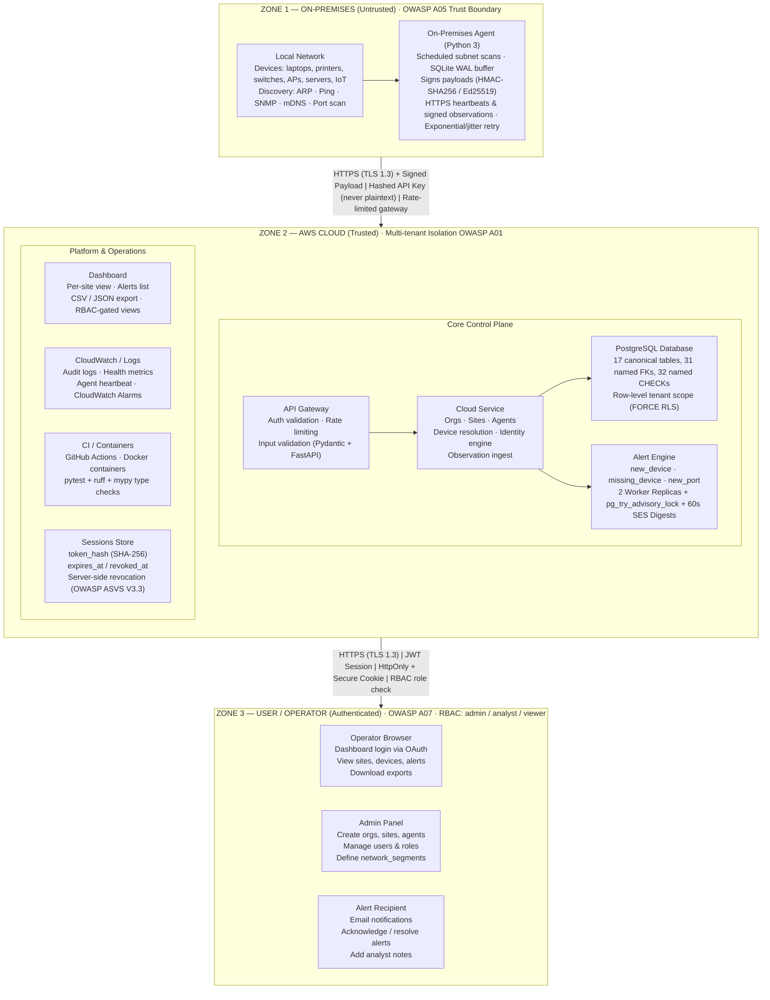

# LAN Atlas — Project & SRE Reference Manual

> **Document ID:** `LAN-ATLAS-ROADMAP-v6.0` | **Release Date:** November 14, 2026 (Supersedes `v5.0` released November 12, 2026)  
> **Lead Architect:** Cynthia Ingersoll (`@Computer8543`)  
> **Repository:** [`CloudSecurityOfficeHours/LANAtlas`](https://github.com/CloudSecurityOfficeHours/LANAtlas)

---

## Table of Contents

- [LAN Atlas — Project \& SRE Reference Manual](#lan-atlas--project--sre-reference-manual)
  - [Table of Contents](#table-of-contents)
  - [1. Project Overview \& Executive Governance Baseline](#1-project-overview--executive-governance-baseline)
    - [1.1 Document Metadata \& Governance Roster](#11-document-metadata--governance-roster)
    - [1.2 Gate 0 Carrying-Cost Audit (4.2 \< 15.0) \& $0.00/mo Ceiling](#12-gate-0-carrying-cost-audit-42--150--000mo-ceiling)
    - [1.3 Live Repository \& GitHub Board Delta Synthesis (Nov 14, 2026)](#13-live-repository--github-board-delta-synthesis-nov-14-2026)
  - [2. Security Frameworks \& Threat Register](#2-security-frameworks--threat-register)
    - [2.1 Security Frameworks in Active Use](#21-security-frameworks-in-active-use)
    - [2.2 Current Security Posture (`README.md` \& v6.0 Reconciled Baseline)](#22-current-security-posture-readmemd--v60-reconciled-baseline)
    - [2.3 Authentication Architecture: Three Distinct Trust Mechanisms](#23-authentication-architecture-three-distinct-trust-mechanisms)
      - [Mechanism Comparison](#mechanism-comparison)
      - [Agent-to-Cloud API Surface](#agent-to-cloud-api-surface)
      - [Dashboard User Surface](#dashboard-user-surface)
      - [Why No Password, Ever](#why-no-password-ever)
      - [Auth Control Status](#auth-control-status)
    - [2.4 OWASP Controls Mapping v3.0 Summary](#24-owasp-controls-mapping-v30-summary)
      - [OWASP Top 10 (2025) — Web Dashboard](#owasp-top-10-2025--web-dashboard)
      - [OWASP API Security Top 10 (2023) — Agent-to-Cloud API](#owasp-api-security-top-10-2023--agent-to-cloud-api)
      - [Infrastructure Security Controls (v3.0 Section 6)](#infrastructure-security-controls-v30-section-6)
      - [Open Gaps \& Recommendations (v3.0 Section 7)](#open-gaps--recommendations-v30-section-7)
    - [2.5 Extended Controls Under Consideration](#25-extended-controls-under-consideration)
      - [1. Secret Management — OWASP ASVS 5.0 V13.3](#1-secret-management--owasp-asvs-50-v133)
      - [2. Improper Inventory Management — OWASP API Security Top 10 API9:2023](#2-improper-inventory-management--owasp-api-security-top-10-api92023)
      - [3. Audit Log Management — CIS Controls v8.1 Control 8](#3-audit-log-management--cis-controls-v81-control-8)
      - [4. Application Software Security — CIS Controls v8.1 Control 16](#4-application-software-security--cis-controls-v81-control-16)
      - [5. Secure Configuration of Enterprise Assets and Software — CIS Controls v8.1 Control 4](#5-secure-configuration-of-enterprise-assets-and-software--cis-controls-v81-control-4)
    - [2.6 Threat Register \& 1:1 Security Control Reconciliation (TR-01–TR-26)](#26-threat-register--11-security-control-reconciliation-tr-01tr-26)
  - [3. Functional \& Non-Functional Requirements \& System Architecture](#3-functional--non-functional-requirements--system-architecture)
    - [3.1 Functional Requirements](#31-functional-requirements)
    - [3.2 Non-Functional Requirements](#32-non-functional-requirements)
      - [HLD v2.0 NFR Targets Reconciled with v6.0 Baseline](#hld-v20-nfr-targets-reconciled-with-v60-baseline)
    - [3.3 HLD v2.0 Design Principles](#33-hld-v20-design-principles)
    - [3.4 Three-Zone Architecture \& CLASP Trust Boundaries (OWASP Top 10:2025)](#34-three-zone-architecture--clasp-trust-boundaries-owasp-top-102025)
    - [3.5 Agent-to-Dashboard Data Flow (9-Step Pipeline)](#35-agent-to-dashboard-data-flow-9-step-pipeline)
    - [3.6 Five-Layer Hardened Architecture (LanAtlasv5/)](#36-five-layer-hardened-architecture-lanatlasv5)
    - [3.7 Substrate-First Isolation \& Operational Verisimilitude (Gates 5–7)](#37-substrate-first-isolation--operational-verisimilitude-gates-57)
    - [3.8 Subsystem Evolution \& Comparison Matrix (v1.0 -\> v3.0/v4.0 -\> v5.0 -\> v6.0)](#38-subsystem-evolution--comparison-matrix-v10---v30v40---v50---v60)
  - [4. Technology Stack, Repository Structure \& Database Schema](#4-technology-stack-repository-structure--database-schema)
    - [4.1 Technology Stack (README.md Baseline vs. v6.0 Pinned Python 3.12 Stack)](#41-technology-stack-readmemd-baseline-vs-v60-pinned-python-312-stack)
    - [4.2 Canonical LanAtlasv5/ Directory Layout](#42-canonical-lanatlasv5-directory-layout)
    - [4.3 Database Schema, Dual-Role Isolation \& Audit Chain](#43-database-schema-dual-role-isolation--audit-chain)
      - [LLD v2.0 Summary Metrics \& Migration Summary (SQLite v1.3 -\> PostgreSQL v2.0)](#lld-v20-summary-metrics--migration-summary-sqlite-v13---postgresql-v20)
      - [Core Design Principles (schema-reference-v5.md)](#core-design-principles-schema-reference-v5md)
      - [Dual-Role PostgreSQL 16 Split \& FORCE ROW LEVEL SECURITY](#dual-role-postgresql-16-split--force-row-level-security)
      - [audit\_log Hash-Chain Immutability](#audit_log-hash-chain-immutability)
      - [Entity Relationship Overview (LLD Groups 1–6)](#entity-relationship-overview-lld-groups-16)
      - [Per-Table Schema \& Named Constraint Reference (15 LLD Tables + v6.0 Additions)](#per-table-schema--named-constraint-reference-15-lld-tables--v60-additions)
      - [Complete Index Reference (LLD Section 5)](#complete-index-reference-lld-section-5)
      - [Trigger Reference (LLD Section 6 \& v6.0 Audit Triggers)](#trigger-reference-lld-section-6--v60-audit-triggers)
      - [Post-MVP Schema Roadmap (LLD Section 7)](#post-mvp-schema-roadmap-lld-section-7)
  - [5. Agile Roadmap: Initiatives, Epics \& Decomposed User Stories](#5-agile-roadmap-initiatives-epics--decomposed-user-stories)
    - [Initiative 1: Sprint 0 Stabilization \& Repository De-Confliction (72-Hour Gate)](#initiative-1-sprint-0-stabilization--repository-de-confliction-72-hour-gate)
      - [Epic 1.1 (Sprint 0): Environment, Structure \& Schema Stabilization](#epic-11-sprint-0-environment-structure--schema-stabilization)
        - [US-1.1 — Fix Codespaces, PyPI Manifests \& Git Hygiene](#us-11--fix-codespaces-pypi-manifests--git-hygiene)
        - [US-1.2 — Canonical LanAtlasv5 Structure \& AST Layer Linter](#us-12--canonical-lanatlasv5-structure--ast-layer-linter)
        - [US-1.3 — Topological 17-Table DDL \& Dual-Role PG 16 Setup](#us-13--topological-17-table-ddl--dual-role-pg-16-setup)
    - [Initiative 2: Core Multi-Tenant Platform \& Network Discovery (Sprints 1–3, Weeks 1–6)](#initiative-2-core-multi-tenant-platform--network-discovery-sprints-13-weeks-16)
      - [Epic 2.1 (Sprint 1, Weeks 1–2): Local LAN Scanner, RFC 1918 Guardrails \& SQLite WAL Spool](#epic-21-sprint-1-weeks-12-local-lan-scanner-rfc-1918-guardrails--sqlite-wal-spool)
        - [US-2.1 — Async L2/TCP Subnet Scanner \& RFC 1918 Ceiling](#us-21--async-l2tcp-subnet-scanner--rfc-1918-ceiling)
        - [US-2.2 — Agent Local SQLite WAL State Store](#us-22--agent-local-sqlite-wal-state-store)
        - [US-2.3 — Local Inspection CLI \& Protocol v1 Wire Schemas](#us-23--local-inspection-cli--protocol-v1-wire-schemas)
      - [Epic 2.2 (Sprint 2, Weeks 3–4): PostgreSQL 16 Multi-Tenant RLS, Identity Engine \& Token Table](#epic-22-sprint-2-weeks-34-postgresql-16-multi-tenant-rls-identity-engine--token-table)
        - [US-3.1 — Multi-Tenant PG 16 Pool, TCP Keepalives \& Mandatory RLS](#us-31--multi-tenant-pg-16-pool-tcp-keepalives--mandatory-rls)
        - [US-3.2 — Weighted Identity \& Deduplication Engine Hardening](#us-32--weighted-identity--deduplication-engine-hardening)
        - [US-3.3 — Argon2id Login, RBAC Middleware \& OWASP Mapping](#us-33--argon2id-login-rbac-middleware--owasp-mapping)
        - [US-3.4 — Site Creation \& Concurrent Enrollment Token Table](#us-34--site-creation--concurrent-enrollment-token-table)
      - [Epic 2.3 (Sprint 3, Weeks 5–6): Ed25519 Enrollment, State-Delta Ingestion \& Zero-NAT AWS Deploy](#epic-23-sprint-3-weeks-56-ed25519-enrollment-state-delta-ingestion--zero-nat-aws-deploy)
        - [US-4.1 — Ed25519 Agent Enrollment \& Signed Observation Ingestion](#us-41--ed25519-agent-enrollment--signed-observation-ingestion)
        - [US-4.2 — State-Delta Persistence \& Hourly Compaction](#us-42--state-delta-persistence--hourly-compaction)
        - [US-4.3 — Per-Site Inventory Dashboard Views](#us-43--per-site-inventory-dashboard-views)
        - [US-4.4 — Zero-NAT-Gateway AWS Free Tier Deployment](#us-44--zero-nat-gateway-aws-free-tier-deployment)
    - [Initiative 3: Production SRE, Asymmetric 3-2-1 DR, CIS/SOC-2 Compliance \& Operational Verisimilitude (Sprints 4–6, Weeks 7–12)](#initiative-3-production-sre-asymmetric-3-2-1-dr-cissoc-2-compliance--operational-verisimilitude-sprints-46-weeks-712)
      - [Epic 3.1 (Sprint 4, Weeks 7–8): Out-of-Band Watchdog, Coalesced Alerting \& CIS Controls v8 Mapping](#epic-31-sprint-4-weeks-78-out-of-band-watchdog-coalesced-alerting--cis-controls-v8-mapping)
        - [US-5.1 — Signed Agent Heartbeats, 2s Lock Supervisor \& 30s Watchdog](#us-51--signed-agent-heartbeats-2s-lock-supervisor--30s-watchdog)
        - [US-5.2 — Topology-Aware Alert Rules Engine](#us-52--topology-aware-alert-rules-engine)
        - [US-5.3 — Alerts Triage UI, 60s SES Digests \& Scoped CIS v8 Mapping](#us-53--alerts-triage-ui-60s-ses-digests--scoped-cis-v8-mapping)
      - [Epic 3.2 (Sprint 5, Weeks 9–10): Decoupled AI Eval Engine, Trigger-Immutable SOC 2 Audit Log \& Edge Resilience](#epic-32-sprint-5-weeks-910-decoupled-ai-eval-engine-trigger-immutable-soc-2-audit-log--edge-resilience)
        - [US-6.1 — Monkey-Patch-Immune Decoupled AI Invariant Suite](#us-61--monkey-patch-immune-decoupled-ai-invariant-suite)
        - [US-6.2 — Trigger-Immutable SOC 2 Audit Log \& Serialized Hash Chain](#us-62--trigger-immutable-soc-2-audit-log--serialized-hash-chain)
        - [US-6.3 — SQLite WAL 500-Batch FIFO Ring Buffer \& Decorrelated Jitter Retry](#us-63--sqlite-wal-500-batch-fifo-ring-buffer--decorrelated-jitter-retry)
        - [US-6.4 — Two-Tier Authenticated Rate Limiter](#us-64--two-tier-authenticated-rate-limiter)
        - [US-6.5 — Wire Schema Versioning, Banner/Hostname XSS Sanitization \& 30-Day Pruning](#us-65--wire-schema-versioning-bannerhostname-xss-sanitization--30-day-pruning)
      - [Epic 3.3 (Sprint 6, Weeks 11–12): 99.5% Burn-Rate SLOs, Chaos Game Day, Asymmetric 3-2-1 R2 DR \& Gates 5–7](#epic-33-sprint-6-weeks-1112-995-burn-rate-slos-chaos-game-day-asymmetric-3-2-1-r2-dr--gates-57)
        - [US-7.1 — Outbound Prometheus Remote-Write \& 99.5% Burn-Rate SLO Dashboard](#us-71--outbound-prometheus-remote-write--995-burn-rate-slo-dashboard)
        - [US-7.2 — SRE Chaos Game Day (scripts/chaos-agent-kill.sh) \& Immutable Rollback](#us-72--sre-chaos-game-day-scriptschaos-agent-killsh--immutable-rollback)
        - [US-7.3 — Asymmetric GPG Streaming 3-2-1 Backup \& R2 Object Lock DR Drill](#us-73--asymmetric-gpg-streaming-3-2-1-backup--r2-object-lock-dr-drill)
        - [US-7.4 — Streaming CSV/JSON Exports, CloudWatch Retention \& Portfolio Fuzzing](#us-74--streaming-csvjson-exports-cloudwatch-retention--portfolio-fuzzing)
        - [US-7.5 — Operational Verisimilitude Gates 5–7 \& POSIX CoW risk-ledger.jsonl](#us-75--operational-verisimilitude-gates-57--posix-cow-risk-ledgerjsonl)
      - [Epic 3.4 (Sprint 6 Validation \& Release, GitHub #54–#64, #84, #87) — Full-Stack Validation \& Release Governance](#epic-34-sprint-6-validation--release-github-5464-84-87--full-stack-validation--release-governance)
        - [US-8.1 — Detection, Upsert, Deduplication \& Timestamp Validation Suite](#us-81--detection-upsert-deduplication--timestamp-validation-suite)
        - [US-8.2 — Failure Scenarios, Scan Benchmarks, Release Cadence \& HLD/LLD Sync](#us-82--failure-scenarios-scan-benchmarks-release-cadence--hldlld-sync)
  - [6. Carrying Cost Budget, FinOps \& Succession Governance](#6-carrying-cost-budget-finops--succession-governance)
    - [6.1 Unified Budget \& Free-Tier Resource Allocation](#61-unified-budget--free-tier-resource-allocation)
    - [6.2 Bi-Weekly Sprint Cadence \& WIP=1 Cap](#62-bi-weekly-sprint-cadence--wip1-cap)
    - [6.3 Physical Break-Glass Sovereignty](#63-physical-break-glass-sovereignty)
    - [6.4 Closed-Loop CTEM Integration](#64-closed-loop-ctem-integration)
  - [7. Contributing, Local Setup \& Quality Gates](#7-contributing-local-setup--quality-gates)
    - [7.1 Local Environment Setup](#71-local-environment-setup)
    - [7.2 Codespaces \& Devcontainer Alignment](#72-codespaces--devcontainer-alignment)
    - [7.3 CI/CD Pipeline Architecture \& Quality Gates](#73-cicd-pipeline-architecture--quality-gates)
    - [7.4 Tool Glossary \& Responsibilities](#74-tool-glossary--responsibilities)
    - [7.5 Security Framework Alignment (OWASP SAMM v2.0 \& NIST SP 800-218 SSDF)](#75-security-framework-alignment-owasp-samm-v20--nist-sp-800-218-ssdf)
    - [7.6 Rollout Strategy, Suggested Build Order \& Common Mistakes to Avoid](#76-rollout-strategy-suggested-build-order--common-mistakes-to-avoid)
      - [Gate vs. Advisory Rollout Strategy](#gate-vs-advisory-rollout-strategy)
      - [Suggested Build Order](#suggested-build-order)
      - [Common Mistakes to Avoid](#common-mistakes-to-avoid)
    - [7.7 Verification Harness (verify\_lan\_atlas\_v5.py)](#77-verification-harness-verify_lan_atlas_v5py)
    - [7.8 .eval/invariants/ Isolation \& Tier 0 GPG Diff Guard](#78-evalinvariants-isolation--tier-0-gpg-diff-guard)

---

## 1. Project Overview & Executive Governance Baseline

> **Audience, Purpose & Diátaxis Routing:** This manual is the single-source engineering and SRE reference for **LAN Atlas** (`LAN-ATLAS-ROADMAP-v6.0`). Use **Sections 1–2** for governance and security posture, **Sections 3–4** for architecture and PostgreSQL 16 schema reference, **Section 5** for sprint execution (`US-1.1`–`US-8.2`), and **Sections 6–7** for FinOps, DR, and contributor onboarding.

LAN Atlas is a lightweight, cloud-hosted network visibility SaaS for solo IT admins and small MSPs. On-prem agents scan local networks and securely send observations to a centralized cloud service, which provides dashboards, alerts, and exports that answer three questions:

- what devices exist?
- what changed?
- what needs attention?

Development happens in the open through **Cloud Security Office Hours** ([`CloudSecurityOfficeHours`](https://github.com/CloudSecurityOfficeHours) on GitHub) as a hands-on exercise in building a production-minded system against real security frameworks.

### 1.1 Document Metadata & Governance Roster

| Attribute | Value |
|---|---|
| **Document ID** | `LAN-ATLAS-ROADMAP-v6.0` |
| **Lead Architect** | Cynthia Ingersoll (`@Computer8543`) |
| **Contributors** | 7 Active CSOH Engineers (`@Computer8543`, `@hetzipickle`, `@rawsGit`, `@nerdsofafeather12`, `@nicholasC03`, `@neilcar`, `@princeman2`) |
| **Release Date** | November 14, 2026 (Supersedes `v5.0` released November 12, 2026) |

### 1.2 Gate 0 Carrying-Cost Audit (4.2 < 15.0) & $0.00/mo Ceiling

Before executing Sprint 0 or admitting new architectural complexity, Gate 0 evaluates the Operational Carrying-Cost Index (CCI) against a hard ceiling of `15.0` and a `$0.00/mo` infrastructure budget:

- **Cloud Infrastructure & FinOps Burden (Weight `0.25` | Score `0.5`):** `$0.00/mo` AWS Free Tier (EC2 `t4g.small`/`t3.micro`, Single-AZ RDS `db.t4g.micro`, SES, SSM Parameter Store) + Cloudflare R2 Free Tier + Grafana Cloud Free Tier; zero NAT Gateway, zero Redis, zero DynamoDB.
- **Runtime Dependency & Stack Surface (Weight `0.25` | Score `1.2`):** Single-language Python 3.12 (`FastAPI==0.115.6`, `Pydantic v2 2.10.4`, `SQLAlchemy 2.0.36`, `cryptography==44.0.0`, `pwdlib[argon2]==0.2.1`) + PostgreSQL 16 + SQLite 3 WAL edge spool.
- **Operational Failover & DR Maintenance (Weight `0.25` | Score `1.3`):** 2 local container replicas with 2s `pg_try_advisory_lock` supervisor; zero-disk asymmetric GPG pipe (`pg_dump | gpg --encrypt -r`) to immutable Cloudflare R2 Object Lock.
- **Governance, CI & Eval Overhead (Weight `0.25` | Score `1.2`):** 26 deterministic CI gates (`TR-01`–`TR-26`), `verify_lan_atlas_v5.py` (`unittest`, `<50ms` under `python3 -O`), and POSIX CoW `risk-ledger.jsonl`.
- **Total Gate 0 Carrying Cost:** **`4.2 / 15.0` (PASS)**.

### 1.3 Live Repository & GitHub Board Delta Synthesis (Nov 14, 2026)

Reconciling `LANAtlas-main.zip`, `LAN Atlas - Roadmap.tsv` (72 tracked items), and `LAN_Atlas_Audited_Agile_Roadmap_v5.0_Complete.pdf`:

- **Completed Baseline (22 Items Done):**
  - Bootstrap & docs: [#8](https://github.com/CloudSecurityOfficeHours/LANAtlas/issues/8), [#9](https://github.com/CloudSecurityOfficeHours/LANAtlas/issues/9), [PR #1](https://github.com/CloudSecurityOfficeHours/LANAtlas/pull/1)
  - Setup & deps: [#10](https://github.com/CloudSecurityOfficeHours/LANAtlas/issues/10), [#12](https://github.com/CloudSecurityOfficeHours/LANAtlas/issues/12), [#13](https://github.com/CloudSecurityOfficeHours/LANAtlas/issues/13), [#14](https://github.com/CloudSecurityOfficeHours/LANAtlas/issues/14), [#16](https://github.com/CloudSecurityOfficeHours/LANAtlas/issues/16), [#18](https://github.com/CloudSecurityOfficeHours/LANAtlas/issues/18)
  - Codespaces: [#11](https://github.com/CloudSecurityOfficeHours/LANAtlas/issues/11), [PR #71](https://github.com/CloudSecurityOfficeHours/LANAtlas/pull/71)
  - Initial schema tables: [#3](https://github.com/CloudSecurityOfficeHours/LANAtlas/issues/3), [#4](https://github.com/CloudSecurityOfficeHours/LANAtlas/issues/4), [#5](https://github.com/CloudSecurityOfficeHours/LANAtlas/issues/5), [#6](https://github.com/CloudSecurityOfficeHours/LANAtlas/issues/6)
  - CI/Super-Linter: [#78](https://github.com/CloudSecurityOfficeHours/LANAtlas/issues/78), [#79](https://github.com/CloudSecurityOfficeHours/LANAtlas/issues/79), [#83](https://github.com/CloudSecurityOfficeHours/LANAtlas/issues/83)
  - Folder structure: [#15](https://github.com/CloudSecurityOfficeHours/LANAtlas/issues/15)
  - Identity Engine PG migration: [#85](https://github.com/CloudSecurityOfficeHours/LANAtlas/issues/85)
  - OWASP review: [#86](https://github.com/CloudSecurityOfficeHours/LANAtlas/issues/86)
  - Recent repo fixes: [PR #103](https://github.com/CloudSecurityOfficeHours/LANAtlas/pull/103) (`psycopg2-binary`), [PR #106](https://github.com/CloudSecurityOfficeHours/LANAtlas/pull/106) (`LanAtlasv5/` merge)
- **Active Sprint 0 Stabilization WIP (6 In-Progress Issues):**
  - [#7](https://github.com/CloudSecurityOfficeHours/LANAtlas/issues/7) — Environment Setup
  - [#17](https://github.com/CloudSecurityOfficeHours/LANAtlas/issues/17) — Confirm all contributors can run the project locally
  - [#19](https://github.com/CloudSecurityOfficeHours/LANAtlas/issues/19) — Create database initialization script
  - [#72](https://github.com/CloudSecurityOfficeHours/LANAtlas/issues/72) — Set up Super-Linter Quality Gate for Pull Requests
  - [#76](https://github.com/CloudSecurityOfficeHours/LANAtlas/issues/76) — Create Naming Convention and Standards
  - [#80](https://github.com/CloudSecurityOfficeHours/LANAtlas/issues/80) — Create Super-Linter Quality Gate Documentation
- **Live Repo Drift Identified in `LANAtlas-main.zip`:**
  - `.devcontainer/devcontainer.json` still runs `pip install -r requirements-dev.txt` from root while manifests live in `docs/requirements*.txt`.
  - `.gitignore` still contains `=======` merge conflict markers.
  - `LanAtlasv5/` coexists with legacy root `apps/` and `dbschema.sql`, and several `LanAtlasv5/` modules (`collector.txt`, `heartbeat.txt`, `signer.txt`, `alerting.txt`, `cleanup_worker.txt`, `identity_worker.txt`, `protocol/schemas/*.txt`) are still `.txt` stubs awaiting `.py` implementation.

---

## 2. Security Frameworks & Threat Register

### 2.1 Security Frameworks in Active Use

Every control decision in LAN Atlas is checked against at least one of the following standards:

- **OWASP Top 10 (2025)** — web dashboard (`owasp-controls-mapping-v3.pdf`, Section 4)
- **OWASP API Security Top 10 (2023)** — agent-to-cloud API surface (`owasp-controls-mapping-v3.pdf`, Section 5)
- **OWASP ASVS 5.0** — verification-level requirements across cryptography (`V6`), authorization (`V8`), OAuth/session management (`V10.2` / `V10.3`), and secret management (`V13.3`)
- **NIST SP 800-63B** — digital identity and authenticator assurance (`§ 4`), establishing why OAuth-only delegation removes memorized-secret requirements
- **NIST SP 800-53 / SP 800-61** — control baselines and incident handling
- **CIS Controls v8.1** — operational cross-checks covering asset inventory (Control 1), secure configuration (Control 4), audit log management (Control 8), and application software security (Control 16)
- **MITRE ATT&CK** — threat modeling reference for the agent trust boundary

Control status is tracked continuously in `LAN_Atlas_OWASP_Controls_v3.docx` / `owasp-controls-mapping-v3.pdf` (v3.0, based on PostgreSQL schema v2.0, prepared June 16, 2026) alongside its companion addendum `LAN_Atlas_Auth_Architecture_and_Extended_Controls.pdf` (v1.0, prepared July 4, 2026), and reconciled below with `README.md` and the v6.0 Threat Register (`TR-01`–`TR-26`).

---

### 2.2 Current Security Posture (`README.md` & v6.0 Reconciled Baseline)

| Control area | Status | Notes |
|---|---|---|
| **A01 — Broken Access Control** | ✅ Implemented | FastAPI RBAC middleware: session-validated `get_current_user` dependency, `require_role()` factory, tenant scope from verified session only, 404-not-403 pattern to prevent resource enumeration. |
| **A02 — Security Misconfiguration** | 🟡 Partial | `fn_set_updated_at()` triggers, `.env`-sourced secrets, DB-layer FK/CHECK enforcement. AWS Secrets Manager migration and security-header/CORS policy still open. |
| **A03 — Software Supply Chain Failures** | 🟡 Partial | Dependabot (pip + GitHub Actions ecosystems) implemented. Super Linter runs in CI but does **not** close dependency CVE scanning, hash verification, signed commits, or artifact signing — those remain open. `pip-audit --strict` integration is next up (see Roadmap). |
| **A04 — Insecure Design** | ✅ Implemented | Two-tier pre-auth Ed25519 + in-memory per-`agent_id` token-bucket rate limiter (`US-6.4`, zero Redis/ElastiCache per Gate 0); threshold-based volume anomaly detection on `idx_obs_agent_time`; bulk-resolve gated to admin role with alert ceiling + re-auth window. |
| **A06 / API4 — Rate Limiting & Resource Abuse** | ✅ Implemented | Pre-parse Ed25519 signature check + per-`agent_id` token bucket on the agent-to-cloud API surface (CGNAT-safe). |
| **A07 — Auth & Session Failures** | ✅ Implemented | OAuth 2.0/OIDC (Google/Microsoft/Okta), server-side `sessions` table with `token_hash`/`expires_at`/`revoked_at`, `failed_login_count` + `lockout_until` brute-force tracking. |
| **A08 — Data Integrity Failures** | 🟡 Partial | `payload_hash` (HMAC) on every observation for tamper/dedup detection. **Gap:** `agent_token` is currently stored plaintext — should be hashed consistent with the `api_key_hash` pattern on `agents`. |
| **A09 — Logging & Alerting Failures** | ⚪ Not started | Audit data exists (`observations`, `alerts`, `analyst_notes`, `sessions`) but there's no structured application-level logging framework and nothing ships to CloudWatch yet. |
| **Replay protection (agent payloads)** | ⚪ Planned — Sprint 3 | HMAC-SHA256 replay protection is the next hardening item on the agent-to-cloud path. |

> **Legend (v6.0 / `README.md` Posture):** ✅ Implemented · 🟡 Partial (closes some but not all of the control) · ⚪ Not started / planned

---

### 2.3 Authentication Architecture: Three Distinct Trust Mechanisms

LAN Atlas separates three cryptographic controls that answer distinct security questions. Treating them as interchangeable in design reviews leads to missed gaps (for example, assuming payload signing proves caller authentication).

- **Authentication** (*NIST SP 800-63B § 4 — Authenticator Assurance*): Verifying that a party is who it claims to be before granting access. Answers: *"who is this?"*
- **Integrity** (*OWASP ASVS 5.0, V6 — Cryptography*): Verifying that data was not altered, in transit or storage, since it was created. Answers: *"was this tampered with?"* — independent of who sent it.
- **Authorization** (*OWASP ASVS 5.0, V8 — Authorization*): Determining what an already-authenticated party is permitted to do. Answers: *"what is this identity allowed to access?"*

#### Mechanism Comparison

All three mechanisms are required; none substitutes for another:

| Mechanism | Answers | Used By | Standard Reference |
|---|---|---|---|
| **HMAC-SHA256 payload signing** *(upgraded to Ed25519 + SHA-256 `payload_hash` in v6.0)* | Was this observation tampered with or replayed? | Agent → Cloud (every payload) | OWASP ASVS 5.0 `V6.2` |
| **Hashed API key (SHA-256)** | Is this really the agent it claims to be? | Agent → Cloud (per request) | OWASP API Security Top 10 `API2:2023` |
| **OAuth 2.0 / OIDC + JWT session** | Is this really the human it claims to be? | Dashboard user → Cloud | OWASP ASVS 5.0 `V10.2` / `V10.3` |

#### Agent-to-Cloud API Surface

```text
On-Prem Agent ──▶ HTTPS (TLS 1.3) ──▶ Cloud API ──▶ PostgreSQL (AWS RDS)
```

- **Authentication:** Per-agent API key, stored exclusively as a hex SHA-256 hash at rest (`agents.api_key_hash` via `pgcrypto` `digest()`).
- **Zero-Downtime Key Rotation:** `token_version CHECK >= 1` on `agents`; the auth layer rejects any token whose version is less than the current value, enabling rotation without reissuing all agents simultaneously.
- **Integrity:** HMAC-SHA256 `payload_hash` computed on every observation (augmented in v6.0 with per-agent Ed25519 request signatures and `±60s` timestamp replay protection).
- **DB-Level Replay / Duplicate Rejection:** `UNIQUE(payload_hash)` (`uq_observations_payload_hash`) enforces idempotent deduplication and replay rejection in PostgreSQL before the identity engine processes a row.

#### Dashboard User Surface

```text
Browser ──▶ HTTPS (TLS 1.3) ──▶ Cloud API ──▶ PostgreSQL (AWS RDS)
```

- **Delegated Authentication:** OAuth 2.0 / OIDC via external identity providers (Google, Microsoft, GitHub, Okta). The `users` table anchors identity to `UNIQUE (oauth_provider, oauth_subject)` using the provider's stable `sub` claim, which survives email changes.
- **Short-Lived Tokens:** LAN Atlas issues a short-lived JWT access token (15-minute target) with refresh token rotation after OAuth success.
- **Revocable Server-Side Sessions:** The `sessions` table tracks `token_hash` (hex SHA-256), `expires_at`, and `revoked_at`, allowing immediate revocation on logout, role change, or account deactivation independent of JWT expiry.
- **Cookie Hardening:** `HttpOnly` + `Secure` cookie flags on the session cookie (`SameSite=Strict` in v6.0).

#### Why No Password, Ever

LAN Atlas does not hash passwords—it eliminates them from the trust boundary entirely. The `users` table has no `password_hash` column and no password-reset flow because user credentials never touch LAN Atlas infrastructure. By delegating authentication to OAuth 2.0 / OIDC providers, an entire class of risk—credential stuffing, weak-password enforcement, and breach-database reuse checks—is removed by design rather than mitigated in code. Consequently, NIST SP 800-63B memorized-secret requirements (length, complexity, rotation) do not apply.

#### Auth Control Status

| Control | Status |
|---|---|
| Agent API key hashed at rest (SHA-256) | ✅ Implemented |
| `token_version` rotation support (`CHECK >= 1`) | ✅ Implemented |
| HMAC-SHA256 payload signing + DB-level replay rejection (`UNIQUE payload_hash`) | ✅ Implemented |
| OAuth identity anchor (`oauth_provider`, `oauth_subject`) | ✅ Implemented |
| Server-side session table (`token_hash`, `revoked_at`) | ✅ Implemented |
| JWT expiry + refresh token rotation (code) | 🔵 Planned |
| `HttpOnly` + `Secure` cookie enforcement (code) | 🔵 Planned |
| OAuth provider tenant restrictions | 🔵 Planned |

---

### 2.4 OWASP Controls Mapping v3.0 Summary

The PostgreSQL migration resolved key SQLite-era security gaps at the schema layer: `fn_set_updated_at()` triggers on all mutable tables, `SMALLINT (0–100)` confidence scores eliminating float drift, `sessions` revocation, `failed_login_count` / `lockout_until` brute-force columns, `network_segments` FK replacing free-text strings, `UNIQUE(payload_hash)`, `CITEXT` case-insensitive email normalization, `pgcrypto` native hashing, `ck_alerts_resolved_consistency`, named constraints, and the `ENABLE ROW LEVEL SECURITY` scaffold.

> **Legend (v3.0 Mapping):** ✅ Implemented · 🔵 Planned · 🟡 Partial · 🔴 Not Started · ➖ N/A

#### OWASP Top 10 (2025) — Web Dashboard

| # | Risk | v3.0 Status | Key Implemented Controls & Remaining Gaps |
|---|---|---|---|
| **A01** | Broken Access Control *(includes SSRF)* | 🟡 Partial | **In place:** Multi-tenant FK-enforced schema isolation, `ck_users_role` (`admin`/`analyst`/`viewer`), `UNIQUE(oauth_provider, oauth_subject)`, `is_authorized` device approval, no outbound HTTP from observation data, `network_segments` FK, RLS scaffold. **Gaps:** API middleware RBAC & agent-site trust validation (`🔴`), RLS activation & local OUI file (`🔵`). |
| **A02** | Security Misconfiguration | 🟡 Partial | **In place:** `fn_set_updated_at()` triggers, named constraints, `ck_alerts_resolved_consistency`, `.env` secrets, `DATABASE_URL` startup validation, rollback-on-exception in `db.py`. **Gaps:** HTTP security headers & CORS policy (`🔴`), `pg_hba.conf`, `DEBUG=False`, RDS port 5432 SG, least-privilege IAM, Secrets Manager (`🔵`). |
| **A03** | Software Supply Chain Failures | 🔴 Not Started | **In place:** `pgcrypto` first-party extension; `requirements.txt` (`🟡 Partial`). **Gaps:** Automated dependency scanning (`pip-audit`, Dependabot), pinned Python version in deploy, `--require-hashes`, signed commits, CI/CD artifact signing (`🔴`). *(Note: Dependabot & Super-Linter added later in v6.0.)* |
| **A04** | Cryptographic Failures | 🟡 Partial | **In place:** No password storage (OAuth-only), SHA-256 API key & session token hashing, HMAC-SHA256 `payload_hash`, `token_version` rotation, `SMALLINT` scores. **Gaps:** HTTPS-only & TLS 1.2+ at ALB, AWS KMS RDS encryption at rest, `ssl_mode=require` (`🔵`). |
| **A05** | Injection | 🟡 Partial | **In place:** Parameterized queries, named `CHECK` constraints, `network_segment` FK, `CITEXT` email, MAC regex `CHECK`s, `UNIQUE(payload_hash)`. **Gaps:** SQLite `?` → PostgreSQL `%s` placeholder audit (`🔴`), API-layer input validation & SQLAlchemy adoption (`🔵`). |
| **A06** | Insecure Design | 🟡 Partial | **In place:** `UNIQUE(fingerprint_hash)` per site, scan-tier confidence ceilings, `seen_count` threshold, `is_authorized`, DB replay rejection, OAuth-only auth, `token_version`, `sessions.revoked_at`, brute-force columns, alert lifecycle `CHECK`. **Gaps:** API rate limiting, volume anomaly detection, bulk operation safeguards (`🔴`). |
| **A07** | Authentication Failures | 🟡 Partial | **In place:** OAuth identity anchor, server-side `sessions` + `revoked_at`, SHA-256 API keys, `is_active` decommissioning, `last_login_at`, brute-force schema. **Gaps:** Brute-force lockout enforcement in auth code (`🔴`), OAuth social provider flow, `HttpOnly`/`Secure` JWTs, refresh rotation, provider tenant restrictions (`🔵`). |
| **A08** | Software or Data Integrity Failures | 🟡 Partial | **In place:** `UNIQUE(payload_hash)`, `UNIQUE(fingerprint_hash)`, named `UNIQUE` constraints, `pgcrypto`, `fn_set_updated_at()`, MAC `CHECK`s. **Gaps:** CI/CD pipeline integrity & dependency hash verification (`🔴`), local OUI file integrity (`🔵`). |
| **A09** | Security Logging and Alerting Failures | 🟡 Partial | **In place:** Append-only `observations`, `alerts` lifecycle, `analyst_notes`, `sessions`, `last_login_at` / `failed_login_count`, `agents.last_seen`, `fn_set_updated_at()`. **Gaps:** Structured app logging, auth failure log shipping, security event alerting, alert engine watchdog (`🔴`), CloudWatch integration (`🔵`). |
| **A10** | Mishandling of Exceptional Conditions | 🟡 Partial | **In place:** `db.py` rollback-on-exception, `ck_alerts_resolved_consistency`, named constraints, `is_duplicate_observation()` (`device_id IS NOT NULL`). **Gaps:** `INSERT OR IGNORE` → `ON CONFLICT DO NOTHING`, identity engine `try/except` handling, observation retry mechanism (`🔴`), alert engine orchestration handling & suppressed prod stack traces (`🔵`). |

#### OWASP API Security Top 10 (2023) — Agent-to-Cloud API

| # | Risk | v3.0 Status | Key Implemented Controls & Remaining Gaps |
|---|---|---|---|
| **API1** | Broken Object Level Authorization | 🟡 Partial | **In place:** `agents` → `sites` FK; `observations` → `organization`/`sites`/`agents` FK chain. **Gap:** Agent-site trust validation in API middleware (`🔴`). |
| **API2** | Broken Authentication | 🟡 Partial | **In place:** SHA-256 API keys, `token_version CHECK >= 1`, `agents.is_active`, `sessions.token_hash`. **Gaps:** Key rotation API endpoint (`🔴`), HTTPS-only at ALB (`🔵`). |
| **API3** | Broken Object Property Level Authorization | 🔴 Not Started | **In place:** No password storage; server-side `pgcrypto` hashing. **Gaps:** Role-based response field filtering & mass assignment protection (`🔴`), excluding `api_key_hash`/`token_hash` from responses (`🔵`). |
| **API4** | Unrestricted Resource Consumption | 🟡 Partial | **In place:** DB-level duplicate rejection (`UNIQUE payload_hash`). **Gaps:** API rate limiting, per-agent submission quota, max payload size enforcement (`🔴`). |
| **API5** | Broken Function Level Authorization | 🟡 Partial | **In place:** `ck_users_role` `CHECK` constraint. **Gap:** Role enforcement in API middleware (`🔴`). |
| **API6** | Unrestricted Access to Sensitive Business Flows | 🟡 Partial | **In place:** `is_authorized`, `acknowledged` alert state, `seen_count` threshold, `ck_alerts_resolved_consistency`. **Gap:** Bulk operation safeguards (`🔴`). |
| **API7** | Server-Side Request Forgery | 🟡 Partial | **In place:** No outbound HTTP from observation data; `network_segments` FK. **Gap:** Local bundled IEEE OUI file lookup (`🔵`). |
| **API8** | Security Misconfiguration | 🟡 Partial | **In place:** Default PostgreSQL FK enforcement, named constraints, `.env` secrets. **Gaps:** CORS policy, HTTP security headers, `/api/v1/` versioning (`🔴`). |
| **API9** | Improper Inventory Management | 🟡 Partial | **In place:** `docs/schema-reference.md` and OWASP controls documentation. **Gaps:** OpenAPI specification, API deprecation policy, `agents.version` tracking column (`🔴`). |
| **API10** | Unsafe Consumption of APIs | 🟡 Partial | **In place:** Agent data treated as untrusted (`CHECK`s, parameterized queries, MAC regex, `UNIQUE payload_hash`). **Gaps:** OAuth via provider SDK & local OUI bundle (`🔵`); webhook validation (`➖ N/A` post-MVP). |

#### Infrastructure Security Controls (v3.0 Section 6)

| Control | Requirement | v3.0 Status |
|---|---|---|
| **HTTPS enforcement** | TLS 1.2+ at ALB/API Gateway; HTTP rejected, not redirected. | 🔵 Planned |
| **RDS encryption at rest** | Enabled at RDS creation via AWS KMS (cannot be added post-creation without snapshot-and-restore). | 🔵 Planned |
| **RDS encryption in transit** | `ssl_mode=require` in PostgreSQL connection string. | 🔵 Planned |
| **Security groups** | PostgreSQL port `5432` accessible from app layer only; never publicly exposed. | 🔵 Planned |
| **Least-privilege IAM** | App role: `SELECT`/`INSERT`/`UPDATE`/`DELETE` only; no `DROP`/`CREATE`/`TRUNCATE` in production. | 🔵 Planned |
| **VPC isolation** | RDS in private subnet; application behind ALB in public subnet. | 🔵 Planned |
| **AWS Secrets Manager** | `DATABASE_URL` and API secrets in Secrets Manager in production — not `.env`. | 🔵 Planned |
| **CloudWatch logging** | Structured JSON application logs; 7-day CloudWatch retention (v6.0 Free Tier baseline, `US-7.4`). | 🔵 Planned |
| **Automated RDS backups** | Point-in-time recovery enabled; retention `>= 7` days. | 🔵 Planned |
| **AWS WAF** | WAF on ALB for SQLi, XSS, and rate-abuse patterns. | 🔵 Planned |
| **RLS activation** | `ENABLE ROW LEVEL SECURITY` + tenant isolation policy on tenant-scoped tables *(activated as `FORCE ROW LEVEL SECURITY` in v6.0)*. | 🔵 Planned *(post-MVP)* |

#### Open Gaps & Recommendations (v3.0 Section 7)

**Critical — Must Fix Before Production**

| Gap | Recommendation |
|---|---|
| **Agent-site trust validation missing** | Validate `agent_id` owns submitted `site_id` on every observation call; reject mismatches with HTTP `403`. |
| **RBAC enforcement not implemented** | Add authentication middleware validating `organization_id` on every request; enforce role checks on every endpoint. |
| **`INSERT OR IGNORE` → `ON CONFLICT DO NOTHING`** | Update all engine files for PostgreSQL syntax before go-live (SQLite syntax is invalid in PostgreSQL). |
| **Query placeholder audit (`?` → `%s`)** | Audit all parameterized queries in identity engine files (SQLite uses `?`; `psycopg2` uses `%s`). |
| **Identity engine function-level error handling** | Add `try`/`except` in `create_device`, `update_signals`, and `resolve_observation`; return safe defaults on recoverable errors. |
| **Rate limiting absent** | Implement per-agent rate limiting (e.g., `100 req/min`); return HTTP `429` on excess. |
| **Brute-force lockout not yet enforced in code** | Implement auth-layer logic to check `lockout_until` and increment `failed_login_count` (schema is ready). |
| **HTTP security headers missing** | Add `CSP`, `X-Frame-Options`, `X-Content-Type-Options`, and `HSTS` at API gateway or middleware. |
| **RDS encryption must be pre-configured** | Enable AWS KMS encryption at RDS instance creation; document as a mandatory deployment requirement. |

**Important — Address in Production Hardening**

| Gap | Recommendation |
|---|---|
| **API versioning absent** | Version all endpoints as `/api/v1/`; field agents cannot be force-updated. |
| **CORS policy undefined** | Restrict to dashboard domain; reject unknown origins. |
| **OpenAPI specification missing** | Document all endpoints for input validation and client SDK generation. |
| **Automated dependency scanning** | Add `pip-audit` to CI and enable GitHub Dependabot. |
| **OUI lookup SSRF risk** | Bundle IEEE OUI list locally; never issue outbound HTTP using agent-supplied data. |
| **Alert engine error handling** | Catch `None` returns, log failures, and buffer for retry at orchestration layer. |
| **Agent version tracking** | Add `agent_version` column to `agents` table for API backward-compatibility management. |
| **Observation retry mechanism** | Define a retry queue for observations that fail identity resolution. |
| **`DATABASE_URL` in Secrets Manager** | Move from `.env` to AWS Secrets Manager for production deployments. |

**Post-MVP**

| Gap | Recommendation |
|---|---|
| **RLS policy activation** | Activate `ENABLE ROW LEVEL SECURITY` and deploy tenant isolation policies (schema scaffold is ready). |
| **SQLAlchemy adoption** | Eliminates SQL dialect drift and manual `?` → `%s` placeholder audits. |
| **Anomaly detection on observation volume** | Alert when an agent submits at abnormal rates (potential compromise or misconfiguration). |
| **Signed commits policy** | Enforce GPG-signed commits to protect the software supply chain. |
| **AWS WAF** | Protect ALB from common attack patterns without application code changes. |
| **`alerts.metadata` as `JSONB`** | Upgrade from `VARCHAR(1000)` to `JSONB` for indexed JSON queries on alert metadata. |

---

### 2.5 Extended Controls Under Consideration

Five additional controls sit outside the OWASP Top 10 (2025) and OWASP API Security Top 10 (2023) checklists in v3.0 and are tracked against **OWASP ASVS 5.0**, **API9:2023**, and **CIS Controls v8.1**:

#### 1. Secret Management — OWASP ASVS 5.0 V13.3

Controls how an application stores, accesses, and rotates sensitive configuration values (API keys, signing keys, database credentials, OAuth client secrets) separately from application code and version control.
- **Why it applies:** OAuth client secrets, JWT signing keys, and `DATABASE_URL` currently load from a local `.env` file via `python-dotenv`. While acceptable for local development, `.env` files must never serve as the production secret store.
- **Recommended approach:** Before first production deploy, move secrets to AWS Secrets Manager or SSM Parameter Store; read secrets at process start via an IAM role, never from a committed file.

| Control | Status |
|---|---|
| `.env` for local dev only (`python-dotenv`) | ✅ Implemented |
| Secrets Manager / Parameter Store for production | 🔴 Not Started |
| IAM role-based secret access (no long-lived AWS keys in app) | 🔴 Not Started |
| Secret rotation policy documented | 🔴 Not Started |

#### 2. Improper Inventory Management — OWASP API Security Top 10 API9:2023

Addresses the risk of running outdated or undocumented API versions and endpoints that remain reachable after maintenance ends.
- **Why it applies:** LAN Atlas exposes two distinct API surfaces (agent-to-cloud and dashboard) and versions the agent API as the observation schema evolves (`scan_tier`, payload format). Without an explicit inventory, deprecated agent API versions could stay live indefinitely.
- **Recommended approach:** Maintain a single source-of-truth endpoint inventory (including version, consumer, and deprecation date) and review it on the same sprint cadence as the OWASP gap walkthrough.

| Control | Status |
|---|---|
| Documented endpoint inventory | 🔴 Not Started |
| API versioning scheme defined (e.g. `/api/v1/`) | ✅ Implemented |
| Deprecation policy for old agent API versions | 🔴 Not Started |

#### 3. Audit Log Management — CIS Controls v8.1 Control 8

Collects, alerts on, reviews, and retains audit logs of events needed to detect, understand, or recover from an attack — explicitly distinguishing logging (recording) from alerting (acting on what was recorded).
- **Why it applies:** Cross-checks the same gap flagged under `A09:2025`: LAN Atlas has rich underlying audit tables (`observations`, `alerts`, `analyst_notes`, `sessions`, `last_login_at`) but lacks a structured application-level logging framework and CloudWatch shipping.
- **Recommended approach:** Configure Python's standard `logging` module with structured JSON formatting, ship logs to CloudWatch Logs, and enforce a defined retention policy.

| Control | Status |
|---|---|
| Underlying audit data exists (`observations`, `sessions`, `alerts`) | ✅ Implemented |
| Structured application-level logging framework | 🔴 Not Started |
| Log shipping to CloudWatch | 🔴 Not Started |
| Retention policy defined | 🔴 Not Started |

#### 4. Application Software Security — CIS Controls v8.1 Control 16

Manages the security life cycle of in-house and acquired software to prevent, detect, and remediate weaknesses before production (secure development, dependency management, code review).
- **Why it applies:** Provides the broader lifecycle framing for `A03:2025` (Software Supply Chain Failures): missing automated dependency scanning (`pip-audit`), dependency hash verification, signed commits, and CI/CD artifact signing.
- **Recommended approach:** Enable `pip-audit --strict` alongside Dependabot in CI first (lowest effort, highest immediate value), then add signed commits and artifact signing once the pipeline stabilizes.

| Control | Status |
|---|---|
| Dependency tracking (`requirements.txt`) | 🟡 Partial |
| Automated dependency vulnerability scanning (`pip-audit`) | 🔴 Not Started |
| Dependabot (`pip` + Actions ecosystems) | ✅ Implemented |
| Signed commits policy | 🔴 Not Started |
| CI/CD artifact signing | 🔴 Not Started |

#### 5. Secure Configuration of Enterprise Assets and Software — CIS Controls v8.1 Control 4

Establishes and maintains secure configurations to reduce attack surface exposed by defaults—debug modes, exposed API docs, and unnecessary open ports.
- **Why it applies:** Pre-deploy is the cheapest phase to lock down configuration defaults: `DEBUG=False` in production, restricting FastAPI's auto-generated `/docs` and `/redoc`, and locking RDS port `5432` to application security groups only.
- **Recommended approach:** Add a pre-deploy runbook verification checklist rather than new application code.

| Control | Status |
|---|---|
| Debug mode disabled in production | 🔴 Not Started |
| API docs endpoint (`/docs`, `/redoc`) restricted in production | 🔴 Not Started |
| RDS security group restricts port `5432` | 🔴 Not Started |
| Pre-deploy configuration checklist exists | 🔴 Not Started |

---

### 2.6 Threat Register & 1:1 Security Control Reconciliation (TR-01–TR-26)

| Gate ID | Severity | Remediated Contradictions & ADVs | Mapped Story IDs (1:1 CON-05) | Deterministic CI Verification |
|---|---|---|---|---|
| **TR-01** | Critical | CON-01, ADV-01 | [`US-1.3`](#us-13--topological-17-table-ddl--dual-role-pg-16-setup) | `psql -v ON_ERROR_STOP=1` + `alembic upgrade head` across 17 canonical tables in clean PG 16. |
| **TR-02** | Critical | CON-02, CON-03, CON-12, … | [`US-1.1`](#us-11--fix-codespaces-pypi-manifests--git-hygiene) | `pip install -r docs/requirements-dev.txt`, `pip-audit` (0 CVEs), `0 =======` in `.gitignore`. |
| **TR-03** | High | CON-04, ADV-11 | [`US-1.2`](#us-12--canonical-lanatlasv5-structure--ast-layer-linter) | `pytest tests/architecture/test_layer_imports.py` (0 layer violations / raw SQL). |
| **TR-04** | Critical | CON-08, ADV-04 | [`US-3.4`](#us-34--site-creation--concurrent-enrollment-token-table), [`US-4.1`](#us-41--ed25519-agent-enrollment--signed-observation-ingestion) | `pytest agent/tests/test_signer.py` (3 concurrent enrollments succeed; replay/tamper -> 401/409). |
| **TR-05** | Critical | CON-06, ADV-05 | [`US-4.2`](#us-42--state-delta-persistence--hourly-compaction), [`US-8.1`](#us-81--detection-upsert-deduplication--timestamp-validation-suite) | `pytest cloud/tests/repositories/test_observations.py` (1,500 devices x 60 cycles -> 0 redundant rows). |
| **TR-06** | Critical | CON-09, ADV-06 | [`US-3.1`](#us-31--multi-tenant-pg-16-pool-tcp-keepalives--mandatory-rls) | `pytest cloud/tests/database/test_db.py` (`lanatlas_runtime` `NOBYPASSRLS`; `Org_A` isolated from `Org_B`). |
| **TR-07** | High | CON-07, ADV-07 | [`US-3.2`](#us-32--weighted-identity--deduplication-engine-hardening), [`US-8.1`](#us-81--detection-upsert-deduplication--timestamp-validation-suite) | `pytest cloud/tests/services/test_identity.py` (MAC+OUI update vs spoofed hostname distinct device). |
| **TR-08** | High | CON-11, ADV-08 | [`US-2.1`](#us-21--async-l2tcp-subnet-scanner--rfc-1918-ceiling), [`US-8.2`](#us-82--failure-scenarios-scan-benchmarks-release-cadence--hldlld-sync) | `pytest agent/tests/test_scanner.py` (rejects `169.254.169.254/32`, `8.8.8.8/32`; `/24` in <=4.5s as UID 10001). |
| **TR-09** | High | ADV-09 | [`US-5.1`](#us-51--signed-agent-heartbeats-2s-lock-supervisor--30s-watchdog) | `pytest cloud/tests/workers/test_alert_worker.py` (30s watchdog <=220s MTTA). |
| **TR-10** | High | ADV-09 | [`US-5.2`](#us-52--topology-aware-alert-rules-engine) | `test_alert_worker.py` (50/100 drop -> 1 `site_mass_outage` digest). |
| **TR-11** | High | ADV-10 | [`US-7.4`](#us-74--streaming-csvjson-exports-cloudwatch-retention--portfolio-fuzzing) | Streaming 100k-row `COPY TO STDOUT` <3.5s, <=32 MB RSS delta. |
| **TR-12** | Medium | CON-05, ADV-12 | [`US-2.2`](#us-22--agent-local-sqlite-wal-state-store), [`US-6.3`](#us-63--sqlite-wal-500-batch-fifo-ring-buffer--decorrelated-jitter-retry) | `pytest agent/tests/test_buffer.py` (500-batch / 50 MB SQLite WAL cap, <=2 batches/s jitter drain). |
| **TR-13** | Medium | CON-17, ADV-13 | [`US-6.4`](#us-64--two-tier-authenticated-rate-limiter) | `pytest cloud/tests/api/test_rate_limit.py` (500 spoofed packets fail pre-auth Ed25519). |
| **TR-14** | Medium | CON-17, ADV-14 | [`US-2.3`](#us-23--local-inspection-cli--protocol-v1-wire-schemas), [`US-4.3`](#us-43--per-site-inventory-dashboard-views), [`US-6.5`](#us-65--wire-schema-versioning-bannerhostname-xss-sanitization--30-day-pruning) | `pytest protocol/tests/test_observation_schema.py` (`<script>` and control chars stripped). |
| **TR-15** | Medium | CON-10, ADV-15 | [`US-3.3`](#us-33--argon2id-login-rbac-middleware--owasp-mapping), [`US-4.4`](#us-44--zero-nat-gateway-aws-free-tier-deployment) | `gitleaks` 0 secrets; IaC provisions 0 `aws_nat_gateway`, 0 `aws_dynamodb_table`, 0 `aws_elasticache_cluster`. |
| **TR-16** | High | CON-13, ADV-16 | [`US-6.1`](#us-61--monkey-patch-immune-decoupled-ai-invariant-suite) | Tier 0 GPG diff guard on `.eval/**`, `.github/workflows/**`, `conftest.py`, `pyproject.toml`; `PYTHONNOUSERSITE=1`. |
| **TR-17** | Critical | CON-14, CON-15, ADV-17 | [`US-7.3`](#us-73--asymmetric-gpg-streaming-3-2-1-backup--r2-object-lock-dr-drill) | `scripts/backup-r2.sh` asymmetric `gpg --encrypt -r`, 0 temp files, R2 `AccessDenied` on delete/overwrite. |
| **TR-18** | High | CON-16, CON-18, ADV-18 | [`US-7.1`](#us-71--outbound-prometheus-remote-write--995-burn-rate-slo-dashboard) | Public `/metrics` returns 404; synthetic 10% drop fires 99.5% SLO 1h/6h burn-rate alert <2% budget. |
| **TR-19** | High | CON-20, ADV-19 | [`US-7.2`](#us-72--sre-chaos-game-day-scriptschaos-agent-killsh--immutable-rollback), [`US-8.2`](#us-82--failure-scenarios-scan-benchmarks-release-cadence--hldlld-sync) | `scripts/chaos-agent-kill.sh` (<2s `SIGKILL` failover; <11s TCP blackhole lock release). |
| **TR-20** | Critical | CON-19, ADV-20 | [`US-6.2`](#us-62--trigger-immutable-soc-2-audit-log--serialized-hash-chain) | `UPDATE`/`DELETE`/`TRUNCATE` on `audit_log` fails via `trg_audit_log_immutable`; 20 concurrent inserts unbroken. |
| **TR-21** | Low | ADV-21 | [`US-5.3`](#us-53--alerts-triage-ui-60s-ses-digests--scoped-cis-v8-mapping), [`US-8.2`](#us-82--failure-scenarios-scan-benchmarks-release-cadence--hldlld-sync) | `docs/cis-controls-mapping.md` scoped strictly to CIS Control 1 (`1.1–1.2`) and Control 2/4 network baselines. |
| **TR-22** | Medium | ADV-21 | [`US-7.4`](#us-74--streaming-csvjson-exports-cloudwatch-retention--portfolio-fuzzing) | Public portfolio sanitizer confirms 0 hardcoded rate/spool integers (`${AGENT_MAX_SPOOL_BATCHES}`). |
| **TR-23** | Medium | CON-21, ADV-22 | [`US-1.1`](#us-11--fix-codespaces-pypi-manifests--git-hygiene) | `python3 -O verify_lan_atlas_v5.py` confirms Gate 0 CCI `4.2 < 15.0` in <50ms. |
| **TR-24** | Medium | CON-22, ADV-23 | [`US-1.2`](#us-12--canonical-lanatlasv5-structure--ast-layer-linter) | `test_tr24_con05_set_equality` confirms exact set equality (24 CON, 25 ADV, 26 TR). |
| **TR-25** | Critical | CON-23, ADV-24 | [`US-6.2`](#us-62--trigger-immutable-soc-2-audit-log--serialized-hash-chain) | `test_tr25_audit_log_chain_canonicalization` verifies `octet_length(...)`. |
| **TR-26** | High | CON-24, ADV-25 | [`US-7.5`](#us-75--operational-verisimilitude-gates-57--posix-cow-risk-ledgerjsonl) | `test_tr26_us65_gates_5_to_7` verifies `ReadOnceRawStream`, `ScrubbedTraceArtifact`, Gate 6 projections, and POSIX CoW `risk-ledger.jsonl`. |

---

## 3. Functional & Non-Functional Requirements & System Architecture

### 3.1 Functional Requirements

Mirroring the project baseline in `README.md` and incorporating the hardened v6.0 SRE specifications (`LAN-ATLAS-ROADMAP-v6.0`), LAN Atlas separates responsibilities cleanly between the on-premises scanning agent and the multi-tenant cloud control plane:

**On-Premises Agent (`lanatlas/agent/`):**
- **Subnet Discovery:** Scans configured local subnets using async ARP/ICMP discovery and bounded TCP port checks (`asyncio.Semaphore(64)`, `0.4s` timeout, sweeping a `/24` in `<= 4.5s`). Enforces an RFC 1918 `/22` ceiling and explicitly rejects link-local metadata (`169.254.0.0/16`) and public `/8` CIDRs.
- **Cryptographic Signing:** Signs all observation batches and 60-second heartbeats before transmission. While `README.md` and HLD v2.0 specify HMAC-SHA256 payload signing, the v5.0/v6.0 baseline upgrades agent-to-cloud authentication to per-agent Ed25519 private keys paired with `payload_hash` (SHA-256) and `+-60s` timestamp replay protection.
- **Resilient Local Buffering:** Buffers scan batches locally in an offline SQLite 3 WAL edge spool (`PRAGMA journal_mode=WAL`) capped at 500 batches / 50 MB (evicting oldest heartbeat-only rows first) and drains on reconnect with decorrelated jitter backoff (`<= 2` batches/sec) during cloud outages.

**Cloud Service (`lanatlas/cloud/`):**
- **Multi-Tenant Inventory:** Supports `organization`, `sites`, `agents`, `devices`, and `observations` with strict structural tenant isolation.
- **Per-Site Dashboards & Exports:** Provides Jinja2/HTMX per-site inventory views (active devices, 24h/7d new arrivals, missing devices, agent liveness, and per-device service/port tables) alongside streaming 30-day CSV/JSON exports (`COPY (...) TO STDOUT`, `<= 32 MB` worker RSS delta, `< 3.5s` for 100k rows).

**Alerting & Triage:**
- **`new_device`:** Fires when a previously unseen device is resolved at a site (never auto-authorized).
- **`missing_device`:** Fires when a known device exceeds its `missing_threshold_hours` window (respecting site business hours and minimum `seen_count`).
- **`new_open_port`:** Fires when an unexpected port (`device_services.is_expected = FALSE`) is detected on a known device.
- **Topology-Aware Coalescing (v6.0):** Suppresses per-device alert storms when a parent agent is offline or `> 25%` of a site's devices drop in a single batch, emitting a single `site_mass_outage` digest via 60-second coalesced AWS SES notifications.

### 3.2 Non-Functional Requirements

- **Secure Agent-to-Cloud Communication:** Enforces TLS 1.3 transport, hashed API keys (`api_key_hash`) and single-use 15-minute `agent_enrollment_tokens`, per-agent Ed25519 request signatures, and SHA-256 `payload_hash` deduplication.
- **Multi-Tenant Data Isolation:** `organization_id` is derived exclusively from verified server-side OAuth/JWT sessions or authenticated agent records—never from request bodies—and is enforced at the database layer via foreign keys and PostgreSQL `FORCE ROW LEVEL SECURITY` (`SET LOCAL app.current_org_id`).
- **Resilient Edge & Standby Behavior:** Combines bounded local SQLite WAL spooling at the edge with 2 local cloud worker replicas competing on PostgreSQL advisory locks (`pg_try_advisory_lock`) every 2 seconds (`< 2s` SIGKILL failover, `< 11s` TCP keepalive release).
- **Least-Privilege AWS Deployment (`$0.00/mo` Free Tier Ceiling):** Deploys on AWS following defense-in-depth (EC2 `t4g.small`/`t3.micro` locked to port `443`, private Single-AZ RDS `db.t4g.micro` with TLS enforced, IAM Roles, SSM Parameter Store, zero NAT Gateways, zero Redis/DynamoDB, protected by a `$5.00` AWS Budgets alarm).
- **Clean, Typed, Linted, Tested Python Codebase:** Targets Python 3.12 with strict `ruff`, `mypy --strict`, `sqlfluff`, `pip-audit`, `gitleaks`, `pytest`, and `pytest-cov` gates, plus AST-enforced architectural layer boundaries.

#### HLD v2.0 NFR Targets Reconciled with v6.0 Baseline

| NFR | HLD v2.0 Target | v6.0 Hardened Implementation |
|---|---|---|
| **Security** | All OWASP Top 10 (2021) controls addressed. Named constraints enforce integrity at DB layer. | Extended to OWASP Top 10 (2025), OWASP API Top 10 (2023), and OWASP ASVS; enforced via 26 deterministic CI gates (`TR-01`–`TR-26`) and dual-role PostgreSQL 16 isolation. |
| **Multi-tenancy** | Complete data isolation per `organization_id`. No cross-tenant query path in schema or ORM. | Structural `(organization_id, site_id)` scoping reinforced by `FORCE ROW LEVEL SECURITY` (`SET LOCAL app.current_org_id`) under `NOBYPASSRLS` role `lanatlas_runtime`. |
| **Availability** | Agent local buffer + retry ensures no observation loss during cloud outage. | 500-batch / 50 MB SQLite WAL FIFO ring buffer with decorrelated jitter drain (`<= 2` batches/s) + 2-replica `pg_try_advisory_lock` cloud standby (`< 2s` failover). |
| **Auditability** | Observations are append-only. Analyst notes and alert lifecycle changes are timestamped. | Trigger-immutable `audit_log` (`trg_audit_log_immutable`) with serialized SHA-256 hash chain (`trg_audit_log_chain`) and `ck_alerts_resolved_consistency`. |
| **Scalability** | `observations` table: partial indexes on unresolved rows and open alerts keep query paths lean as volume grows. | Preserved alongside state-delta persistence (eliminating redundant unchanged-device writes), hourly compaction, and 30-day streaming `COPY TO STDOUT` exports. |
| **Maintainability** | All 76 constraints named (31 FK, 32 CHECK, 12 UNIQUE). Errors produce actionable messages. | Reconciled into topologically ordered `schema.sql` (`psql -v ON_ERROR_STOP=1`), Alembic migrations, and AST-enforced 5-layer package boundaries (`LanAtlasv5/`). |

### 3.3 HLD v2.0 Design Principles

Per `LAN Atlas — High-Level Design Document (v2.0: Schema to PostgreSQL)`, six foundational design principles govern every schema, agent, and control-plane decision:

| Principle | Applied As |
|---|---|
| **Observations Are Append-Only** | Every agent scan writes to `observations` and never mutates. Device state is derived, not stored directly — enabling audit, replay, and debugging. |
| **Device Identity Is Computed** | Devices are not identified by IP or MAC alone. A `fingerprint_hash` is computed from hardware-anchored and network-observable signals weighted by reliability. |
| **Multi-Tenant Isolation Is Structural** | Every operational table carries `organization_id` and `site_id`. There is no cross-tenant query path. Indexes are built around the `(organization_id, site_id)` pair. |
| **Signal Quality Bounds Confidence** | Scan tier (`UNAUTHENTICATED` -> `WMI`/`SSH`) caps the confidence ceiling. A raw ARP scan cannot produce a confidence score that auto-links a device. |
| **Intentionally Minimal for MVP** | Only what is needed to prove the agent -> cloud -> dashboard pipeline. Everything present can be extended without restructuring existing tables. |
| **Security-First, Not Bolted On** | OWASP ASVS alignment from Sprint 0. Named constraints, bounded `VARCHAR`, `SMALLINT` confidence, third-party OAuth, and HMAC payload signing *(upgraded to Ed25519 + SHA-256 `payload_hash` in v6.0)* are schema-level decisions. |

### 3.4 Three-Zone Architecture & CLASP Trust Boundaries (OWASP Top 10:2025)

Aligned to [OWASP Secure Cloud Architecture Cheat Sheet — Trust Boundaries](https://cheatsheetseries.owasp.org/cheatsheets/Secure_Cloud_Architecture_Cheat_Sheet.html#trust-boundaries), CLASP trust boundaries, and OWASP Top 10:2025, LAN Atlas partitions execution into three distinct trust zones separated by explicit cryptographic and authorization boundaries:



| Zone / Boundary | Trust Level & Control | Responsibilities & Components |
|---|---|---|
| **Zone 1 — On-Premises** | **Untrusted** · OWASP A05 Trust Boundary | **Local Network:** Laptops, printers, switches, access points, servers, IoT discovered via ARP, Ping, SNMP, mDNS, and port scans.<br>**On-Premises Agent (Python 3):** Scans configured subnets on schedule, buffers observations locally in SQLite during outages, signs every payload (HMAC-SHA256 in HLD v2.0; per-agent Ed25519 + `payload_hash` in v6.0), sends heartbeats and signed observations over HTTPS, and retries with exponential/decorrelated jitter back-off on failure. |
| **Boundary 1 -> 2** | **Ingress Trust Boundary** | `HTTPS + Signed Payload \| Hashed API Key (never plaintext) \| Rate-limited gateway` (two-tier pre-auth Ed25519 + `agent_id` token bucket in v6.0). |
| **Zone 2 — AWS Cloud** | **Trusted** · Multi-tenant Isolation OWASP A01 | **API Gateway:** Auth validation, rate limiting, Pydantic + FastAPI input validation.<br>**Cloud Service:** Orgs, Sites, Agents, device resolution, identity engine, observation ingest.<br>**PostgreSQL Database:** 17 canonical tables (14 LLD tables after merging `device_ports`/`services` into `device_services`, plus 3 v6.0 tables), 31 named FKs, 32 named CHECKs, topological `schema.sql`, `FORCE ROW LEVEL SECURITY`, and dual-role `lanatlas_migrator`/`lanatlas_runtime`.<br>**Alert Engine:** `new_device`, `missing_device`, `new_port` evaluation via 2 worker replicas + `pg_try_advisory_lock` + 60s coalesced AWS SES digests (superseding HLD v2.0 Dramatiq).<br>**Dashboard / CloudWatch / CI / Sessions Store:** Per-site RBAC views and CSV/JSON exports; audit logs, health metrics, agent heartbeats, and CloudWatch Alarms; GitHub Actions, Docker, `pytest` + `ruff` + `mypy`; `token_hash` (SHA-256), `expires_at`/`revoked_at`, and server-side revocation (OWASP ASVS V3.3). |
| **Boundary 2 -> 3** | **Operator Trust Boundary** | `HTTPS (TLS 1.3) \| JWT Session \| HttpOnly + Secure Cookie \| RBAC role check`. |
| **Zone 3 — User / Operator** | **Authenticated** · OWASP A07 · RBAC (`admin` / `analyst` / `viewer`) | **Operator Browser:** Dashboard login via OAuth; view sites, devices, and alerts; download exports.<br>**Admin Panel:** Create orgs, sites, and agents; manage users and roles; define `network_segments`.<br>**Alert Recipient:** Receive email notifications; acknowledge or resolve alerts; add analyst notes. |

### 3.5 Agent-to-Dashboard Data Flow (9-Step Pipeline)

Per HLD v2.0, every observation flows end-to-end across all three trust zones through nine deterministic stages:

| # | Step | Detail |
|---|---|---|
| **1** | **Agent scans subnet** | ARP, Ping, SNMP, mDNS — records MAC, IP, hostname, open ports, `scan_tier`. |
| **2** | **Payload assembled** | Observation fields hashed to `payload_hash` (HMAC-SHA256 in HLD v2.0; SHA-256 + Ed25519 batch signature in v6.0). Duplicates detected server-side by hash. |
| **3** | **Signed HTTPS POST** | Agent sends to `POST /api/v1/observations`. Header: `Authorization: Bearer <api_key>`. API key validated against `api_key_hash` in `agents` table. |
| **4** | **API Gateway validates** | Rate limiting, auth check, Pydantic schema validation. Rejects malformed or oversized payloads before they reach business logic. |
| **5** | **Cloud service ingests** | Observation written to `observations` (append-only). `organization_id` sourced from verified JWT session or authenticated agent record — never from request body (OWASP A01). |
| **6** | **Identity engine runs** | Computes candidate device matches via `device_fingerprint_signals` index. Applies `scan_tier` confidence ceiling. Sets `device_id`, `match_confidence`, `match_method` on observation. |
| **7** | **Alert engine evaluates** | Checks: new device (`is_authorized=FALSE`), missing device (`last_seen` threshold), new port (`is_expected=FALSE`). Inserts into `alerts` with metadata JSON. |
| **8** | **Dashboard reflects** | Per-site dashboard queries `devices` and `alerts` scoped by `organization_id` and `site_id`. Operator sees current state, alert list, and device history. |
| **9** | **Analyst acts** | Analyst adds note via `analyst_notes`. Updates `alert_status` to `acknowledged` / `resolved`. `resolved_at` set by `ck_alerts_resolved_consistency` constraint. |

### 3.6 Five-Layer Hardened Architecture (LanAtlasv5/)

Per Section 2.1 of `LAN Atlas — Audited Agile Roadmap & SRE Specification (v6.0)`, the `LanAtlasv5/` codebase is partitioned into five strictly decoupled layers enforced by an AST import linter (`tests/architecture/test_layer_imports.py`):

1. **Layer 1 — On-Premises Agent (`lanatlas/agent/{scanner,signer,buffer,heartbeat,collector,config}.py`)**
   - Built on Python 3.12 + `asyncio` + `cryptography==44.0.0` + `httpx==0.28.1` + SQLite 3 WAL edge spool (capped at 500 batches / 50 MB).
   - Executes in a rootless container as non-root `UID 10001` with `CAP_NET_RAW` only (`--cap-drop=ALL --cap-add=NET_RAW --read-only`).
   - Enforces the RFC 1918 `/22` scan ceiling (blocking `169.254.0.0/16` and public `/8` CIDRs) and signs payloads with per-agent Ed25519 private keys.

2. **Layer 2 — Wire Protocol Contract (`lanatlas/protocol/schemas/{observation_v1,heartbeat_v1,auth_handshake_v1}.py`)**
   - Implements Parse-Don't-Validate Pydantic v2 (`2.10.4`) Domain Primitives designed to survive `python3 -O` (no reliance on `assert` statements).
   - Strips HTML tags and non-printable control characters from scraped hostnames and service banners (enforcing printable ASCII `0x20-0x7E` only) and validates `payload_hash` + `VERSION` compatibility.

3. **Layer 3 — Cloud API & Auth Middleware (`lanatlas/cloud/app/api/{routes,middleware,schemas}/`)**
   - Powered by FastAPI (`0.115.6`) + Uvicorn (`0.34.0`) + `pwdlib[argon2]==0.2.1` + `pyjwt[crypto]==2.10.1` + Jinja2 (`3.1.5`).
   - Enforces pre-parse Ed25519 signature verification (`X-Agent-Id`, `X-Timestamp`, signature header) before JSON body parsing, two-tier `agent_id` token-bucket rate limiting (preventing CGNAT cross-tenant lockouts), and `admin`/`analyst`/`viewer` RBAC.
   - Permitted to call `services/` only; direct imports of `database/` or raw SQL are blocked by CI.

4. **Layer 4 — Domain Services & Standby Workers (`lanatlas/cloud/app/{services,workers,config,data}/`)**
   - Houses pure domain logic (`identity.py`, `deduplication.py`, `classification.py`, `thresholds.py`, `alerting.py`, `oui.py`) decoupled from transport and persistence.
   - Runs 2 local container worker replicas polling PostgreSQL advisory locks (`pg_try_advisory_lock`) every 2 seconds with an 11-second TCP keepalive timeout (`keepalives_idle=5`, `keepalives_interval=2`, `keepalives_count=3`), eliminating Redis and Dramatiq.

5. **Layer 5 — Repositories, Dual-Role DB & Audit Chain (`lanatlas/cloud/app/{database,repositories,schema,migrations}/`)**
   - Backed by PostgreSQL 16 + SQLAlchemy (`2.0.36`) + Alembic (`1.14.0`).
   - Separates schema ownership (`lanatlas_migrator`) from runtime execution (`lanatlas_runtime` with `NOSUPERUSER NOCREATEDB NOCREATEROLE NOBYPASSRLS`) under `FORCE ROW LEVEL SECURITY` scoped via `SET LOCAL app.current_org_id`.
   - `audit_log` enforces `trg_audit_log_immutable` and `trg_audit_log_chain` using length-prefixed pipe-delimited canonicalization (`octet_length(...) || ':' || ... || '|'`) and schema-qualified `extensions.digest(..., 'sha256')`.

### 3.7 Substrate-First Isolation & Operational Verisimilitude (Gates 5–7)

Per Section 2.2 of the v6.0 SRE Specification, verification harnesses are isolated from application code and governed by deterministic runtime gates:

- **Container & AI Eval Isolation:** `.eval/invariants/` executes with `PYTHONNOUSERSITE=1` and a read-only `PYTHONPATH=/eval_harness` (`chmod 0400`, `UID 10002`) under cgroups v2 and network namespace isolation. Tier 0 GPG diff guards in `ci.yml` protect `.eval/**`, `.github/workflows/**`, `.githooks/**`, `conftest.py`, and `pyproject.toml`.
- **Gate 5 (`ReadOnceRawStream` & `ScrubbedTraceArtifact`):** Zeroes raw telemetry buffers immediately after a single `.read_once()` call (raising `RuntimeError` on any subsequent read) and strips credentials (`token`, `secret`, `password`, `apikey`) and IPv4 literals before emitting trace artifacts.
- **Gate 6 (Bounded-Context Projections):** Emits typed operational projections—`DirectorSummaryArtifact`, `ResumeStarBullet`, and `OperatorRunbookTarget` (bound to a `<= 220s` MTTA ceiling)—from verified ledger state.
- **Gate 7 (POSIX CoW `risk-ledger.jsonl`):** `promote_risk_ledger_cow()` writes JSONL records atomically via `tempfile.mkstemp`, `os.fsync()`, and `os.replace()`, unlinking temporary files on crash.

### 3.8 Subsystem Evolution & Comparison Matrix (v1.0 -> v3.0/v4.0 -> v5.0 -> v6.0)

Per Section 3 of the v6.0 SRE Specification, each core subsystem evolved from initial MVP prototypes to the hardened v6.0 CON-05/CON-06 target:

| Subsystem / Domain | v1.0 Design Doc | v3.0 / v4.0 Intermediate | v5.0 Audited Baseline | v6.0 CON-05/CON-06 Target |
|---|---|---|---|---|
| **Database DDL, Roles & Audit Immutability** | v1.0: 7 tables, Phase 0 SQLite, single DB user | v3.0/v4.0: 12-table PG 16, `REVOKE` bypassed by owner, Python hash race | v5.0: Dual-role (`lanatlas_migrator` / `lanatlas_runtime`), `BEFORE UPDATE/DELETE/TRUNCATE` trigger, length-prefixed `extensions.digest` | v6.0: Preserved + topological 13-table DDL verified by `psql -v ON_ERROR_STOP=1` + CON-06 Gate 1–4 harnesses. |
| **Agent Enrollment & Multi-Tenancy** | v1.0: Static `api_key_hash` | v3.0/v4.0: Single `sites.enrollment_token_hash` | v5.0: `agent_enrollment_tokens` 15m single-use + per-agent Ed25519 + PG 16 RLS | v6.0: Preserved + 1:1 CON-05 Threat Register equality (`TR-01`–`TR-26`) + `US-X.Y` canonical decomposition. |
| **SRE Telemetry, SLOs & Lock Failover** | v1.0: Static CloudWatch alarms | v3.0/v4.0: Fly.io Prometheus API, 99.9% SLO on Single-AZ, 30s polling | v5.0: Outbound Prometheus Remote-Write to Grafana Cloud, 99.5% SLO (`3.65h/mo` budget), 2s supervisor + 11s TCP keepalives + Gates 5–7 | v6.0: Preserved + cgroups v2 / netns / tmpfs Gate 3 substrate verification. |
| **AI Code Generation & Verification Governance** | v1.0: Manual PR reviews | v3.0/v4.0: `.eval/` `0400`, unguarded `conftest.py` | v5.0: Isolated `PYTHONPATH`, Tier 0 GPG guard, Gate 0 (`4.2 < 15.0`), `verify_lan_atlas_v5.py` | v6.0: Canonical `US-X.Y` stories with embedded CON-06 Gates 1–4 and closed-loop `risk-ledger.jsonl` promotion. |

---

## 4. Technology Stack, Repository Structure & Database Schema

### 4.1 Technology Stack (README.md Baseline vs. v6.0 Pinned Python 3.12 Stack)

`README.md` outlines the original baseline stack (citing Python 3, `FastAPI >= 0.136`, `PostgreSQL 18`, `AWS ElastiCache Redis`, `Dramatiq`, and `scapy/ARP`) and references `LAN_Atlas_LLD.pdf` (`v2.0 — PostgreSQL`, migrated from SQLite `v1.3`).

In `LanAtlasv5/` and `LAN-ATLAS-ROADMAP-v6.0`, the stack is pinned to a single-language **Python 3.12** runtime with zero Redis/DynamoDB/NAT Gateway carrying cost (`4.2 / 15.0` Gate 0 CCI):

| Layer | `README.md` Baseline | v6.0 Pinned Stack (`LanAtlasv5/`) | Purpose |
|---|---|---|---|
| **API & Runtime** | FastAPI `>= 0.136` · Python 3 · Uvicorn | Python 3.12 · `FastAPI==0.115.6` · `Uvicorn 0.34.0` · `Pydantic v2 2.10.4` · `Jinja2 3.1.5` | Async REST API, Parse-Don't-Validate schemas, autoescaped HTMX UI |
| **Database** | PostgreSQL 18 · SQLAlchemy 2 · Alembic | PostgreSQL 16 · `SQLAlchemy==2.0.36` · `Alembic==1.14.0` · `psycopg2-binary` | Dual-role production DB, parameterized queries, hand-written migrations |
| **Security & Auth** | `pwdlib` (Argon2id) · `PyJWT[crypto]` · `cryptography 44` · OAuth 2.0/OIDC | `pwdlib[argon2]==0.2.1` · `pyjwt[crypto]==2.10.1` · `cryptography==44.0.0` · OAuth 2.0/OIDC | Argon2id fallback, `HttpOnly`/`Secure`/`SameSite=Strict` JWT cookies, Ed25519 payload signing |
| **Rate Limiting & Workers** | `slowapi` · AWS ElastiCache Redis · Dramatiq | Two-tier `agent_id` token-bucket middleware · 2 container replicas + `pg_try_advisory_lock` | CGNAT-safe pre-auth throttling and 2s advisory-lock failover (zero Redis/Dramatiq) |
| **Agent (On-Prem)** | Python 3 · `scapy`/ARP · SQLite buffer | Python 3.12 · `asyncio` · `httpx==0.28.1` · `cryptography==44.0.0` · SQLite 3 WAL | Non-root (`UID 10001`, `CAP_NET_RAW`) L2/TCP scanning, Ed25519 signing, 500-batch WAL spool |
| **Cloud, Observability & DR** | AWS (RDS, ECR, ElastiCache, CloudWatch) · `boto3` | AWS Free Tier (EC2 `t4g.small`/`t3.micro`, RDS `db.t4g.micro`, SES, SSM, CloudWatch 7d) · Grafana Cloud · Cloudflare R2 | `$0.00/mo` Free Tier hosting, outbound Prometheus Remote-Write, asymmetric GPG 3-2-1 R2 Object Lock DR |
| **Testing & CI/CD** | `pytest` · `pytest-cov` · `ruff` · `mypy` · GitHub Actions · Docker · Dependabot | `pytest==8.3.4` · `pytest-cov` · `ruff` · `mypy --strict` · `sqlfluff` · `pip-audit` · `gitleaks` · `shellcheck` · GitHub Actions | 26 deterministic CI gates (`TR-01`–`TR-26`), AST layer linting, `verify_lan_atlas_v5.py` |

### 4.2 Canonical LanAtlasv5/ Directory Layout

Grounded in `LanAtlasv5/docs/structure-new.md`, the repository is organized into three top-level packages (`cloud/`, `agent/`, `protocol/`) plus shared `docs/`. During Sprint 0 stabilization (`US-1.2`), legacy root `apps/` stubs and `.txt` placeholders in `LanAtlasv5/` (such as `collector.txt`, `heartbeat.txt`, `signer.txt`, `alerting.txt`, `cleanup_worker.txt`, `identity_worker.txt`, and `protocol/schemas/*.txt`) are standardized to `.py` modules:

```text
lanatlas/
    cloud/                              # becomes lanatlas-cloud/ later
        app/
            schema/
                schema.sql              # full DDL — single source of truth, no ORM models
            migrations/                 # Alembic — hand-written, references schema.sql
                env.py
                versions/
                    0001_initial_schema.py
                    0002_add_audit_log.py
            config/
                identity.py             # SIGNAL_WEIGHTS, CONFIDENCE_THRESHOLDS, SCAN_TIERS,
                                        # TIER_CONFIDENCE_CEILING, HARDWARE_ANCHORED_SIGNALS
                alerts.py               # MISSING_THRESHOLD_BY_TYPE
            database/
                pool.py                 # SQLAlchemy engine, pool config, TCP keepalives
                db.py                   # get_db(), get_test_db()
                transaction.py          # @transactional decorator, SET LOCAL app.current_org_id
                exceptions.py           # typed DB exceptions
                audit.py                # AuditEvent, AuditAction, redact()
                logging.py              # DB query audit logging
            repositories/
                devices.py
                signals.py
                observations.py         # includes insert_observation_if_new
                audit.py
                agents.py               # lookup by api_key_hash, site ownership
                alerts.py               # insert, update status, fetch unresolved
                sites.py                # business hours lookup
                users.py                # oauth_subject lookup, role lookup
            services/
                identity.py
                deduplication.py
                classification.py
                thresholds.py
                oui.py                  # lookup(mac) -> vendor_name, reads data/oui.csv
                alerting.py             # new_device/missing_device/new_port triggers
                devices.py
                alerts.py
                users.py
                agents.py
                sites.py
            api/
                routes/
                    agents.py           # observation submission, heartbeat — imports ObservationV1
                    devices.py
                    alerts.py
                    sites.py
                    auth.py
                middleware/
                    auth.py             # JWT validation, org_id injection
                    rbac.py             # role enforcement per endpoint
                    rate_limit.py       # two-tier Ed25519 + agent_id token bucket
                schemas/
                    devices.py          # DeviceOut — role-filtered response
                    alerts.py           # AlertOut, AlertStatusUpdate
                    auth.py             # TokenResponse, UserContext
            workers/
                alert_worker.py
                identity_worker.py
                cleanup_worker.py
            data/
                oui.csv                 # moved from repo root — only cloud/ reads this
        tests/
            conftest.py
            database/test_db.py
            repositories/{test_devices,test_observations,test_signals,test_audit}.py
            services/{test_identity,test_deduplication}.py
            workers/test_alert_worker.py
        requirements.txt
        .env                            # DATABASE_URL, JWT secret, OAuth client secrets
        .gitignore

    agent/                              # becomes lanatlas-agent/ later
        scanner.py
        signer.py
        buffer.py
        heartbeat.py
        collector.py
        config.py                       # port ranges, protocol lists
        tests/
            {test_scanner,test_signer,test_buffer}.py
        requirements.txt                # minimal by design
        .env                            # agent's own API key, cloud API URL — never DB creds

    protocol/                           # becomes lanatlas-protocol/ later
        schemas/
            observation_v1.py           # imported directly by cloud/app/api/routes/agents.py
            heartbeat_v1.py
            auth_handshake_v1.py
        tests/
            test_observation_schema.py
        VERSION
        CHANGELOG.md

    docs/
        schema-reference.md
        owasp-controls-mapping.md
```

### 4.3 Database Schema, Dual-Role Isolation & Audit Chain

The foundational PostgreSQL data model is defined in `LAN_Atlas_LLD.pdf` (`v2.0 — PostgreSQL`, migrated from SQLite `v1.3`), extended in `LanAtlasv5/docs/schema-reference-v5.md`, and reconciled in `LAN-ATLAS-ROADMAP-v6.0` into a topologically ordered DDL (`schema.sql`) verified via `psql -v ON_ERROR_STOP=1` and `alembic upgrade head`.

#### LLD v2.0 Summary Metrics & Migration Summary (SQLite v1.3 -> PostgreSQL v2.0)

| Metric | LLD v2.0 Count |
|---|---|
| **Core Tables** | `15` |
| **Named Foreign Keys (`fk_*`)** | `31` |
| **Named CHECK Constraints (`ck_*`)** | `32` |
| **UNIQUE Constraints (`uq_*`)** | `12` |
| **Total Named Constraints** | `76` |

Key structural fixes and type/constraint upgrades introduced during the `SQLite v1.3` -> `PostgreSQL v2.0` migration:

| Change Category | Detail |
|---|---|
| **Bug Fix — `FIX-6.1`** | Removed invalid self-referencing FK from `alert_type`; `alert_type_id` FK belongs on `alerts` only. |
| **Bug Fix — `FIX-6.2`** | Removed trailing comma from `alerts` table definition (PostgreSQL rejects; SQLite silently accepted). |
| **Bug Fix — `FIX-6.3`** | Resolved `agents.id` (`INTEGER`) vs. `observations.agent_id` (`TEXT`) type mismatch; both are now `SERIAL` / `INTEGER`. |
| **Bug Fix — `FIX-6.4`** | Added `FOREIGN KEY` enforcement for `organization_id` across all tenant-scoped tables so no orphaned tenant data is possible. |
| **Type: `TEXT` -> `VARCHAR(n)`** | Bounded all free-text columns to reduce injection surface (OWASP A03). |
| **Type: `REAL` -> `SMALLINT (0–100)`** | Converted `confidence`, `identity_strength`, and `match_confidence` to `0–100` integers, eliminating floating-point comparison drift. |
| **Type: `TIMESTAMP` -> `TIMESTAMPTZ`** | Converted all timestamps to timezone-aware UTC for multi-site, multi-timezone deployments. |
| **Type: `ENUM` -> `VARCHAR + CHECK`** | Replaced PostgreSQL `ENUM` schema objects with portable, auditable named `CHECK` constraints. |
| **Removed: `ON UPDATE CURRENT_TIMESTAMP`** | Replaced MySQL-only syntax with the shared `fn_set_updated_at()` `BEFORE UPDATE` trigger on all mutable tables. |
| **Removed: `password_hash`** | Replaced local password storage on `users` with `oauth_provider` + `oauth_subject` (stable OIDC `sub` claim, OWASP A02). |
| **Added: `sessions` table** | Added server-side session revocation (`token_hash` SHA-256, `expires_at`, `revoked_at`, OWASP ASVS V3.3). |
| **Added: `failed_login_count` + `lockout_until`** | Added brute-force tracking on `users` (OWASP A07). |
| **Added: `network_segments` table** | Replaced free-text `network_segment` on `observations` with a structured `(cidr, vlan_id)` lookup. |
| **Added: `device_mac_addresses` table** | Added full MAC address history per device to support multi-NIC and VM clone scenarios. |
| **Added: `device_fingerprint_signals` table** | Separated raw identity signal evidence from the computed `fingerprint_hash` on `devices`. |
| **Duplicate columns removed** | Removed duplicate `created_at` / `updated_at` columns from `alerts` and orphaned `site_id` FK from `analyst_notes`. |
| **All 76 constraints named** | Standardized `fk_` / `ck_` / `uq_` naming convention so every constraint violation produces an actionable error message. |

#### Core Design Principles (schema-reference-v5.md)
- **Append-Only Observations:** `observations` rows are never mutated after insert except by identity resolution setting `device_id`, `match_confidence`, and `match_method`. Uniqueness on `payload_hash` (`uq_observations_payload_hash`) enforces idempotent deduplication at the database layer.
- **Computed Device Identity:** Devices anchor to `fingerprint_hash` (computed from `device_fingerprint_signals`) rather than IP or MAC alone. All confidence scores (`identity_strength`, `confidence`, `match_confidence`) use `SMALLINT` (`0–100`) to avoid floating-point comparison drift.
- **Scan-Tier Confidence Ceilings:** `UNAUTHENTICATED` scans cap at `65` (never auto-linking), `SNMP` caps at `80`, and `WMI`/`SSH` permit `100` (full auto-link via `HARDWARE_UUID` [weight 70] or `SERIAL` [weight 65]).
- **OAuth-Only Authentication:** `users` stores no `password_hash`, anchoring identity to `UNIQUE (oauth_provider, oauth_subject)` with `CITEXT` email and server-side revocable `sessions` (`token_hash`, `expires_at`, `revoked_at`).

#### Dual-Role PostgreSQL 16 Split & FORCE ROW LEVEL SECURITY
To prevent privilege escalation or RLS bypass (remediating `TR-01` and `TR-06`), database access is split into two distinct PostgreSQL 16 roles:
- **`lanatlas_migrator`:** Owns tables and executes `schema.sql` and Alembic migrations (`alembic upgrade head`).
- **`lanatlas_runtime`:** Used exclusively by the API and worker pools (`pool.py` / `transaction.py`) with `NOSUPERUSER NOCREATEDB NOCREATEROLE NOBYPASSRLS` and TCP keepalives (`keepalives_idle=5`, `keepalives_interval=2`, `keepalives_count=3`).

Although `schema-reference-v5.md` (Section 6.4) initially scaffolded RLS as commented-out SQL, v6.0 activates **`FORCE ROW LEVEL SECURITY`** across all tenant-scoped tables. Every runtime transaction must execute parameterized `SELECT set_config('app.current_org_id', :org_id, true)` before querying, and every tenant RLS policy enforces `USING (organization_id = NULLIF(current_setting('app.current_org_id', true), '')::integer)` so missing or unset tenant context fails closed.

#### audit_log Hash-Chain Immutability
`audit_log` records every human-initiated mutation (`before_value`/`after_value` JSONB with secrets redacted prior to write). Beyond the `fn_prevent_audit_log_mutation()` trigger documented in `schema-reference-v5.md`, v6.0 enforces two database triggers that hold even against the table owner:
- **`trg_audit_log_immutable`:** Blocks `UPDATE`, `DELETE`, and `TRUNCATE` on `audit_log` with a fatal PostgreSQL exception (`TR-20`).
- **`trg_audit_log_chain`:** Serializes concurrent inserts via `pg_advisory_xact_lock` and computes a SHA-256 `record_hash` using length-prefixed pipe-delimited canonicalization (`octet_length(...) || ':' || ... || '|'`) and schema-qualified `extensions.digest(..., 'sha256')` under `search_path = ''` (`TR-25`).

#### Entity Relationship Overview (LLD Groups 1–6)

All tables in Groups 2–6 (and tenant-scoped tables in Group 1) carry `organization_id` (`FK -> organization.id`) as the multi-tenant isolation anchor (`OWASP A01`).

| Group | Table | PK | Foreign Keys | Key Identity & Behavioral Fields |
|---|---|---|---|---|
| **Group 1 — Tenant & Access** | `organization` | `id SERIAL` | — | `slug VARCHAR(100)`, `is_active BOOLEAN` |
| **Group 1 — Tenant & Access** | `users` | `id SERIAL` | `organization_id -> organization` | `email CITEXT`, `oauth_provider`, `oauth_subject`, `failed_login_count`, `lockout_until`, `user_role` |
| **Group 1 — Tenant & Access** | `sessions` | `id SERIAL` | `user_id -> users` | `token_hash VARCHAR(64)`, `expires_at`, `revoked_at` |
| **Group 1 — Tenant & Access** | `sites` | `id SERIAL` | `organization_id -> organization` | `site_name`, `timezone`, `business_hours_start`, `business_hours_end`, `business_days` |
| **Group 2 — Network Topology** | `network_segments` | `id SERIAL` | `organization_id -> organization`, `site_id -> sites` | `cidr VARCHAR(43)`, `vlan_id SMALLINT (1–4094)`, `segment_name` |
| **Group 3 — Network Agents** | `agents` | `id SERIAL` | `site_id -> sites` | `api_key_hash VARCHAR(64)`, `token_version`, `is_active`, `last_seen` |
| **Group 4 — Device Identity** | `devices` | `id SERIAL` | `organization_id -> organization`, `site_id -> sites` | `fingerprint_hash VARCHAR(64)`, `device_type`, `identity_strength SMALLINT (0–100)`, `is_authorized` |
| **Group 4 — Device Identity** | `device_mac_addresses` | `id SERIAL` | `device_id -> devices` | `mac_address VARCHAR(17)`, `first_seen`, `last_seen` |
| **Group 4 — Device Identity** | `device_fingerprint_signals` | `id SERIAL` | `device_id -> devices`, `observation_id -> observations` (nullable) | `signal_type`, `signal_value`, `confidence SMALLINT (0–100)`, `source` |
| **Group 5 — Observations & Enrichment** | `observations` | `id SERIAL` | `organization_id -> organization`, `site_id -> sites`, `agent_id -> agents`, `device_id -> devices` (nullable), `network_segment_id -> network_segments` (nullable) | `payload_hash VARCHAR(64)`, `scan_tier`, `match_confidence SMALLINT (0–100)`, `protocol_used`, `observed_at` |
| **Group 5 — Observations & Enrichment** | `device_ports` | `id SERIAL` | `device_id -> devices`, `observation_id -> observations` (nullable) | `port_number (0–65535)`, `protocol (TCP/UDP)`, `is_expected`, `service_name`, `banner` |
| **Group 5 — Observations & Enrichment** | `services` *(v6.0 `device_services`)* | `id SERIAL` | `organization_id -> organization`, `site_id -> sites`, `device_id -> devices`, `observation_id -> observations` | `port (0–65535)`, `protocol (TCP/UDP)`, `service_state`, `is_expected`, `banner` |
| **Group 6 — Alerting** | `alert_type` | `id SERIAL` | — | `alert_type_name UNIQUE`, `default_severity` |
| **Group 6 — Alerting** | `alerts` | `id SERIAL` | `organization_id -> organization`, `site_id -> sites`, `device_id -> devices` (nullable), `observation_id -> observations` (nullable), `alert_type_id -> alert_type` | `severity`, `alert_status`, `resolved_at`, `metadata VARCHAR(1000)` [JSON] |
| **Group 6 — Alerting** | `analyst_notes` | `id SERIAL` | `user_id -> users`, `alert_id -> alerts` (nullable), `device_id -> devices` (nullable), `observation_id -> observations` (nullable) | `note VARCHAR(300)` |

#### Per-Table Schema & Named Constraint Reference (15 LLD Tables + v6.0 Additions)

1. **`organization`** — Root tenant entity (`OWASP A01`).
   - **Columns:** `id SERIAL PK`, `slug VARCHAR(100) NOT NULL`, `is_active BOOLEAN NOT NULL DEFAULT TRUE`, `created_at TIMESTAMPTZ NOT NULL DEFAULT NOW()`, `updated_at TIMESTAMPTZ NOT NULL DEFAULT NOW()`.
   - **Constraints:** `uq_organization_slug` (`UNIQUE(slug)`), `ck_organization_slug_format` (`CHECK(slug ~ '^[a-z0-9\-]+$')`).

2. **`users`** — OAuth-only operator accounts (no `password_hash`).
   - **Columns:** `id SERIAL PK`, `organization_id INTEGER NOT NULL`, `email CITEXT NOT NULL`, `first_name VARCHAR(100) NULL`, `last_name VARCHAR(100) NULL`, `oauth_provider VARCHAR(50) NOT NULL`, `oauth_subject VARCHAR(255) NOT NULL`, `user_role VARCHAR(20) NOT NULL DEFAULT 'viewer'`, `is_active BOOLEAN NOT NULL DEFAULT TRUE`, `last_login_at TIMESTAMPTZ NULL`, `failed_login_count SMALLINT NOT NULL DEFAULT 0`, `lockout_until TIMESTAMPTZ NULL`, `created_at TIMESTAMPTZ NOT NULL DEFAULT NOW()`, `updated_at TIMESTAMPTZ NOT NULL DEFAULT NOW()`.
   - **Constraints:** `fk_users_organization` (`-> organization(id) ON DELETE RESTRICT`), `uq_users_email_org` (`UNIQUE(organization_id, email)`), `uq_users_oauth` (`UNIQUE(oauth_provider, oauth_subject)`), `ck_users_role` (`CHECK(user_role IN ('admin','analyst','viewer'))`), `ck_users_failed_login_count` (`CHECK(failed_login_count >= 0)`).

3. **`sessions`** — Server-side revocable session store (`OWASP ASVS V3.3`).
   - **Columns:** `id SERIAL PK`, `user_id INTEGER NOT NULL`, `token_hash VARCHAR(64) NOT NULL`, `expires_at TIMESTAMPTZ NOT NULL`, `revoked_at TIMESTAMPTZ NULL`, `created_at TIMESTAMPTZ NOT NULL DEFAULT NOW()`.
   - **Constraints:** `fk_sessions_user` (`-> users(id) ON DELETE CASCADE`), `uq_sessions_token_hash` (`UNIQUE(token_hash)`).

4. **`sites`** — Physical/logical network locations with business-hours alert suppression config.
   - **Columns:** `id SERIAL PK`, `organization_id INTEGER NOT NULL`, `site_name VARCHAR(150) NOT NULL`, `site_location VARCHAR(255) NULL`, `timezone VARCHAR(64) NOT NULL DEFAULT 'UTC'`, `business_hours_start SMALLINT NOT NULL DEFAULT 9`, `business_hours_end SMALLINT NOT NULL DEFAULT 17`, `business_days VARCHAR(20) NOT NULL DEFAULT '1,2,3,4,5'`, `is_active BOOLEAN NOT NULL DEFAULT TRUE`, `created_at TIMESTAMPTZ NOT NULL DEFAULT NOW()`, `updated_at TIMESTAMPTZ NOT NULL DEFAULT NOW()`.
   - **Constraints:** `fk_sites_organization` (`-> organization(id) ON DELETE RESTRICT`), `uq_sites_name_per_org` (`UNIQUE(organization_id, site_name)`), `ck_sites_biz_hours_start` (`CHECK(business_hours_start BETWEEN 0 AND 23)`), `ck_sites_biz_hours_end` (`CHECK(business_hours_end BETWEEN 0 AND 23)`), `ck_sites_biz_hours_order` (`CHECK(business_hours_end > business_hours_start)`).

5. **`network_segments`** *(NEW in v2.0)* — Structured subnet CIDR and 802.1Q VLAN lookup.
   - **Columns:** `id SERIAL PK`, `organization_id INTEGER NOT NULL`, `site_id INTEGER NOT NULL`, `cidr VARCHAR(43) NOT NULL`, `vlan_id SMALLINT NULL`, `segment_name VARCHAR(100) NULL`, `description VARCHAR(300) NULL`, `is_active BOOLEAN NOT NULL DEFAULT TRUE`, `created_at TIMESTAMPTZ NOT NULL DEFAULT NOW()`, `updated_at TIMESTAMPTZ NOT NULL DEFAULT NOW()`.
   - **Constraints:** `fk_network_segments_organization` (`-> organization(id) ON DELETE RESTRICT`), `fk_network_segments_site` (`-> sites(id) ON DELETE RESTRICT`), `uq_network_segments_cidr_per_site` (`UNIQUE(site_id, cidr)`), `ck_network_segments_vlan_range` (`CHECK(vlan_id IS NULL OR vlan_id BETWEEN 1 AND 4094)`), `ck_network_segments_cidr_format` (`CHECK(cidr ~ '^[\da-fA-F:./]+$')`).

6. **`agents`** — On-premises scanning agents with versioned SHA-256 API keys (`OWASP A02`).
   - **Columns:** `id SERIAL PK`, `site_id INTEGER NOT NULL`, `agent_name VARCHAR(100) NULL`, `api_key_hash VARCHAR(64) NOT NULL`, `public_key_pem VARCHAR(255) NOT NULL`, `agent_version VARCHAR(32) NULL`, `token_version SMALLINT NOT NULL DEFAULT 1`, `last_seen TIMESTAMPTZ NULL`, `is_active BOOLEAN NOT NULL DEFAULT TRUE`, `created_at TIMESTAMPTZ NOT NULL DEFAULT NOW()`, `updated_at TIMESTAMPTZ NOT NULL DEFAULT NOW()`.
   - **Constraints:** `fk_agents_site` (`-> sites(id) ON DELETE RESTRICT`), `ck_agents_token_version` (`CHECK(token_version >= 1)`).

7. **`devices`** — Resolved physical device identity anchored to `fingerprint_hash` (requires `seen_count >= 3` before `missing_device` alerts fire).
   - **Columns:** `id SERIAL PK`, `organization_id INTEGER NOT NULL`, `site_id INTEGER NOT NULL`, `fingerprint_hash VARCHAR(64) NULL`, `primary_mac VARCHAR(17) NULL`, `last_ip VARCHAR(45) NULL`, `ports_hash VARCHAR(64) NULL`, `vendor_name VARCHAR(100) NULL`, `friendly_name VARCHAR(150) NULL`, `device_type VARCHAR(30) NOT NULL DEFAULT 'unknown'`, `classification_source VARCHAR(20) NULL`, `first_seen TIMESTAMPTZ NOT NULL DEFAULT NOW()`, `last_seen TIMESTAMPTZ NULL`, `seen_count INTEGER NOT NULL DEFAULT 0`, `missing_threshold_hours SMALLINT NOT NULL DEFAULT 24`, `identity_strength SMALLINT NOT NULL DEFAULT 0`, `is_authorized BOOLEAN NOT NULL DEFAULT FALSE`, `created_at TIMESTAMPTZ NOT NULL DEFAULT NOW()`, `updated_at TIMESTAMPTZ NOT NULL DEFAULT NOW()`.
   - **Constraints:** `fk_devices_organization` (`-> organization(id) ON DELETE RESTRICT`), `fk_devices_site` (`-> sites(id) ON DELETE RESTRICT`), `uq_devices_fingerprint_per_site` (`UNIQUE(organization_id, site_id, fingerprint_hash)`), `ck_devices_identity_strength_range` (`CHECK(identity_strength BETWEEN 0 AND 100)`), `ck_devices_seen_count` (`CHECK(seen_count >= 0)`), `ck_devices_missing_threshold` (`CHECK(missing_threshold_hours > 0)`), `ck_devices_type` (`CHECK(device_type IN ('router','switch','access_point','server','workstation','mobile','printer','iot','unknown'))`), `ck_devices_classification_source` (`CHECK(classification_source IS NULL OR classification_source IN ('MANUAL','OUI','PORT_PROFILE','SNMP','WMI'))`).

8. **`device_mac_addresses`** *(NEW in v2.0)* — Authoritative lifetime MAC history per device.
   - **Columns:** `id SERIAL PK`, `device_id INTEGER NOT NULL`, `mac_address VARCHAR(17) NOT NULL`, `first_seen TIMESTAMPTZ NOT NULL DEFAULT NOW()`, `last_seen TIMESTAMPTZ NOT NULL DEFAULT NOW()`.
   - **Constraints:** `fk_device_mac_device` (`-> devices(id) ON DELETE CASCADE`), `uq_device_mac_per_device` (`UNIQUE(device_id, mac_address)`), `ck_device_mac_format` (`CHECK(mac_address ~ '^([0-9A-Fa-f]{2}:){5}[0-9A-Fa-f]{2}$')`).

9. **`device_fingerprint_signals`** *(NEW in v2.0)* — Raw weighted identity signal store (`HW_UUID=70`, `SERIAL=65`, `MAC=50`, `NETBIOS=30`, `HOSTNAME=25`, `SNMP=20`, `TTL=15`, `PORTS=10`); auto-linking to an existing device requires `score >= 70` and at least one hardware-anchored signal (`HARDWARE_UUID`, `SERIAL`, or `SNMP_SYSDESCR`).
   - **Columns:** `id SERIAL PK`, `device_id INTEGER NOT NULL`, `observation_id INTEGER NULL`, `signal_type VARCHAR(30) NOT NULL`, `signal_value VARCHAR(500) NOT NULL`, `confidence SMALLINT NOT NULL`, `source VARCHAR(20) NOT NULL`, `first_seen TIMESTAMPTZ NOT NULL DEFAULT NOW()`, `last_seen TIMESTAMPTZ NOT NULL DEFAULT NOW()`.
   - **Constraints:** `fk_signals_device` (`-> devices(id) ON DELETE CASCADE`), `fk_signals_observation` (`-> observations(id) ON DELETE SET NULL`), `ck_signals_type` (`CHECK(signal_type IN ('HARDWARE_UUID','SERIAL','MAC','NETBIOS','HOSTNAME','SNMP_SYSDESCR','TTL_PROFILE','OPEN_PORTS'))`), `ck_signals_confidence_range` (`CHECK(confidence BETWEEN 0 AND 100)`), `ck_signals_source` (`CHECK(source IN ('ARP','PING','SNMP','MDNS','WMI','SSH','MANUAL'))`).

10. **`observations`** — Append-only scan log with HMAC-SHA256 `payload_hash` deduplication.
    - **Columns:** `id SERIAL PK`, `organization_id INTEGER NOT NULL`, `site_id INTEGER NOT NULL`, `agent_id INTEGER NOT NULL`, `device_id INTEGER NULL`, `network_segment_id INTEGER NULL`, `mac_address VARCHAR(17) NULL`, `ip_address VARCHAR(45) NULL`, `hostname VARCHAR(253) NULL`, `payload_hash VARCHAR(64) NOT NULL`, `protocol_used VARCHAR(20) NULL`, `scan_tier VARCHAR(20) NOT NULL DEFAULT 'UNAUTHENTICATED'`, `match_confidence SMALLINT NULL`, `match_method VARCHAR(150) NULL`, `observed_at TIMESTAMPTZ NOT NULL DEFAULT NOW()`.
    - **Constraints:** `fk_observations_organization` (`-> organization(id) ON DELETE RESTRICT`), `fk_observations_site` (`-> sites(id) ON DELETE RESTRICT`), `fk_observations_agent` (`-> agents(id) ON DELETE RESTRICT`), `fk_observations_device` (`-> devices(id) ON DELETE SET NULL`), `fk_observations_network_segment` (`-> network_segments(id) ON DELETE SET NULL`), `uq_observations_payload_hash` (`UNIQUE(payload_hash)`), `ck_observations_protocol_used` (`CHECK(protocol_used IS NULL OR protocol_used IN ('ARP','PING','SNMP','MDNS','MANUAL'))`), `ck_observations_scan_tier` (`CHECK(scan_tier IN ('UNAUTHENTICATED','SNMP','WMI','SSH'))`), `ck_observations_match_confidence_range` (`CHECK(match_confidence IS NULL OR match_confidence BETWEEN 0 AND 100)`), `ck_observations_mac_format` (`CHECK(mac_address IS NULL OR mac_address ~ '^([0-9A-Fa-f]{2}:){5}[0-9A-Fa-f]{2}$')`).

11. **`device_ports`** — Lifetime port and banner history per device with `is_expected` alert suppression.
    - **Columns:** `id SERIAL PK`, `device_id INTEGER NOT NULL`, `observation_id INTEGER NULL`, `port_number INTEGER NOT NULL`, `protocol VARCHAR(5) NOT NULL`, `service_name VARCHAR(50) NULL`, `banner VARCHAR(500) NULL`, `is_expected BOOLEAN NOT NULL DEFAULT FALSE`, `first_seen TIMESTAMPTZ NOT NULL DEFAULT NOW()`, `last_seen TIMESTAMPTZ NOT NULL DEFAULT NOW()`.
    - **Constraints:** `fk_device_ports_device` (`-> devices(id) ON DELETE CASCADE`), `fk_device_ports_observation` (`-> observations(id) ON DELETE SET NULL`), `uq_device_ports_unique` (`UNIQUE(device_id, port_number, protocol)`), `ck_device_ports_port_range` (`CHECK(port_number BETWEEN 0 AND 65535)`), `ck_device_ports_protocol` (`CHECK(protocol IN ('TCP','UDP'))`).

12. **`services`** *(v6.0 `device_services`)* — Active service state per observation.
    - **Columns:** `id SERIAL PK`, `organization_id INTEGER NOT NULL`, `site_id INTEGER NOT NULL`, `device_id INTEGER NOT NULL`, `observation_id INTEGER NOT NULL`, `port INTEGER NOT NULL`, `protocol VARCHAR(5) NOT NULL`, `service_name VARCHAR(100) NULL`, `banner VARCHAR(500) NULL`, `service_state VARCHAR(10) NOT NULL DEFAULT 'open'`, `is_expected BOOLEAN NOT NULL DEFAULT FALSE`, `first_seen TIMESTAMPTZ NOT NULL DEFAULT NOW()`, `last_seen TIMESTAMPTZ NOT NULL DEFAULT NOW()`.
    - **Constraints:** `fk_services_organization` (`-> organization(id) ON DELETE RESTRICT`), `fk_services_site` (`-> sites(id) ON DELETE RESTRICT`), `fk_services_device` (`-> devices(id) ON DELETE CASCADE`), `fk_services_observation` (`-> observations(id) ON DELETE CASCADE`), `uq_services_unique` (`UNIQUE(observation_id, port, protocol)`), `ck_services_port_range` (`CHECK(port BETWEEN 0 AND 65535)`), `ck_services_protocol` (`CHECK(protocol IN ('TCP','UDP'))`), `ck_services_state` (`CHECK(service_state IN ('open','closed','filtered'))`).

13. **`alert_type`** *(`FIX-6.1`: invalid self-referencing FK removed)* — Seeded lookup table (`new_device` [medium], `missing_device` [high], `new_port` [medium]).
    - **Columns:** `id SERIAL PK`, `alert_type_name VARCHAR(60) NOT NULL`, `alert_type_description VARCHAR(300) NOT NULL`, `default_severity VARCHAR(10) NOT NULL DEFAULT 'medium'`, `created_at TIMESTAMPTZ NOT NULL DEFAULT NOW()`.
    - **Constraints:** `uq_alert_type_name` (`UNIQUE(alert_type_name)`), `ck_alert_type_severity` (`CHECK(default_severity IN ('low','medium','high','critical'))`).

14. **`alerts`** *(`FIX-6.2`: trailing comma removed)* — Alert lifecycle events with `resolved_at` state-consistency enforcement.
    - **Columns:** `id SERIAL PK`, `organization_id INTEGER NOT NULL`, `site_id INTEGER NOT NULL`, `device_id INTEGER NULL`, `observation_id INTEGER NULL`, `alert_type_id INTEGER NOT NULL`, `metadata VARCHAR(1000) NULL`, `severity VARCHAR(10) NOT NULL DEFAULT 'medium'`, `alert_status VARCHAR(15) NOT NULL DEFAULT 'open'`, `alert_message VARCHAR(500) NOT NULL`, `resolved_at TIMESTAMPTZ NULL`, `created_at TIMESTAMPTZ NOT NULL DEFAULT NOW()`, `updated_at TIMESTAMPTZ NOT NULL DEFAULT NOW()`.
    - **Constraints:** `fk_alerts_organization` (`-> organization(id) ON DELETE RESTRICT`), `fk_alerts_site` (`-> sites(id) ON DELETE RESTRICT`), `fk_alerts_device` (`-> devices(id) ON DELETE SET NULL`), `fk_alerts_observation` (`-> observations(id) ON DELETE SET NULL`), `fk_alerts_type` (`-> alert_type(id) ON DELETE RESTRICT`), `ck_alerts_severity` (`CHECK(severity IN ('low','medium','high','critical'))`), `ck_alerts_status` (`CHECK(alert_status IN ('open','acknowledged','resolved'))`), `ck_alerts_resolved_consistency` (`CHECK((alert_status = 'resolved' AND resolved_at IS NOT NULL) OR (alert_status <> 'resolved' AND resolved_at IS NULL))`).

15. **`analyst_notes`** — Bounded free-text annotations (`<= 300` chars) anchored to at least one target entity.
    - **Columns:** `id SERIAL PK`, `user_id INTEGER NOT NULL`, `alert_id INTEGER NULL`, `device_id INTEGER NULL`, `observation_id INTEGER NULL`, `note VARCHAR(300) NOT NULL`, `created_at TIMESTAMPTZ NOT NULL DEFAULT NOW()`, `updated_at TIMESTAMPTZ NOT NULL DEFAULT NOW()`.
    - **Constraints:** `fk_analyst_notes_user` (`-> users(id) ON DELETE RESTRICT`), `fk_analyst_notes_alert` (`-> alerts(id) ON DELETE SET NULL`), `fk_analyst_notes_device` (`-> devices(id) ON DELETE SET NULL`), `fk_analyst_notes_observation` (`-> observations(id) ON DELETE SET NULL`), `ck_analyst_notes_has_context` (`CHECK(alert_id IS NOT NULL OR device_id IS NOT NULL OR observation_id IS NOT NULL)`).

**v6.0 Schema Additions (`schema-reference-v5.md` & `LAN-ATLAS-ROADMAP-v6.0`):**
- **`agent_enrollment_tokens`:** 15-minute single-use agent onboarding tokens redeemed atomically (`WHERE used_at IS NULL AND expires_at > NOW()`).
- **`hourly_rollups`:** State-delta and hourly observation compaction rollups preventing unbounded raw scan growth.
- **`audit_log`:** Trigger-immutable, SHA-256 hash-chained log of all human-initiated mutations (`before_value`/`after_value` JSONB with pre-write secret redaction), protected by `trg_audit_log_immutable` and `trg_audit_log_chain`.

#### Complete Index Reference (LLD Section 5)

| Index Name | Table | Purpose |
|---|---|---|
| `idx_users_org` | `users` | Tenant-scoped user lookups |
| `idx_users_email` | `users` | Login email lookup |
| `idx_sessions_user` | `sessions` | Load all sessions for a user |
| `idx_sessions_token` | `sessions` | Token validation on every request |
| `idx_sites_org` | `sites` | Tenant-scoped site list |
| `idx_network_segments_site` | `network_segments` | Segment lookup by `org + site` |
| `idx_agents_site` | `agents` | Agents registered at a site |
| `idx_devices_org_site` | `devices` | Primary dashboard query path |
| `idx_devices_fingerprint` | `devices` | Identity engine candidate lookup |
| `idx_devices_last_seen` | `devices` | Missing-device threshold queries |
| `idx_device_mac_device` | `device_mac_addresses` | All MACs for a device |
| `idx_device_mac_address` | `device_mac_addresses` | All devices that ever used a MAC |
| `idx_signals_device` | `device_fingerprint_signals` | Load all signals for a candidate device |
| `idx_signals_type_value` | `device_fingerprint_signals` | Core identity engine lookup: new MAC -> known devices |
| `idx_obs_device_time` | `observations` | Device history, newest first |
| `idx_obs_org_site_time` | `observations` | Tenant-scoped observation log |
| `idx_obs_device_lookup` *(partial)* | `observations` | `WHERE device_id IS NULL` — unresolved only; stays small |
| `idx_obs_agent_time` | `observations` | Agent activity and heartbeat queries |
| `idx_obs_network_segment` | `observations` | All observations on a given VLAN/subnet |
| `idx_ports_device` | `device_ports` | Port history for a specific device |
| `idx_alerts_org_unresolved` *(partial)* | `alerts` | `WHERE resolved_at IS NULL` — open alerts only |
| `idx_alerts_device_active` | `alerts` | Active alert lookup by device |
| `idx_alerts_site` | `alerts` | Recent alerts for a site |
| `idx_analyst_notes_user` | `analyst_notes` | Notes by user |
| `idx_analyst_notes_device` | `analyst_notes` | Notes attached to a device |

#### Trigger Reference (LLD Section 6 & v6.0 Audit Triggers)

`fn_set_updated_at()` is a shared PL/pgSQL function (`SECURITY INVOKER SET search_path = ''`) called by `BEFORE UPDATE` triggers on all 8 mutable LLD tables, setting `NEW.updated_at = pg_catalog.now()` (replacing MySQL's `ON UPDATE CURRENT_TIMESTAMP`). `observations` has **no** `updated_at` trigger because it is append-only (the identity engine writes `device_id`, `match_confidence`, and `match_method` once per row).

| Trigger | Table | Function / Enforcement |
|---|---|---|
| `trg_organization_updated_at` | `organization` | `fn_set_updated_at()` (`BEFORE UPDATE`) |
| `trg_users_updated_at` | `users` | `fn_set_updated_at()` (`BEFORE UPDATE`) |
| `trg_sites_updated_at` | `sites` | `fn_set_updated_at()` (`BEFORE UPDATE`) |
| `trg_network_segments_updated_at` | `network_segments` | `fn_set_updated_at()` (`BEFORE UPDATE`) |
| `trg_agents_updated_at` | `agents` | `fn_set_updated_at()` (`BEFORE UPDATE`) |
| `trg_devices_updated_at` | `devices` | `fn_set_updated_at()` (`BEFORE UPDATE`) |
| `trg_alerts_updated_at` | `alerts` | `fn_set_updated_at()` (`BEFORE UPDATE`) |
| `trg_analyst_notes_updated_at` | `analyst_notes` | `fn_set_updated_at()` (`BEFORE UPDATE`) |
| `trg_audit_log_immutable` *(v6.0)* | `audit_log` | Blocks `UPDATE`, `DELETE`, and `TRUNCATE` with fatal exception (`TR-20`) |
| `trg_audit_log_chain` *(v6.0)* | `audit_log` | `pg_advisory_xact_lock` + SHA-256 `record_hash` under `search_path = ''` (`TR-25`) |

#### Post-MVP Schema Roadmap (LLD Section 7)

| Addition | Rationale |
|---|---|
| **Row-Level Security activation** | RLS scaffolding present and commented in v2.0; requires per-connection `current_setting('app.current_org_id')` in FastAPI middleware *(activated in v6.0 via `FORCE ROW LEVEL SECURITY`)*. |
| **`JSONB` for `alerts.metadata`** | `VARCHAR(1000)` suffices for the 3 initial alert types; `JSONB` enables indexed JSON queries as alert types expand. |
| **Observations archival** | `observations` grows continuously; monthly partitioning by `observed_at` or cold-storage offloading is required at scale. |
| **`user_preferences` table** | Per-user alert notification settings, dashboard layout preferences, and timezone overrides. |
| **Alert suppression window** | Prevents re-firing the same alert immediately after resolution. |
| **Alert escalation rules** | Escalates severity when a device exceeds `2x` its `missing_threshold_hours`. |
| **Segment movement detection** | Correlates `new_device` and `missing_device` alerts across `network_segments` to detect physical/VLAN relocation. |
| **Authenticated scanning (`WMI`/`SSH`)** | Adds `HARDWARE_UUID` and `SERIAL` signals, raising the scan-tier confidence ceiling to `100`. |

---

## 5. Agile Roadmap: Initiatives, Epics & Decomposed User Stories

**Decomposition Governance:** All 29 stories (`US-1.1`–`US-8.2`) pass Gate 0 Carrying Cost (`4.2 < 15.0`, `<= 5` contracts/story), Total Domain Primitives (`DP-ContextSlug-Name` frozen slotted dataclasses surviving `python3 -O`), the Zero-Stub AST/Tokenize Gate (zero `pass`, `...`, `NotImplementedError`, coverage-exclusion pragmas, or `object.__setattr__`), and 1:1 `TR-01`–`TR-26` reconciliation.

### Initiative 1: Sprint 0 Stabilization & Repository De-Confliction (72-Hour Gate)

#### Epic 1.1 (Sprint 0): Environment, Structure & Schema Stabilization

##### US-1.1 — Fix Codespaces, PyPI Manifests & Git Hygiene

- **Story ID & Links:** `US-1.1` ([GitHub #7](https://github.com/CloudSecurityOfficeHours/LANAtlas/issues/7), [#17](https://github.com/CloudSecurityOfficeHours/LANAtlas/issues/17), [#13](https://github.com/CloudSecurityOfficeHours/LANAtlas/issues/13), [#83](https://github.com/CloudSecurityOfficeHours/LANAtlas/issues/83))
- **Metadata:** **Owners:** `@hetzipickle`, `@Computer8543` | **Est/Priority:** 3 pts / P0 | **Remediates:** `TR-02`, `TR-23` | **Carrying Cost:** `4.2 < 15.0` (4 contracts)
- **Acceptance Criteria:** Pin verified Python 3.12 packages (`fastapi==0.115.6`, `pwdlib[argon2]==0.2.1`, `pytest==8.3.4`, `cryptography==44.0.0`), align `.devcontainer/devcontainer.json` with `docs/requirements-dev.txt`, strip `=======` markers from `.gitignore`, and verify Gate 0 CCI (`4.2 < 15.0`) via `python3 -O verify_lan_atlas_v5.py`.
- **Domain Primitives:** `DP-Env-PinnedRequirement` (frozen slotted PyPI pin), `DP-Env-GitignoreLine` (conflict-free ignore rule), `DP-Gate0-CarryingCostScore` (`< 15.0` float invariant).
- **Frozen Contracts:**
  1. `BoundaryParser` — `parse_requirements_manifest`: Parses `docs/requirements-dev.txt` and `.devcontainer/devcontainer.json` into `DP-Env-PinnedRequirement` tuples.
  2. `PureCore` — `evaluate_gate0_cci`: Computes weighted CCI (`0.25 * 4` dimensions) asserting `4.2 < 15.0` under `python3 -O`.
  3. `SubstrateAdapter` — `verify_codespace_bootstrap`: Executes `pip install -r docs/requirements-dev.txt` and `pip-audit` inside isolated cgroup/tmpfs.
  4. `FailureHandler` — `halt_on_conflict_or_cve`: Fails closed on `=======` markers in `.gitignore`, unresolved pins, or non-zero CVEs.
- **Zero-Stub & CON-06 Gates:**
  - **Gate 1:** `ruff check` + `grep -n "^=======" .gitignore` (`<150ms`)
  - **Gate 2:** `verify_lan_atlas_v5.py::test_tr23_gate0_carrying_cost_audit` + `pip-audit`
  - **Gate 3:** Codespaces 2 vCPU / 8 GB cgroup + tmpfs clean build
  - **Gate 4:** `verify.sh --staging` zero unresolved deps/CVEs

##### US-1.2 — Canonical LanAtlasv5 Structure & AST Layer Linter

- **Story ID & Links:** `US-1.2` ([GitHub #15](https://github.com/CloudSecurityOfficeHours/LANAtlas/issues/15), [#76](https://github.com/CloudSecurityOfficeHours/LANAtlas/issues/76), [PR #106](https://github.com/CloudSecurityOfficeHours/LANAtlas/pull/106))
- **Metadata:** **Owners:** `@hetzipickle`, `@rawsGit`, `@nerdsofafeather12` | **Est/Priority:** 3 pts / P0 | **Remediates:** `TR-03`, `TR-24` | **Carrying Cost:** `4.2 < 15.0` (4 contracts)
- **Acceptance Criteria:** Remove legacy `structure.txt` and root `apps/` stubs, standardize `LanAtlasv5/` `.txt` stubs to `.py` modules, publish naming standards ([#76](https://github.com/CloudSecurityOfficeHours/LANAtlas/issues/76)), enforce AST layer boundaries (`test_layer_imports.py`), and verify CON-05 set equality (24 CON, 25 ADV, 26 TR).
- **Domain Primitives:** `DP-Arch-LayerPath` (enum: `api|services|workers|repositories|database`), `DP-Arch-MatrixIdSet` (`CON-01..24`, `ADV-01..25`, `TR-01..26`).
- **Frozen Contracts:**
  1. `BoundaryParser` — `parse_python_ast_tree`: Parses `LanAtlasv5/**/*.py` AST nodes into `DP-Arch-LayerPath` import edges.
  2. `PureCore` — `check_con05_set_equality`: Verifies exact set equality (24 CON, 25 ADV, 26 TR) with zero orphan/phantom IDs.
  3. `SubstrateAdapter` — `run_eval_layer_linter`: Runs `tests/architecture/test_layer_imports.py` under read-only `/eval_harness` (`PYTHONNOUSERSITE=1`).
  4. `FailureHandler` — `reject_layer_or_cardinality_drift`: Aborts CI on `api/services/workers -> database` imports or raw SQL outside `repositories/`.
- **Zero-Stub & CON-06 Gates:**
  - **Gate 1:** `ruff` + AST `test_layer_imports.py` (`<150ms`)
  - **Gate 2:** `test_tr24_con05_set_equality` + 100% branch coverage on import linter
  - **Gate 3:** Read-only `0400` `/eval_harness` namespace check
  - **Gate 4:** `verify.sh --staging` 0 layer violations

##### US-1.3 — Topological 17-Table DDL & Dual-Role PG 16 Setup

- **Story ID & Links:** `US-1.3` ([GitHub #19](https://github.com/CloudSecurityOfficeHours/LANAtlas/issues/19), [#72](https://github.com/CloudSecurityOfficeHours/LANAtlas/issues/72), [#80](https://github.com/CloudSecurityOfficeHours/LANAtlas/issues/80))
- **Metadata:** **Owners:** `@nerdsofafeather12`, `@Computer8543`, `@nicholasC03` | **Est/Priority:** 5 pts / P0 | **Remediates:** `TR-01` | **Carrying Cost:** `4.2 < 15.0` (4 contracts)
- **Acceptance Criteria:** Reorder `schema.sql` topologically across all 17 canonical tables (`organization` through `audit_log`, merging `device_ports`/`services` into `device_services`), create `lanatlas_migrator` and `lanatlas_runtime` (`NOBYPASSRLS`) roles, deduplicate `.sqlfluff`, complete Super-Linter docs ([#80](https://github.com/CloudSecurityOfficeHours/LANAtlas/issues/80)), and validate `psql -v ON_ERROR_STOP=1` + `alembic upgrade head` in `ci.yml`.
- **Domain Primitives:** `DP-DB-TableOrder` (17-table topological DAG), `DP-DB-RolePrivilege` (`lanatlas_migrator` vs `lanatlas_runtime NOBYPASSRLS`).
- **Frozen Contracts:**
  1. `BoundaryParser` — `parse_ddl_statements`: Parses `schema.sql` into `DP-DB-TableOrder` ensuring zero forward FK references.
  2. `PureCore` — `validate_role_separation`: Verifies `lanatlas_runtime` lacks `SUPERUSER`/`CREATEROLE`/`BYPASSRLS`.
  3. `SubstrateAdapter` — `apply_pg16_schema_and_alembic`: Executes `psql -v ON_ERROR_STOP=1` and `alembic upgrade head` in clean PG 16 container.
  4. `FailureHandler` — `abort_on_ddl_or_lint_error`: Fails build on SQL syntax/FK error or `.sqlfluff` violation.
- **Zero-Stub & CON-06 Gates:**
  - **Gate 1:** `sqlfluff lint` + `super-linter/slim@v7` (`<150ms` local pre-commit)
  - **Gate 2:** `psql -v ON_ERROR_STOP=1` + `alembic upgrade head` idempotency tests
  - **Gate 3:** PG 16 service container in isolated Docker network
  - **Gate 4:** `verify.sh --staging` clean 17-table schema init

### Initiative 2: Core Multi-Tenant Platform & Network Discovery (Sprints 1–3, Weeks 1–6)

#### Epic 2.1 (Sprint 1, Weeks 1–2): Local LAN Scanner, RFC 1918 Guardrails & SQLite WAL Spool

##### US-2.1 — Async L2/TCP Subnet Scanner & RFC 1918 Ceiling

- **Story ID & Links:** `US-2.1` ([GitHub #2](https://github.com/CloudSecurityOfficeHours/LANAtlas/issues/2), [#20](https://github.com/CloudSecurityOfficeHours/LANAtlas/issues/20))
- **Metadata:** **Owners:** `@Computer8543`, `@neilcar` | **Est/Priority:** 5 pts / P0 | **Remediates:** `TR-08` | **Carrying Cost:** `4.2 < 15.0` (4 contracts)
- **Acceptance Criteria:** Implement `agent/scanner.py` with async ARP/ICMP + bounded TCP probing (`asyncio.Semaphore(64)`, `0.4s` timeout) sweeping `/24` in `<=4.5s` against 3 Alpine targets on `172.28.10.0/24`; block `169.254.0.0/16` and public `/8` CIDRs; run as UID `10001` (`--cap-drop=ALL --cap-add=NET_RAW --read-only`).
- **Domain Primitives:** `DP-Net-Rfc1918Cidr` (validated RFC 1918 `/22` max ceiling; rejects `169.254.0.0/16` & public IPs), `DP-Scan-ProbeResult` (MAC, IP, open ports).
- **Frozen Contracts:**
  1. `BoundaryParser` — `parse_target_cidr`: Parses CLI/config subnet string into `DP-Net-Rfc1918Cidr` at ingress.
  2. `PureCore` — `schedule_bounded_probes`: Enforces `asyncio.Semaphore(64)` and `0.4s` timeout budget (`<=4.5s` per `/24`).
  3. `SubstrateAdapter` — `execute_raw_arp_icmp`: Runs as UID `10001` (`CAP_NET_RAW` only, `--read-only`) on `172.28.10.0/24` bridge.
  4. `FailureHandler` — `reject_forbidden_cidr`: Raises `ValueError` before socket open on `169.254.169.254/32` or `8.8.8.8/32`.
- **Zero-Stub & CON-06 Gates:**
  - **Gate 1:** `ruff` + Semgrep `no-raw-unbounded-cidr` (`<150ms`)
  - **Gate 2:** `pytest agent/tests/test_scanner.py` + `hypothesis` CIDR fuzzing
  - **Gate 3:** Rootless UID `10001` container with `--read-only` + `tmpfs` + `172.28.10.0/24` bridge
  - **Gate 4:** `verify.sh --staging` rejects `169.254.169.254/32` & `8.8.8.8/32`

##### US-2.2 — Agent Local SQLite WAL State Store

- **Story ID & Links:** `US-2.2` ([GitHub #22](https://github.com/CloudSecurityOfficeHours/LANAtlas/issues/22))
- **Metadata:** **Owners:** `@rawsGit`, `@nerdsofafeather12` | **Est/Priority:** 3 pts / P0 | **Remediates:** `TR-12` | **Carrying Cost:** `4.2 < 15.0` (4 contracts)
- **Acceptance Criteria:** Implement `agent/buffer.py` using `PRAGMA journal_mode=WAL` storing discovered devices, port snapshots, and queued observation batches cleanly decoupled from PostgreSQL 16.
- **Domain Primitives:** `DP-Edge-WalBatch` (batch UUID, payload bytes, `is_heartbeat_only` flag), `DP-Edge-SpoolCap` (`max_batches=500`, `max_bytes=52428800`).
- **Frozen Contracts:**
  1. `BoundaryParser` — `parse_wal_batch`: Validates batch size and schema into `DP-Edge-WalBatch`.
  2. `PureCore` — `select_fifo_eviction`: Prioritizes evicting oldest heartbeat-only rows when spool reaches `DP-Edge-SpoolCap`.
  3. `SubstrateAdapter` — `persist_sqlite_wal`: Executes `PRAGMA journal_mode=WAL` writes in `agent/buffer.py`.
  4. `FailureHandler` — `handle_disk_full_or_corrupt`: Enforces FIFO cap without crashing scanner loop.
- **Zero-Stub & CON-06 Gates:**
  - **Gate 1:** `ruff` + `mypy` (`<150ms`)
  - **Gate 2:** `pytest agent/tests/test_buffer.py` 100% branch coverage
  - **Gate 3:** `tmpfs` bounded disk quota verification
  - **Gate 4:** `verify.sh --staging` WAL crash-recovery check

##### US-2.3 — Local Inspection CLI & Protocol v1 Wire Schemas

- **Story ID & Links:** `US-2.3` ([GitHub #21](https://github.com/CloudSecurityOfficeHours/LANAtlas/issues/21))
- **Metadata:** **Owners:** `@hetzipickle`, `@nicholasC03` | **Est/Priority:** 3 pts / P1 | **Remediates:** `TR-14` | **Carrying Cost:** `4.2 < 15.0` (4 contracts)
- **Acceptance Criteria:** Build `lanatlas-agent inspect` CLI reporting active, 24h new, and missing devices backed by Pydantic v2 Domain Primitives (`observation_v1.py`, `heartbeat_v1.py`) surviving `python3 -O`.
- **Domain Primitives:** `DP-Wire-ObservationV1` (Pydantic v2 printable ASCII hostname/banner), `DP-Wire-HeartbeatV1` (`agent_id`, `monotonic_ts`).
- **Frozen Contracts:**
  1. `BoundaryParser` — `parse_observation_v1`: Parses raw scan output into `DP-Wire-ObservationV1` stripping HTML/control chars.
  2. `PureCore` — `compute_inspect_summary`: Computes active, 24h new, and missing device sets.
  3. `SubstrateAdapter` — `render_cli_inspect`: Outputs deterministic JSON/table via `lanatlas-agent inspect`.
  4. `FailureHandler` — `quarantine_malformed_banner`: Strips `<script>` payloads and logs sanitized warning.
- **Zero-Stub & CON-06 Gates:**
  - **Gate 1:** `mypy --strict` + `ruff` (`<150ms`)
  - **Gate 2:** `pytest protocol/tests/test_observation_schema.py` + `hypothesis` banner fuzzing
  - **Gate 3:** `python3 -O` execution in isolated venv
  - **Gate 4:** `verify.sh --staging` strips `<script>` and control chars

#### Epic 2.2 (Sprint 2, Weeks 3–4): PostgreSQL 16 Multi-Tenant RLS, Identity Engine & Token Table

##### US-3.1 — Multi-Tenant PG 16 Pool, TCP Keepalives & Mandatory RLS

- **Story ID & Links:** `US-3.1` ([GitHub #24](https://github.com/CloudSecurityOfficeHours/LANAtlas/issues/24), [#40](https://github.com/CloudSecurityOfficeHours/LANAtlas/issues/40))
- **Metadata:** **Owners:** `@nerdsofafeather12`, `@rawsGit` | **Est/Priority:** 5 pts / P0 | **Remediates:** `TR-06` | **Carrying Cost:** `4.2 < 15.0` (4 contracts)
- **Acceptance Criteria:** Implement `pool.py` and `transaction.py` connecting strictly as `lanatlas_runtime` (`NOBYPASSRLS`) with `keepalives_idle=5`, `keepalives_interval=2`, `keepalives_count=3`, executing `SET LOCAL app.current_org_id` under `FORCE ROW LEVEL SECURITY` across all tenant tables.
- **Domain Primitives:** `DP-Tenant-OrgId` (positive `int > 0`), `DP-DB-KeepaliveConfig` (`idle=5`, `interval=2`, `count=3`).
- **Frozen Contracts:**
  1. `BoundaryParser` — `parse_tenant_context`: Extracts verified `DP-Tenant-OrgId` from auth/agent context.
  2. `PureCore` — `build_rls_session_sql`: Binds parameterized `SELECT set_config('app.current_org_id', :org_id, true)` for fail-closed RLS evaluation.
  3. `SubstrateAdapter` — `acquire_runtime_tx`: Opens `lanatlas_runtime` (`NOBYPASSRLS`) transaction in `pool.py`/`transaction.py`.
  4. `FailureHandler` — `fail_closed_missing_org`: Aborts transaction if `app.current_org_id` is unset.
- **Zero-Stub & CON-06 Gates:**
  - **Gate 1:** AST linter verifying zero `SUPERUSER` or raw SQL outside `repositories/` (`<150ms`)
  - **Gate 2:** `pytest cloud/tests/database/test_db.py` + `pgTAP` RLS suite
  - **Gate 3:** Isolated PG 16 container with cgroup memory cap
  - **Gate 4:** `verify.sh --staging` `Org_A` blocked from `Org_B`

##### US-3.2 — Weighted Identity & Deduplication Engine Hardening

- **Story ID & Links:** `US-3.2` ([GitHub #85](https://github.com/CloudSecurityOfficeHours/LANAtlas/issues/85))
- **Metadata:** **Owners:** `@Computer8543`, `@rawsGit` | **Est/Priority:** 5 pts / P0 | **Remediates:** `TR-07` | **Carrying Cost:** `4.2 < 15.0` (4 contracts)
- **Acceptance Criteria:** Harden `services/identity.py` 3-tier resolution using `SMALLINT (0–100)` scores bounded by `TIER_CONFIDENCE_CEILING` (Tier 1: Global MAC+OUI `[100]`, capped at `[65]` for `UNAUTHENTICATED`; Tier 2: Randomized MAC quarantine `[60]`; Tier 3: L3-routed IP fallback `[80]`), atomically updating `devices.last_ip` and `ports_hash` and never merging on hostname alone.
- **Domain Primitives:** `DP-Id-MatchScore` (`SMALLINT 0..100`: `MAC_OUI=100`, `L3_IP=80`, `RAND_MAC=60`), `DP-Id-DeviceFingerprint` (normalized MAC, IP, `ports_hash`).
- **Frozen Contracts:**
  1. `BoundaryParser` — `parse_device_observation`: Normalizes MAC OUI, randomized-bit flag, and IPv4 into `DP-Id-DeviceFingerprint`.
  2. `PureCore` — `score_identity_candidate`: Resolves 3-tier weighted match; strictly forbids hostname-only merges.
  3. `SubstrateAdapter` — `upsert_device_identity`: Atomically updates `devices.last_ip` and `ports_hash` via repository.
  4. `FailureHandler` — `quarantine_randomized_mac`: Assigns `[60]` quarantine bucket rather than hijacking existing device ID.
- **Zero-Stub & CON-06 Gates:**
  - **Gate 1:** `ruff` + `mypy` (`<150ms`)
  - **Gate 2:** `pytest cloud/tests/services/test_identity.py` + `hypothesis` MAC/IP collision fuzzing
  - **Gate 3:** Deterministic isolated worker test
  - **Gate 4:** `verify.sh --staging` spoofed hostname creates distinct device

##### US-3.3 — Argon2id Login, RBAC Middleware & OWASP Mapping

- **Story ID & Links:** `US-3.3` ([GitHub #27](https://github.com/CloudSecurityOfficeHours/LANAtlas/issues/27), [#40](https://github.com/CloudSecurityOfficeHours/LANAtlas/issues/40), [#86](https://github.com/CloudSecurityOfficeHours/LANAtlas/issues/86))
- **Metadata:** **Owners:** `@Computer8543`, `@hetzipickle`, `@neilcar` | **Est/Priority:** 5 pts / P1 | **Remediates:** `TR-15` | **Carrying Cost:** `4.2 < 15.0` (4 contracts)
- **Acceptance Criteria:** Implement OAuth 2.0/OIDC PKCE login (`users.oauth_provider`, `users.oauth_subject` — zero stored user passwords) with `pwdlib[argon2]==0.2.1` verifier for break-glass admin/verifier tokens, `HttpOnly`/`Secure`/`SameSite=Strict` JWT cookies, and `admin`/`analyst`/`viewer` RBAC middleware; document all controls in `docs/owasp-controls-mapping.md` with zero hardcoded secrets (`gitleaks`).
- **Domain Primitives:** `DP-Auth-RbacRole` (enum: `admin|analyst|viewer`), `DP-Auth-SessionCookie` (`HttpOnly`, `Secure`, `SameSite=Strict`), `DP-Auth-ReadOnceSecret` (read-once `SensitiveValue` zeroing secret buffer after `.read_once()` and blocking `__repr__`/`__str__`/serialization).
- **Frozen Contracts:**
  1. `BoundaryParser` — `parse_login_credentials`: Parses OAuth OIDC token or break-glass secret into `DP-Auth-ReadOnceSecret` (`<= 128` bytes) at ingress.
  2. `PureCore` — `authorize_rbac_action`: Enforces `DP-Auth-RbacRole` permission matrix.
  3. `SubstrateAdapter` — `issue_jwt_cookie`: Mints `pyjwt[crypto]` token using `pwdlib[argon2]` hash check.
  4. `FailureHandler` — `reject_unauthorized_401_403`: Returns constant-time `401`/`403` without secret leakage; documented in `docs/owasp-controls-mapping.md`.
- **Zero-Stub & CON-06 Gates:**
  - **Gate 1:** `gitleaks` + Semgrep OWASP rules (`<150ms`)
  - **Gate 2:** 100% RBAC matrix unit tests
  - **Gate 3:** Unprivileged container execution
  - **Gate 4:** `verify.sh --staging` 0 secret leaks

##### US-3.4 — Site Creation & Concurrent Enrollment Token Table

- **Story ID & Links:** `US-3.4` ([GitHub #28](https://github.com/CloudSecurityOfficeHours/LANAtlas/issues/28))
- **Metadata:** **Owners:** `@nicholasC03`, `@hetzipickle` | **Est/Priority:** 3 pts / P1 | **Remediates:** `TR-04` | **Carrying Cost:** `4.2 < 15.0` (4 contracts)
- **Acceptance Criteria:** Implement site creation API validating RFC 1918 `/22` bounds and minting 15-minute single-use tokens in `agent_enrollment_tokens` redeemed atomically via `UPDATE ... WHERE used_at IS NULL AND expires_at > NOW() RETURNING id`.
- **Domain Primitives:** `DP-Enroll-SingleUseToken` (UUID, SHA-256 `token_hash`, 15m `expires_at`), `DP-Net-SiteCidr` (RFC 1918 `/22`).
- **Frozen Contracts:**
  1. `BoundaryParser` — `parse_site_create_request`: Validates site name and `DP-Net-SiteCidr`.
  2. `PureCore` — `mint_enrollment_token_hash`: Generates CSPRNG token and SHA-256 digest (`ttl=900s`).
  3. `SubstrateAdapter` — `redeem_token_atomic`: Executes `UPDATE agent_enrollment_tokens ... WHERE used_at IS NULL AND expires_at > NOW() RETURNING id`.
  4. `FailureHandler` — `reject_expired_or_reused_token`: Returns HTTP `409`/`401` on concurrent or expired redemption.
- **Zero-Stub & CON-06 Gates:**
  - **Gate 1:** `mypy` + `ruff` (`<150ms`)
  - **Gate 2:** Concurrent token redemption race tests
  - **Gate 3:** PG 16 SSI isolation verification
  - **Gate 4:** `verify.sh --staging` 3 concurrent enrollments succeed without overwrite

#### Epic 2.3 (Sprint 3, Weeks 5–6): Ed25519 Enrollment, State-Delta Ingestion & Zero-NAT AWS Deploy

##### US-4.1 — Ed25519 Agent Enrollment & Signed Observation Ingestion

- **Story ID & Links:** `US-4.1` ([GitHub #25](https://github.com/CloudSecurityOfficeHours/LANAtlas/issues/25), [#29](https://github.com/CloudSecurityOfficeHours/LANAtlas/issues/29))
- **Metadata:** **Owners:** `@Computer8543`, `@neilcar` | **Est/Priority:** 5 pts / P0 | **Remediates:** `TR-04` | **Carrying Cost:** `4.2 < 15.0` (4 contracts)
- **Acceptance Criteria:** Exchange single-use enrollment tokens for per-agent `agents.public_key_pem` and verify Ed25519 signatures, `+-60s` timestamps, and `payload_hash` deduplication on `POST /api/v1/agents/{id}/observations`.
- **Domain Primitives:** `DP-Crypto-Ed25519Sig` (64-byte signature + `+-60s` timestamp), `DP-Wire-PayloadHash` (SHA-256 hex).
- **Frozen Contracts:**
  1. `BoundaryParser` — `parse_signed_headers`: Extracts `X-Agent-Id`, `X-Timestamp`, and `DP-Crypto-Ed25519Sig` before body JSON parse.
  2. `PureCore` — `verify_ed25519_and_window`: Validates signature against `agents.public_key_pem` and `abs(now - ts) <= 60`.
  3. `SubstrateAdapter` — `check_payload_dedup`: Inserts `payload_hash` uniqueness record on `POST /api/v1/agents/{id}/observations`.
  4. `FailureHandler` — `reject_replay_or_tamper`: Returns HTTP `401` on invalid sig/skew and HTTP `409` on replay.
- **Zero-Stub & CON-06 Gates:**
  - **Gate 1:** `ruff` + `mypy` (`<150ms`)
  - **Gate 2:** `pytest agent/tests/test_signer.py` + replay fuzzing
  - **Gate 3:** Isolated API + agent network namespace
  - **Gate 4:** `verify.sh --staging` replayed/tampered batches return HTTP `401`/`409`

##### US-4.2 — State-Delta Persistence & Hourly Compaction

- **Story ID & Links:** `US-4.2` ([GitHub #26](https://github.com/CloudSecurityOfficeHours/LANAtlas/issues/26))
- **Metadata:** **Owners:** `@rawsGit`, `@nerdsofafeather12` | **Est/Priority:** 5 pts / P0 | **Remediates:** `TR-05` | **Carrying Cost:** `4.2 < 15.0` (4 contracts)
- **Acceptance Criteria:** Implement bulk PostgreSQL `UNNEST` ingestion updating `devices.last_seen` and `hourly_rollups` on every scan while inserting into `observations` and `device_services` strictly on state/port deltas (`-98.2%` RDS writes).
- **Domain Primitives:** `DP-Ingest-DeltaBatch` (changed devices/services only), `DP-Ingest-HourlyBucket` (UTC hour-truncated rollup key).
- **Frozen Contracts:**
  1. `BoundaryParser` — `parse_ingest_batch`: Validates batch array into `DP-Ingest-DeltaBatch`.
  2. `PureCore` — `diff_device_state`: Filters unchanged devices/ports so only state transitions emit `observations`/`device_services` rows (`-98.2%` writes).
  3. `SubstrateAdapter` — `bulk_unnest_upsert`: Executes PostgreSQL `UNNEST` updating `devices.last_seen` and `hourly_rollups`.
  4. `FailureHandler` — `rollback_on_batch_error`: Rolls back transaction atomically without partial state.
- **Zero-Stub & CON-06 Gates:**
  - **Gate 1:** `sqlfluff` + `ruff` (`<150ms`)
  - **Gate 2:** `pytest cloud/tests/repositories/test_observations.py` 1,500-device x 60-cycle test
  - **Gate 3:** PG 16 storage growth check
  - **Gate 4:** `verify.sh --staging` 0 redundant observation rows

##### US-4.3 — Per-Site Inventory Dashboard Views

- **Story ID & Links:** `US-4.3` ([GitHub #30](https://github.com/CloudSecurityOfficeHours/LANAtlas/issues/30))
- **Metadata:** **Owners:** `@hetzipickle`, `@nicholasC03` | **Est/Priority:** 3 pts / P1 | **Remediates:** `TR-14` | **Carrying Cost:** `4.2 < 15.0` (4 contracts)
- **Acceptance Criteria:** Build Jinja2/HTMX dashboard views displaying active devices, 24h/7d new arrivals, missing devices, agent liveness, and per-device service/port tables from cached `devices` state.
- **Domain Primitives:** `DP-UI-SiteViewFilter` (`active|new_24h|new_7d|missing`), `DP-UI-EscapedBanner` (HTML-escaped string).
- **Frozen Contracts:**
  1. `BoundaryParser` — `parse_dashboard_query`: Validates `site_id` and `DP-UI-SiteViewFilter`.
  2. `PureCore` — `project_site_inventory`: Maps cached `devices` state and agent liveness into view models.
  3. `SubstrateAdapter` — `render_jinja_htmx`: Renders autoescaped Jinja2/HTMX templates.
  4. `FailureHandler` — `escape_untrusted_strings`: Ensures zero unescaped HTML in device hostnames/banners.
- **Zero-Stub & CON-06 Gates:**
  - **Gate 1:** HTML/Jinja autoescape linter (`<150ms`)
  - **Gate 2:** HTMX route & XSS escaping tests
  - **Gate 3:** Headless browser / container render check
  - **Gate 4:** `verify.sh --staging` `<script>` payloads escaped

##### US-4.4 — Zero-NAT-Gateway AWS Free Tier Deployment

- **Story ID & Links:** `US-4.4` ([GitHub #31](https://github.com/CloudSecurityOfficeHours/LANAtlas/issues/31))
- **Metadata:** **Owners:** `@Computer8543`, `@nicholasC03` | **Est/Priority:** 5 pts / P1 | **Remediates:** `TR-15` | **Carrying Cost:** `4.2 < 15.0` (4 contracts)
- **Acceptance Criteria:** Deploy multi-tenant MVP to Single-AZ `db.t4g.micro` RDS (private subnet, TLS enforced) and EC2 `t4g.small`/`t3.micro` (public subnet locked to `443`, 2 local container replicas, zero NAT Gateway, zero Redis/DynamoDB) using IAM Roles + SSM Parameter Store and `$5.00` AWS Budgets alarm.
- **Domain Primitives:** `DP-FinOps-FreeTierSpec` (`0` NAT Gateways, `0` Redis, `0` DynamoDB, `$5.00` budget alarm).
- **Frozen Contracts:**
  1. `BoundaryParser` — `parse_iac_plan_json`: Parses Terraform/IaC plan resources into `DP-FinOps-FreeTierSpec`.
  2. `PureCore` — `assert_zero_paid_sprawl`: Asserts `0 aws_nat_gateway`, `0 aws_dynamodb_table`, `0 aws_elasticache_cluster`.
  3. `SubstrateAdapter` — `deploy_ec2_rds_free_tier`: Provisions `db.t4g.micro` (private, TLS) + `t4g.small`/`t3.micro` (port `443`, 2 replicas) + IAM/SSM.
  4. `FailureHandler` — `halt_on_cost_or_secret_leak`: Fails CI on `gitleaks` hit or paid resource creation.
- **Zero-Stub & CON-06 Gates:**
  - **Gate 1:** `gitleaks` + IaC policy check (`<150ms`)
  - **Gate 2:** IaC plan unit assertion (`0 aws_nat_gateway`, `0 aws_dynamodb_table`, `0 aws_elasticache_cluster`)
  - **Gate 3:** VPC subnet & SG isolation check
  - **Gate 4:** `verify.sh --staging` `$0.00/mo` Free Tier compliance

### Initiative 3: Production SRE, Asymmetric 3-2-1 DR, CIS/SOC-2 Compliance & Operational Verisimilitude (Sprints 4–6, Weeks 7–12)

#### Epic 3.1 (Sprint 4, Weeks 7–8): Out-of-Band Watchdog, Coalesced Alerting & CIS Controls v8 Mapping

##### US-5.1 — Signed Agent Heartbeats, 2s Lock Supervisor & 30s Watchdog

- **Story ID & Links:** `US-5.1` ([GitHub #33](https://github.com/CloudSecurityOfficeHours/LANAtlas/issues/33), [#34](https://github.com/CloudSecurityOfficeHours/LANAtlas/issues/34))
- **Metadata:** **Owners:** `@Computer8543`, `@rawsGit` | **Est/Priority:** 5 pts / P0 | **Remediates:** `TR-09` | **Carrying Cost:** `4.2 < 15.0` (4 contracts)
- **Acceptance Criteria:** Implement 60s signed heartbeats and a background worker with a 2s `pg_try_advisory_lock` supervisor loop running a 30s liveness tick marking agents offline after 3 missed checks (`180s`, `<=220s` MTTA).
- **Domain Primitives:** `DP-SRE-HeartbeatTick` (`60s` interval), `DP-SRE-LivenessThreshold` (`180s` offline, `<=220s` MTTA).
- **Frozen Contracts:**
  1. `BoundaryParser` — `parse_signed_heartbeat`: Validates Ed25519-signed 60s heartbeat payload.
  2. `PureCore` — `evaluate_agent_liveness`: Marks agents offline when `last_seen < NOW() - 180s`.
  3. `SubstrateAdapter` — `acquire_2s_advisory_lock`: Polls `pg_try_advisory_lock` every 2s across 2 container replicas.
  4. `FailureHandler` — `emit_agent_offline_event`: Triggers `agent_offline` alert within `220s` MTTA ceiling.
- **Zero-Stub & CON-06 Gates:**
  - **Gate 1:** `ruff` + `mypy` (`<150ms`)
  - **Gate 2:** `pytest cloud/tests/workers/test_alert_worker.py`
  - **Gate 3:** 2-replica container lock contention test
  - **Gate 4:** `verify.sh --staging` `agent_offline` fires within `220s` MTTA

##### US-5.2 — Topology-Aware Alert Rules Engine

- **Story ID & Links:** `US-5.2` ([GitHub #35](https://github.com/CloudSecurityOfficeHours/LANAtlas/issues/35), [#36](https://github.com/CloudSecurityOfficeHours/LANAtlas/issues/36), [#37](https://github.com/CloudSecurityOfficeHours/LANAtlas/issues/37))
- **Metadata:** **Owners:** `@nerdsofafeather12`, `@neilcar` | **Est/Priority:** 5 pts / P0 | **Remediates:** `TR-10` | **Carrying Cost:** `4.2 < 15.0` (4 contracts)
- **Acceptance Criteria:** Implement `new_device`, `missing_device`, and `new_open_port` rules against `device_services.is_expected`; suppress per-device alerts when parent agent is offline or `>25%` of site devices drop in one batch, firing 1 `site_mass_outage` digest.
- **Domain Primitives:** `DP-Alert-RuleType` (`new_device|missing_device|new_open_port|site_mass_outage`), `DP-Alert-CoalesceRatio` (`>0.25` batch drop).
- **Frozen Contracts:**
  1. `BoundaryParser` — `parse_delta_events`: Reads state-delta events and `device_services.is_expected` baseline.
  2. `PureCore` — `coalesce_topology_alerts`: Suppresses per-device alerts if parent agent offline or `>25%` site drop, emitting 1 `site_mass_outage`.
  3. `SubstrateAdapter` — `persist_alert_records`: Inserts deduplicated alerts into `alerts` table.
  4. `FailureHandler` — `prevent_alert_storm`: Caps batch notifications to 1 digest on switch/site outage.
- **Zero-Stub & CON-06 Gates:**
  - **Gate 1:** `ruff` + `mypy` (`<150ms`)
  - **Gate 2:** `test_alert_worker.py` 50/100 device drop simulation
  - **Gate 3:** Isolated worker memory/CPU cgroup
  - **Gate 4:** `verify.sh --staging` emits 1 coalesced digest instead of 50 emails

##### US-5.3 — Alerts Triage UI, 60s SES Digests & Scoped CIS v8 Mapping

- **Story ID & Links:** `US-5.3` ([GitHub #38](https://github.com/CloudSecurityOfficeHours/LANAtlas/issues/38), [#39](https://github.com/CloudSecurityOfficeHours/LANAtlas/issues/39), [#41](https://github.com/CloudSecurityOfficeHours/LANAtlas/issues/41))
- **Metadata:** **Owners:** `@hetzipickle`, `@nicholasC03` | **Est/Priority:** 5 pts / P1 | **Remediates:** `TR-21` | **Carrying Cost:** `4.2 < 15.0` (4 contracts)
- **Acceptance Criteria:** Build Alerts UI (`open`/`ack`/`resolved` + `analyst_notes`), dispatch 60s coalesced AWS SES digests (`<=3,000/mo`), and author `docs/cis-controls-mapping.md` scoped strictly to CIS Control 1 (`1.1`–`1.2`) and Control 2/4 network service baselines.
- **Domain Primitives:** `DP-Alert-TriageState` (`open|ack|resolved`), `DP-Comp-CisScope` (CIS Control `1.1`–`1.2`, `2.1`, `4.8` only).
- **Frozen Contracts:**
  1. `BoundaryParser` — `parse_triage_update`: Validates `DP-Alert-TriageState` and `analyst_notes` input.
  2. `PureCore` — `build_60s_ses_digest`: Aggregates pending alerts into `<=3,000/mo` SES digest payload.
  3. `SubstrateAdapter` — `dispatch_ses_and_render_ui`: Sends SES email and updates Alerts UI + `docs/cis-controls-mapping.md`.
  4. `FailureHandler` — `reject_cis_scope_overclaim`: Fails docs audit if non-listening OS packages are claimed without OS agent.
- **Zero-Stub & CON-06 Gates:**
  - **Gate 1:** Markdown + CIS scope linter (`<150ms`)
  - **Gate 2:** SES digest batching & UI state transition tests
  - **Gate 3:** Mocked SES / isolated UI container
  - **Gate 4:** `verify.sh --staging` CIS scope audit passes

#### Epic 3.2 (Sprint 5, Weeks 9–10): Decoupled AI Eval Engine, Trigger-Immutable SOC 2 Audit Log & Edge Resilience

##### US-6.1 — Monkey-Patch-Immune Decoupled AI Invariant Suite

- **Story ID & Links:** `US-6.1` ([GitHub #42 Prep](https://github.com/CloudSecurityOfficeHours/LANAtlas/issues/42))
- **Metadata:** **Owners:** `@Computer8543`, All Contributors | **Est/Priority:** 5 pts / P1 | **Remediates:** `TR-16` | **Carrying Cost:** `4.2 < 15.0` (4 contracts)
- **Acceptance Criteria:** Scaffold `.eval/invariants/` (RLS, RFC 1918, Ed25519, audit immutability) running with `PYTHONNOUSERSITE=1` and read-only `PYTHONPATH=/eval_harness` (`chmod 0400`, UID `10002`), guarded by Tier 0 GPG diff check in `ci.yml` covering `.eval/**`, `.github/workflows/**`, `.githooks/**`, `conftest.py`, and `pyproject.toml`.
- **Domain Primitives:** `DP-Eval-ProtectedPath` (`.eval/**`, `.github/workflows/**`, `.githooks/**`, `conftest.py`, `pyproject.toml`), `DP-Eval-SignerKey` (`@Computer8543` GPG).
- **Frozen Contracts:**
  1. `BoundaryParser` — `parse_git_diff_paths`: Extracts modified file paths and commit GPG signatures.
  2. `PureCore` — `verify_tier0_gpg_guard`: Requires verified `@Computer8543` GPG signature for any `DP-Eval-ProtectedPath` change.
  3. `SubstrateAdapter` — `run_isolated_invariants`: Executes `.eval/invariants/` with `PYTHONNOUSERSITE=1` and read-only `PYTHONPATH=/eval_harness` (`0400`, UID `10002`).
  4. `FailureHandler` — `halt_unsigned_eval_mutation`: Aborts CI immediately on unsigned or monkey-patched harness edits.
- **Zero-Stub & CON-06 Gates:**
  - **Gate 1:** Tier 0 GPG signature diff check (`<150ms`)
  - **Gate 2:** `.eval/invariants/` 100% pass under `python3 -O`
  - **Gate 3:** UID `10002` `0400` read-only mount + `PYTHONNOUSERSITE=1`
  - **Gate 4:** `verify.sh --staging` unsigned `.eval/` edit halts CI

##### US-6.2 — Trigger-Immutable SOC 2 Audit Log & Serialized Hash Chain

- **Story ID & Links:** `US-6.2` ([GitHub #42 Prep](https://github.com/CloudSecurityOfficeHours/LANAtlas/issues/42))
- **Metadata:** **Owners:** `@nerdsofafeather12`, `@rawsGit` | **Est/Priority:** 5 pts / P1 | **Remediates:** `TR-20`, `TR-25` | **Carrying Cost:** `4.2 < 15.0` (4 contracts)
- **Acceptance Criteria:** Implement `audit_log` with `trg_audit_log_immutable` (blocking `UPDATE`/`DELETE`/`TRUNCATE` even by owner) and `trg_audit_log_chain` computing SHA-256 `record_hash` via length-prefixed pipe-delimited canonicalization (`octet_length(...) || ':' || ... || '|'`), schema-qualified `extensions.digest(..., 'sha256')`, and `pg_advisory_xact_lock`.
- **Domain Primitives:** `DP-Audit-CanonicalField` (length-prefixed `octet_length(...) || ':' || val`), `DP-Audit-ChainHash` (64-char hex SHA-256).
- **Frozen Contracts:**
  1. `BoundaryParser` — `parse_audit_event`: Validates `organization_id`, `payload_hash`, `action`, and `created_at`.
  2. `PureCore` — `compute_canonical_audit_hash`: Computes length-prefixed pipe-delimited SHA-256 (`canonical_audit_payload`).
  3. `SubstrateAdapter` — `enforce_pg_audit_triggers`: Attaches `trg_audit_log_immutable` and `trg_audit_log_chain` (`extensions.digest(..., 'sha256')` + `pg_advisory_xact_lock`).
  4. `FailureHandler` — `raise_on_audit_mutation`: Raises fatal PG exception on any `UPDATE`/`DELETE`/`TRUNCATE` even by table owner.
- **Zero-Stub & CON-06 Gates:**
  - **Gate 1:** `sqlfluff` + `test_tr25_audit_log_chain_canonicalization` (`<150ms`)
  - **Gate 2:** 20 concurrent inserts + boundary-collision hash test
  - **Gate 3:** PG 16 `search_path = ''` hardened execution
  - **Gate 4:** `verify.sh --staging` `UPDATE`/`DELETE`/`TRUNCATE` raises fatal exception

##### US-6.3 — SQLite WAL 500-Batch FIFO Ring Buffer & Decorrelated Jitter Retry

- **Story ID & Links:** `US-6.3` ([GitHub #43](https://github.com/CloudSecurityOfficeHours/LANAtlas/issues/43), [#44](https://github.com/CloudSecurityOfficeHours/LANAtlas/issues/44))
- **Metadata:** **Owners:** `@rawsGit`, `@Computer8543` | **Est/Priority:** 3 pts / P1 | **Remediates:** `TR-12` | **Carrying Cost:** `4.2 < 15.0` (4 contracts)
- **Acceptance Criteria:** Cap offline SQLite WAL spool in `agent/buffer.py` at 500 batches (`<=50 MB`, evicting oldest heartbeat-only rows first) and drain on reconnect with decorrelated jitter backoff at `<=2 batches/sec`.
- **Domain Primitives:** `DP-Retry-JitterDelay` (decorrelated jitter `<=2 batches/s`), `DP-Edge-FifoWaterMark` (`<=500 batches` / `<=50 MB`).
- **Frozen Contracts:**
  1. `BoundaryParser` — `parse_queued_batches`: Reads oldest queued batches from SQLite WAL.
  2. `PureCore` — `compute_decorrelated_backoff`: Caps drain rate at `<=2 batches/s` with jitter.
  3. `SubstrateAdapter` — `drain_wal_to_cloud`: Flushes batches to Cloud API and evicts heartbeat-only rows first on cap.
  4. `FailureHandler` — `requeue_on_transient_5xx`: Retains batch in WAL without blocking new scans.
- **Zero-Stub & CON-06 Gates:**
  - **Gate 1:** `ruff` + `mypy` (`<150ms`)
  - **Gate 2:** `pytest agent/tests/test_buffer.py` eviction & rate tests
  - **Gate 3:** `tmpfs` 50 MB cap enforcement
  - **Gate 4:** `verify.sh --staging` reconnect drain `<=2 batches/s`

##### US-6.4 — Two-Tier Authenticated Rate Limiter

- **Story ID & Links:** `US-6.4` ([GitHub #42](https://github.com/CloudSecurityOfficeHours/LANAtlas/issues/42), [#45](https://github.com/CloudSecurityOfficeHours/LANAtlas/issues/45), [#46](https://github.com/CloudSecurityOfficeHours/LANAtlas/issues/46), [#47](https://github.com/CloudSecurityOfficeHours/LANAtlas/issues/47), [#48](https://github.com/CloudSecurityOfficeHours/LANAtlas/issues/48))
- **Metadata:** **Owners:** `@neilcar`, `@Computer8543` | **Est/Priority:** 3 pts / P1 | **Remediates:** `TR-13` | **Carrying Cost:** `4.2 < 15.0` (4 contracts)
- **Acceptance Criteria:** Verify Ed25519 signature headers in `api/middleware/rate_limit.py` before incrementing per-`agent_id` token buckets so CGNAT agents never lock each other out and unauthenticated floods fail pre-auth.
- **Domain Primitives:** `DP-Rate-AgentBucket` (per-`agent_id` token bucket), `DP-Rate-PreAuthResult` (`VALID|REJECT_PREAUTH`).
- **Frozen Contracts:**
  1. `BoundaryParser` — `parse_rate_limit_headers`: Extracts `agent_id` and Ed25519 signature before bucket lookup.
  2. `PureCore` — `evaluate_agent_token_bucket`: Decrements per-`agent_id` bucket only after signature verification (CGNAT-safe).
  3. `SubstrateAdapter` — `apply_rate_limit_middleware`: Wires `api/middleware/rate_limit.py` into FastAPI.
  4. `FailureHandler` — `drop_unauthenticated_flood`: Rejects spoofed packets pre-auth without exhausting valid agent buckets.
- **Zero-Stub & CON-06 Gates:**
  - **Gate 1:** `ruff` + `mypy` (`<150ms`)
  - **Gate 2:** `pytest cloud/tests/api/test_rate_limit.py` 500-packet flood test
  - **Gate 3:** Isolated API container
  - **Gate 4:** `verify.sh --staging` spoofed floods fail pre-auth without dropping valid agents

##### US-6.5 — Wire Schema Versioning, Banner/Hostname XSS Sanitization & 30-Day Pruning

- **Story ID & Links:** `US-6.5` ([GitHub #49](https://github.com/CloudSecurityOfficeHours/LANAtlas/issues/49), [#86](https://github.com/CloudSecurityOfficeHours/LANAtlas/issues/86))
- **Metadata:** **Owners:** `@nerdsofafeather12`, `@nicholasC03` | **Est/Priority:** 3 pts / P2 | **Remediates:** `TR-14` | **Carrying Cost:** `4.2 < 15.0` (4 contracts)
- **Acceptance Criteria:** Enforce printable ASCII regex and HTML stripping on scraped hostnames and service banners in `observation_v1.py`, and implement `workers/cleanup_worker.py` pruning raw observations `>30 days` old.
- **Domain Primitives:** `DP-Wire-SanitizedBanner` (printable ASCII `0x20-0x7E` only), `DP-Ret-WindowDays` (`30 days`).
- **Frozen Contracts:**
  1. `BoundaryParser` — `parse_raw_banner`: Strips non-printable control chars and `<script>` tags in `observation_v1.py`.
  2. `PureCore` — `select_expired_observations`: Computes `created_at < NOW() - INTERVAL '30 days'` cutoff.
  3. `SubstrateAdapter` — `run_cleanup_worker`: Executes `workers/cleanup_worker.py` pruning expired raw rows.
  4. `FailureHandler` — `reject_non_ascii_wire_payload`: Rejects/sanitizes malformed wire frames before DB write.
- **Zero-Stub & CON-06 Gates:**
  - **Gate 1:** `mypy --strict` + `ruff` (`<150ms`)
  - **Gate 2:** `pytest protocol/tests/test_observation_schema.py` + cleanup worker tests
  - **Gate 3:** PG 16 retention test
  - **Gate 4:** `verify.sh --staging` `<script>` and control chars stripped

#### Epic 3.3 (Sprint 6, Weeks 11–12): 99.5% Burn-Rate SLOs, Chaos Game Day, Asymmetric 3-2-1 R2 DR & Gates 5–7

##### US-7.1 — Outbound Prometheus Remote-Write & 99.5% Burn-Rate SLO Dashboard

- **Story ID & Links:** `US-7.1` ([GitHub #53](https://github.com/CloudSecurityOfficeHours/LANAtlas/issues/53))
- **Metadata:** **Owners:** `@Computer8543`, `@nicholasC03` | **Est/Priority:** 5 pts / P1 | **Remediates:** `TR-18` | **Carrying Cost:** `4.2 < 15.0` (4 contracts)
- **Acceptance Criteria:** Bind `/metrics` strictly to `127.0.0.1` on EC2 and push outbound to Grafana Cloud Free Tier tracking 99.5% Observation Ingestion SLO (`3.65h/mo` budget) and `p95 <=10s` latency with `1h` (`14.4x`) and `6h` (`6x`) multi-window burn-rate alerts.
- **Domain Primitives:** `DP-SLO-IngestionTarget` (`99.5%`, `3.65h/mo` budget, `p95 <= 10s`), `DP-SLO-BurnWindow` (`1h @ 14.4x`, `6h @ 6x`).
- **Frozen Contracts:**
  1. `BoundaryParser` — `parse_prometheus_config`: Validates `127.0.0.1` bind address and Grafana Cloud Remote-Write URL.
  2. `PureCore` — `compute_burn_rate_alerts`: Evaluates multi-window `14.4x`/`6x` burn thresholds.
  3. `SubstrateAdapter` — `push_outbound_metrics`: Scrapes localhost `/metrics` and pushes to Grafana Cloud Free Tier.
  4. `FailureHandler` — `block_public_metrics_exposure`: Ensures external HTTP requests to `/metrics` return `404`.
- **Zero-Stub & CON-06 Gates:**
  - **Gate 1:** Prometheus config & bind-address linter (`<150ms`)
  - **Gate 2:** Synthetic 10% ingestion drop burn-rate alert test
  - **Gate 3:** Network namespace check confirming public `/metrics` returns `404`
  - **Gate 4:** `verify.sh --staging` alert fires `<2%` budget burn

##### US-7.2 — SRE Chaos Game Day (scripts/chaos-agent-kill.sh) & Immutable Rollback

- **Story ID & Links:** `US-7.2` ([GitHub #52](https://github.com/CloudSecurityOfficeHours/LANAtlas/issues/52))
- **Metadata:** **Owners:** `@rawsGit`, `@neilcar` | **Est/Priority:** 5 pts / P1 | **Remediates:** `TR-19` | **Carrying Cost:** `4.2 < 15.0` (4 contracts)
- **Acceptance Criteria:** Prove `<2s` advisory lock failover on primary worker `SIGKILL`, `<11s` TCP keepalive lock release on simulated network blackhole, and `<60s` rollback to pinned `@sha256` container digest.
- **Domain Primitives:** `DP-Chaos-FailoverBudget` (`sigkill_sec < 2.0`, `net_blackhole_sec < 11.0`, `rollback_sec < 60.0`), `DP-Deploy-ImageDigest` (`@sha256:...`).
- **Frozen Contracts:**
  1. `BoundaryParser` — `parse_chaos_scenario`: Validates target replica container and `@sha256` rollback digest.
  2. `PureCore` — `assert_failover_slas`: Verifies measured lock acquisition `<2s` (`SIGKILL`) and `<11s` (TCP keepalive).
  3. `SubstrateAdapter` — `run_chaos_agent_kill`: Executes `scripts/chaos-agent-kill.sh` against 2 local replicas.
  4. `FailureHandler` — `trigger_immutable_rollback`: Reverts to pinned `@sha256` image in `<60s` on SLA breach.
- **Zero-Stub & CON-06 Gates:**
  - **Gate 1:** `shellcheck` on `chaos-agent-kill.sh` (`<150ms`)
  - **Gate 2:** Automated failover timing assertions
  - **Gate 3:** 2-replica container + `netns` drop test
  - **Gate 4:** `verify.sh --staging` `<2s` `SIGKILL` / `<11s` TCP blackhole

##### US-7.3 — Asymmetric GPG Streaming 3-2-1 Backup & R2 Object Lock DR Drill

- **Story ID & Links:** `US-7.3` ([GitHub #50](https://github.com/CloudSecurityOfficeHours/LANAtlas/issues/50))
- **Metadata:** **Owners:** `@nerdsofafeather12`, `@Computer8543` | **Est/Priority:** 5 pts / P1 | **Remediates:** `TR-17` | **Carrying Cost:** `4.2 < 15.0` (4 contracts)
- **Acceptance Criteria:** Stream nightly `pg_dump -Fc` over TLS through asymmetric `gpg --encrypt -r "college1b7e@gmail.com"` to Cloudflare R2 with 30-day Object Lock (Compliance Mode) and write-only API token; store offline private key on break-glass USB and verify `<15m` staging restore.
- **Domain Primitives:** `DP-DR-AsymmetricRecipient` (`college1b7e@gmail.com` pubkey), `DP-DR-R2ObjectKey` (`UTC-ISO-UUID.dump.gpg`, 30d Compliance Lock).
- **Frozen Contracts:**
  1. `BoundaryParser` — `parse_backup_env`: Validates R2 write-only token and public GPG key ID (zero passphrases).
  2. `PureCore` — `generate_uuid_object_key`: Constructs non-overwritable timestamped UUID key.
  3. `SubstrateAdapter` — `stream_pg_dump_to_r2`: Pipes `pg_dump -Fc | gpg --encrypt -r | rclone rcat` with zero disk temp files.
  4. `FailureHandler` — `verify_object_lock_immutability`: Confirms `s3:DeleteObject` and overwrite return `AccessDenied`; `<15m` staging restore.
- **Zero-Stub & CON-06 Gates:**
  - **Gate 1:** `shellcheck` + zero-passphrase grep on `scripts/backup-r2.sh` (`<150ms`)
  - **Gate 2:** Zero temp file + UUID key uniqueness test
  - **Gate 3:** Zero-disk pipe in `--read-only` container
  - **Gate 4:** `verify.sh --staging` `s3:DeleteObject` returns `AccessDenied` + `<15m` restore

##### US-7.4 — Streaming CSV/JSON Exports, CloudWatch Retention & Portfolio Fuzzing

- **Story ID & Links:** `US-7.4` ([GitHub #42](https://github.com/CloudSecurityOfficeHours/LANAtlas/issues/42), [#51](https://github.com/CloudSecurityOfficeHours/LANAtlas/issues/51))
- **Metadata:** **Owners:** `@hetzipickle`, `@nicholasC03` | **Est/Priority:** 3 pts / P2 | **Remediates:** `TR-11`, `TR-22` | **Carrying Cost:** `4.2 < 15.0` (4 contracts)
- **Acceptance Criteria:** Stream 30-day 100k-row exports via `COPY (...) TO STDOUT` (`<=32 MB` worker RSS delta, `<3.5s`), configure 7-day CloudWatch JSON retention, and fuzz operational integers into `${AGENT_MAX_SPOOL_BATCHES}` env vars in public docs.
- **Domain Primitives:** `DP-Export-StreamBounds` (`<=32 MB` RSS delta, `<3.5s` for 100k rows), `DP-Doc-FuzzedEnvVar` (`${AGENT_MAX_SPOOL_BATCHES}`).
- **Frozen Contracts:**
  1. `BoundaryParser` — `parse_export_range`: Validates 30-day export window and CSV/JSON format.
  2. `PureCore` — `sanitize_public_doc_thresholds`: Replaces hardcoded rate/spool integers with `${...}` env vars.
  3. `SubstrateAdapter` — `stream_copy_stdout`: Streams `COPY (...) TO STDOUT` inside FastAPI `StreamingResponse`.
  4. `FailureHandler` — `abort_on_oom_or_leak`: Bounds chunk buffer to prevent worker OOM kill.
- **Zero-Stub & CON-06 Gates:**
  - **Gate 1:** Public portfolio Markdown sanitizer check (`<150ms`)
  - **Gate 2:** 100k-row export benchmark
  - **Gate 3:** Cgroup RSS memory delta `<=32 MB`
  - **Gate 4:** `verify.sh --staging` `<3.5s` stream + 0 hardcoded ceilings

##### US-7.5 — Operational Verisimilitude Gates 5–7 & POSIX CoW risk-ledger.jsonl

- **Story ID & Links:** `US-7.5` (v5.0 Gates 5–7)
- **Metadata:** **Owners:** `@Computer8543`, `@nerdsofafeather12` | **Est/Priority:** 5 pts / P1 | **Remediates:** `TR-26` | **Carrying Cost:** `4.2 < 15.0` (4 contracts)
- **Acceptance Criteria:** Implement `ReadOnceRawStream`, `ScrubbedTraceArtifact`, `DirectorSummaryArtifact`, `ResumeStarBullet`, `OperatorRunbookTarget` (`<=220s` MTTA), and `promote_risk_ledger_cow()` (`mkstemp` + `fsync` + `os.replace`) passing `python3 -O verify_lan_atlas_v5.py`.
- **Domain Primitives:** `DP-Gate5-ReadOnceStream` (`ReadOnceRawStream` + `ScrubbedTraceArtifact`), `DP-Gate6-Projection` (`DirectorSummaryArtifact`, `ResumeStarBullet`, `OperatorRunbookTarget <=220s`), `DP-Gate7-LedgerPath` (`risk-ledger.jsonl`).
- **Frozen Contracts:**
  1. `BoundaryParser` — `consume_read_once_stream`: Zeroes raw bytes after single `.read_once()` and scrubs credentials/IPv4s.
  2. `PureCore` — `emit_bounded_projections`: Builds typed Gate 6 artifacts from verified ledger state.
  3. `SubstrateAdapter` — `promote_risk_ledger_cow`: Writes JSONL via `tempfile.mkstemp`, `os.fsync()`, and atomic `os.replace()`.
  4. `FailureHandler` — `raise_on_reread_or_unlink_tmp`: Raises `RuntimeError` on second read and unlinks temp file on crash.
- **Zero-Stub & CON-06 Gates:**
  - **Gate 1:** `mypy --strict` + `ruff` (`<150ms`)
  - **Gate 2:** `test_tr26_us65_gates_5_to_7` under `python3 -O`
  - **Gate 3:** Same-filesystem `tmpfs` atomic `os.replace` crash test
  - **Gate 4:** `verify.sh --staging` zero secret/IP leakage + atomic ledger promotion

#### Epic 3.4 (Sprint 6 Validation & Release, GitHub #54–#64, #84, #87) — Full-Stack Validation & Release Governance

##### US-8.1 — Detection, Upsert, Deduplication & Timestamp Validation Suite

- **Story ID & Links:** `US-8.1` ([GitHub #55](https://github.com/CloudSecurityOfficeHours/LANAtlas/issues/55), [#56](https://github.com/CloudSecurityOfficeHours/LANAtlas/issues/56), [#57](https://github.com/CloudSecurityOfficeHours/LANAtlas/issues/57), [#58](https://github.com/CloudSecurityOfficeHours/LANAtlas/issues/58), [#59](https://github.com/CloudSecurityOfficeHours/LANAtlas/issues/59), [#60](https://github.com/CloudSecurityOfficeHours/LANAtlas/issues/60))
- **Metadata:** **Owners:** `@rawsGit`, `@nerdsofafeather12` | **Est/Priority:** 3 pts / P1 | **Remediates:** `TR-05`, `TR-07` | **Carrying Cost:** `4.2 < 15.0` (4 contracts)
- **Acceptance Criteria:** Execute automated validation tests for known/new/missing device detection, database upsert idempotency, duplicate prevention, and `last_seen` timestamp logic across 1,500 simulated devices.
- **Domain Primitives:** `DP-Val-SimScenario` (`known|new|missing|upsert|dedup|last_seen`), `DP-Val-DeviceCount` (1,500 devices).
- **Frozen Contracts:**
  1. `BoundaryParser` — `parse_validation_fixtures`: Loads deterministic 1,500-device test fixtures.
  2. `PureCore` — `assert_detection_and_dedup`: Verifies known/new/missing classification and zero duplicate devices.
  3. `SubstrateAdapter` — `run_full_stack_upsert_suite`: Executes validation suite across SQLite WAL + PG 16.
  4. `FailureHandler` — `fail_on_duplicate_or_stale_ts`: Aborts release if `last_seen` or upsert idempotency fails.
- **Zero-Stub & CON-06 Gates:**
  - **Gate 1:** `ruff` + `pytest --collect-only` (`<150ms`)
  - **Gate 2:** `pytest` 100% pass across `#55`–`#60`
  - **Gate 3:** PG 16 + SQLite WAL container pair
  - **Gate 4:** `verify.sh --staging` zero duplicate devices

##### US-8.2 — Failure Scenarios, Scan Benchmarks, Release Cadence & HLD/LLD Sync

- **Story ID & Links:** `US-8.2` ([GitHub #61](https://github.com/CloudSecurityOfficeHours/LANAtlas/issues/61), [#62](https://github.com/CloudSecurityOfficeHours/LANAtlas/issues/62), [#63](https://github.com/CloudSecurityOfficeHours/LANAtlas/issues/63), [#64](https://github.com/CloudSecurityOfficeHours/LANAtlas/issues/64), [#84](https://github.com/CloudSecurityOfficeHours/LANAtlas/issues/84), [#87](https://github.com/CloudSecurityOfficeHours/LANAtlas/issues/87))
- **Metadata:** **Owners:** `@Computer8543`, `@hetzipickle`, `@nicholasC03` | **Est/Priority:** 3 pts / P2 | **Remediates:** `TR-08`, `TR-19`, `TR-21` | **Carrying Cost:** `4.2 < 15.0` (4 contracts)
- **Acceptance Criteria:** Validate failure scenarios ([#61](https://github.com/CloudSecurityOfficeHours/LANAtlas/issues/61)), `/24` scan performance `<=4.5s` ([#62](https://github.com/CloudSecurityOfficeHours/LANAtlas/issues/62)), CLI usability ([#63](https://github.com/CloudSecurityOfficeHours/LANAtlas/issues/63)), limitations ([#64](https://github.com/CloudSecurityOfficeHours/LANAtlas/issues/64)), formal release cadence ([#84](https://github.com/CloudSecurityOfficeHours/LANAtlas/issues/84)), and HLD/LLD sync ([#87](https://github.com/CloudSecurityOfficeHours/LANAtlas/issues/87)).
- **Domain Primitives:** `DP-Rel-SemVerTag` (release cadence), `DP-Perf-SweepCeiling` (`<=4.5s` per `/24`).
- **Frozen Contracts:**
  1. `BoundaryParser` — `parse_release_checklist`: Validates HLD/LLD sync, limitations doc, and CLI usability checklist.
  2. `PureCore` — `verify_perf_and_failure_slas`: Asserts `/24` sweep `<=4.5s` and failure-injection recovery.
  3. `SubstrateAdapter` — `publish_release_artifacts`: Tags release and syncs HLD/LLD docs ([#84](https://github.com/CloudSecurityOfficeHours/LANAtlas/issues/84), [#87](https://github.com/CloudSecurityOfficeHours/LANAtlas/issues/87)).
  4. `FailureHandler` — `block_release_on_gate_failure`: Blocks release unless all 26 CI gates (`TR-01`–`TR-26`) pass.
- **Zero-Stub & CON-06 Gates:**
  - **Gate 1:** Markdown & OpenAPI schema lint (`<150ms`)
  - **Gate 2:** Benchmark & failure-injection suite
  - **Gate 3:** Codespaces L2 bridge + cgroup limit
  - **Gate 4:** `verify.sh --staging` all 26 gates green

---

## 6. Carrying Cost Budget, FinOps & Succession Governance

### 6.1 Unified Budget & Free-Tier Resource Allocation

Per [Section 1.2](#12-gate-0-carrying-cost-audit-42--150--000mo-ceiling), the baseline architecture maintains a Gate 0 CCI of **4.2 / 15.0 (PASS)** with zero paid AWS sprawl (`0 aws_nat_gateway`, `0 aws_elasticache_cluster`, `0 aws_dynamodb_table`). The unified resource matrix maintains a `$0.00/mo` ceiling during Months 1–12 and `$3.50–$14.50/mo` post-Free Tier, protected by a **`$5.00` AWS Budgets billing alarm**:

| Service / Component | Allocation & Configuration | Months 1–12 (Free Tier) | Post-Free Tier Estimate |
|---|---|---|---|
| **GitHub Codespaces + Actions** | 2 vCPU / 8 GB cgroup devcontainers & CI runners | `$0.00/mo` | `$0.00/mo` |
| **AWS EC2** | `t4g.small` / `t3.micro` (public subnet locked to port `443`, 2 local container replicas) | `$0.00/mo` | Included in `$3.50–$14.50/mo` |
| **AWS RDS (PostgreSQL 16)** | Single-AZ `db.t4g.micro` (private subnet, TLS enforced) | `$0.00/mo` | Included in `$3.50–$14.50/mo` |
| **AWS SES + SSM + CloudWatch** | Coalesced 60s alert digests (`<=3,000/mo`), SSM Parameter Store, 7-day CloudWatch JSON retention | `$0.00/mo` | Included in `$3.50–$14.50/mo` |
| **Cloudflare R2** | 10 GB Object Lock (30-day Compliance Mode) with write-only API token | `$0.00/mo` | `$0.00/mo` |
| **Grafana Cloud + Better Uptime** | Outbound Prometheus Remote-Write (`127.0.0.1/metrics`) & external uptime checks | `$0.00/mo` | `$0.00/mo` |
| **Budget Guardrail** | **$5.00 AWS Budgets billing alarm** (enforced alongside IaC assertions blocking paid sprawl) | Active | Active |

### 6.2 Bi-Weekly Sprint Cadence & WIP=1 Cap

- **Cadence & Ownership:** Engineering executes on bi-weekly sprints led by `@Computer8543` across 6 active Cloud Security Office Hours (CSOH) contributors.
- **Sprint 0 72-Hour Stabilization Gate:** Before Sprint 1 opens, Sprint 0 clears all 6 active In-Progress issues ([#7](https://github.com/CloudSecurityOfficeHours/LANAtlas/issues/7), [#17](https://github.com/CloudSecurityOfficeHours/LANAtlas/issues/17), [#19](https://github.com/CloudSecurityOfficeHours/LANAtlas/issues/19), [#72](https://github.com/CloudSecurityOfficeHours/LANAtlas/issues/72), [#76](https://github.com/CloudSecurityOfficeHours/LANAtlas/issues/76), [#80](https://github.com/CloudSecurityOfficeHours/LANAtlas/issues/80)) inside a 72-hour gate to eliminate repository drift, align devcontainer manifests, and establish the 17-table PostgreSQL 16 schema.
- **Strict WIP=1 Limit:** Contributors are capped at **1 active In-Progress user story per contributor** at any time to prevent context-switching overhead and preserve deterministic gate verification.

### 6.3 Physical Break-Glass Sovereignty

Nightly PostgreSQL backups stream over TLS through an asymmetric GPG pipe (`pg_dump -Fc | gpg --encrypt -r "college1b7e@gmail.com" | rclone rcat`) with zero local temporary files into Cloudflare R2 protected by a 30-day Compliance Mode Object Lock and a write-only API token (`s3:DeleteObject` and overwrites return `AccessDenied`).

To prevent single-point credential loss or unauthorized online decryption:
- The **offline GPG private decryption key** and **administrative Cloudflare R2 / AWS root recovery credentials** are never stored on the host or in CI secrets.
- Both remain sealed in the physical break-glass USB kit, with succession and `<15m` staging restore procedures documented in `docs/runbooks/administrative-handover.md`.

### 6.4 Closed-Loop CTEM Integration

Continuous Threat Exposure Management (CTEM) links all 26 Threat Register gates (`TR-01`–`TR-26`) to runtime verification and immutable state tracking:
- **Regression Detection (`recurrence-sentinel`):** Completed user story verification harnesses register with `recurrence-sentinel` to continuously guard against regressions across CI runs.
- **Atomic Ledger Promotion (`promote_risk_ledger_cow()`):** Under Gate 7, findings are promoted atomically to `MITIGATED` or `VERIFIED` in `risk-ledger.jsonl` using POSIX copy-on-write semantics (`tempfile.mkstemp`, `os.fsync()`, and atomic `os.replace()`), unlinking temporary files on failure.

---

## 7. Contributing, Local Setup & Quality Gates

See [Contributor Setup](contributor-setup.md) for local environment and `.env` instructions, and `AGENTS.md` / `GEMINI.md` for AI agent bounded-context conventions. Branch naming, PR templates, and commit message conventions (Conventional Commits) are defined in `CONTRIBUTING.md`.

### 7.1 Local Environment Setup

**Prerequisites:** Git and Python 3.12 (`python3 --version`, or `python --version` on Windows).

1. **Clone the repository and create a virtual environment (`.venv`):**

   - **macOS / Linux:**
     ```bash
     git clone https://github.com/CloudSecurityOfficeHours/LANAtlas.git
     cd LANAtlas
     python3 -m venv .venv
     source .venv/bin/activate
     ```
   - **Windows PowerShell** (run `Set-ExecutionPolicy -ExecutionPolicy RemoteSigned -Scope CurrentUser` if script activation is blocked):
     ```powershell
     git clone https://github.com/CloudSecurityOfficeHours/LANAtlas.git
     cd LANAtlas
     python -m venv .venv
     .venv\Scripts\Activate.ps1
     ```

2. **Install pinned dependencies:**
   ```bash
   pip install --upgrade pip
   pip install -r docs/requirements-dev.txt
   ```
   *(If working from a legacy branch without `docs/requirements-dev.txt`, fall back to `pip install -r requirements.txt`.)*

3. **Configure local environment variables (`.env`):**
   Copy the template and replace placeholder values (such as `change-me`) with safe local development values:
   ```bash
   cp .env.example .env          # macOS / Linux
   Copy-Item .env.example .env   # Windows PowerShell
   ```
   - **Secret Hygiene:** Keep `.env`, API keys, AWS credentials, certificates, packet captures, logs, and local SQLite databases out of Git. Always verify with `git status` before committing; if `.env` was tracked accidentally, run `git rm --cached .env`.
   - **AI Coding Tool Hygiene:** Never commit personal assistant settings, paste secrets into prompts, or upload real customer or network data into external AI tools.

4. **Verify your local setup (unit test for documentation):**
   ```bash
   python3 -O verify_lan_atlas_v5.py
   pytest -q
   ```
   Confirm `verify_lan_atlas_v5.py` reports `OK` (`<50ms`, Gate 0 CCI `4.2 < 15.0`) before opening a branch.

5. **Deactivate when finished:**
   ```bash
   deactivate
   ```

### 7.2 Codespaces & Devcontainer Alignment

GitHub Codespaces provisions a **2 vCPU / 8 GB cgroup** environment with `tmpfs` clean builds. To eliminate manifest drift (`US-1.1`):
- `.devcontainer/devcontainer.json` installs directly from `docs/requirements-dev.txt` (pinned Python 3.12 packages including `fastapi==0.115.6`, `pwdlib[argon2]==0.2.1`, `pytest==8.3.4`, `cryptography==44.0.0`) rather than a root `requirements-dev.txt`.
- `.gitignore` must be free of merge conflict markers (`grep -n "^=======" .gitignore` must return zero matches).

### 7.3 CI/CD Pipeline Architecture & Quality Gates

Every pull request must pass fast local pre-commit checks (`<150ms`) and deterministic CI gates (`TR-01`–`TR-26`) defined in `.github/workflows/ci.yml`.

At a conceptual level, the pipeline maps the standard five-stage delivery flow to four automated GitHub Actions jobs:

```text
Conceptual Flow:  Write Code  ──▶  Check It                    ──▶  Test It  ──▶  Package It  ──▶  Ship It
                                    │                                  │            │                │
GitHub Actions:                     ├──▶ code-quality (PR + main) ────┐│            │                │
                                    ├──▶ security-scan (PR + main) ───┼┴──────────▶ build-and-push (main only)
                                    └──▶ test (PR + main) ────────────┘
```

- **Parallel PR & `main` Gate Jobs (`code-quality`, `security-scan`, `test`):** Run concurrently on every `pull_request` and `push` targeting `main` so fast static checks fail in seconds without waiting for slower container-backed test suites:
  - **`code-quality` (`timeout-minutes: 10`):** Runs `ruff check .` and `mypy .` (static analysis only—no application code executes).
  - **`security-scan` (`timeout-minutes: 15`, `permissions: contents: read, security-events: write`):** Runs `pip-audit --strict -r requirements.txt` for dependency CVEs, `gitleaks/gitleaks-action@v2` across full git history (`fetch-depth: 0`), `Super Linter` (`VALIDATE_ALL_CODEBASE: false` on PR diffs; `super-linter/slim@v7` / `super-linter/super-linter@v6`) for multi-language linting (SQL via `sqlfluff`, shell scripts via `shellcheck`, YAML, Markdown), and `hadolint/hadolint-action@v3.1.0` for deep `Dockerfile` inspection. *(Note: Dependabot also runs weekly in the background via `.github/dependabot.yml` across `pip` and `github-actions` ecosystems.)*
  - **`test` (`timeout-minutes: 15`):** Spins up a production-parity `postgres:16` CI service container with `pg_isready` healthchecks (eliminating SQLite behavioral drift), validates the topologically ordered 17-table schema (`lanatlas_migrator` vs. `lanatlas_runtime` with `NOBYPASSRLS`) via `psql -v ON_ERROR_STOP=1` and `alembic upgrade head`, and executes `pytest --cov=app --cov-fail-under=80` *(the `80%` floor is a template threshold to calibrate against measured coverage)*.
- **Main-Gated Delivery (`build-and-push`, `timeout-minutes: 15`):** Executes **only** on `refs/heads/main` after all three upstream jobs succeed (`needs: [code-quality, security-scan, test]`). Uses short-lived GitHub OIDC tokens (`id-token: write`, `aws-actions/configure-aws-credentials@v4`) to authenticate to AWS, builds the Docker image tagged with `${{ github.sha }}`, and pushes it to AWS ECR.
- **Supply Chain & Dependency Scope:** As noted in `README.md`, Super-Linter alone does **not** close dependency CVE scanning, hash verification, signed commits, or artifact signing; `pip-audit --strict` is enforced in CI to guarantee zero unresolved CVEs.

### 7.4 Tool Glossary & Responsibilities

| Tool | Category / Job | Responsibility (What It Checks or Does) | Rationale (Why We Chose It) | Official Docs |
|---|---|---|---|---|
| **GitHub Actions** | Platform | Orchestrates the entire CI/CD workflow on every PR and push to `main`, reporting pass/fail status checks. | Code is already hosted on GitHub; zero extra platform or account management. | [GitHub Actions Docs](https://docs.github.com/actions) |
| **`ruff`** | Code Quality (`code-quality`) | Fast Python linter checking style, unused imports, formatting, and bug-prone patterns without executing code. | Written in Rust; replaces multiple separate Python linting dependencies with one fast tool. | [Astral Ruff Docs](https://docs.astral.sh/ruff) |
| **`mypy`** | Code Quality (`code-quality`) | Static type checker verifying Python type hints consistently across the codebase (`mypy --strict`). | Catches type mismatches in seconds during CI before slower DB-backed tests run or bugs reach production. | [mypy Docs](https://mypy.readthedocs.io) |
| **`Super Linter`** | Security & Quality (`security-scan`) | Bundles linters for non-Python repository files (YAML, shell scripts via `shellcheck`, SQL via `sqlfluff`, Markdown). | Covers multi-language repo hygiene in a single step rather than maintaining separate per-language actions. | [Super-Linter Repo](https://github.com/super-linter/super-linter) |
| **`Hadolint`** | Security & Quality (`security-scan`) | Specialist `Dockerfile` linter checking container best practices (e.g., non-root user, base image patterns). | Provides deeper, Dockerfile-specific rule coverage than general-purpose linters. | [Hadolint Repo](https://github.com/hadolint/hadolint) |
| **`pip-audit`** | Dependency Security (`security-scan`) | Scans `requirements.txt` against public CVE databases; `--strict` fails builds on any known vulnerability. | Maintained by PyPA; enforces a hard build-time gate on third-party Python dependencies. | [PyPA pip-audit Repo](https://github.com/pypa/pip-audit) |
| **`Dependabot`** | Dependency Security (Scheduled) | Background GitHub service scanning `pip` and `github-actions` weekly and opening PRs for safer versions. | Complements `pip-audit` by monitoring continuously between pushes and proposing ready-to-review fix PRs. | [GitHub Dependabot Docs](https://docs.github.com/code-security/dependabot) |
| **`Gitleaks`** | Secrets Scanning (`security-scan`) | Scans diffs and full git commit history (`fetch-depth: 0`) for leaked API keys, passwords, and high-entropy tokens. | Secrets committed and later "deleted" remain in git history; Gitleaks catches historical leaks before merge. | [Gitleaks Repo](https://github.com/gitleaks/gitleaks) |
| **`pytest` / `pytest-cov`** | Testing (`test`) | Runs automated unit/integration test suites and enforces minimum code execution coverage. | Proves application logic actually works against real inputs rather than relying on static checks alone. | [pytest Docs](https://docs.pytest.org) |
| **PostgreSQL CI Service** | Testing (`test`) | Spins up an ephemeral `postgres:16` service container with `pg_isready` healthchecks inside the CI job. | Tests run against the same PostgreSQL engine used in AWS RDS, avoiding SQLite behavioral discrepancies. | [PostgreSQL Docs](https://www.postgresql.org/docs) |
| **`Alembic`** | Testing (`test`) | Executes versioned SQLAlchemy database schema migrations (`alembic upgrade head`) against the fresh Postgres container. | Verifies that production migration scripts apply cleanly before application tests execute. | [Alembic Docs](https://alembic.sqlalchemy.org) |
| **`Docker`** | Infrastructure (`build-and-push`) | Packages the Python 3.12 runtime, dependencies, and application into a portable container image. | Guarantees identical runtime behavior across CI, staging, and production ("works on my machine" eliminated). | [Docker Docs](https://docs.docker.com) |
| **`AWS ECR`** | Infrastructure (`build-and-push`) | Private AWS container registry storing SHA-tagged Docker images pushed from `main`. | Keeps images in the same AWS cloud and IAM boundary as RDS and compute without a third-party registry. | [AWS ECR Docs](https://docs.aws.amazon.com/ecr) |

### 7.5 Security Framework Alignment (OWASP SAMM v2.0 & NIST SP 800-218 SSDF)

Every CI/CD job maps directly to industry-standard software assurance practices. **NIST SP 800-218 (SSDF)** organizes secure software development into four practice groups—**PO** (Prepare the Organization), **PS** (Protect the Software), **PW** (Produce Well-Secured Software), and **RV** (Respond to Vulnerabilities)—turning manual checklists into automated, machine-enforced gates:

| Pipeline Job | OWASP SAMM v2.0 Practice | NIST SP 800-218 (SSDF) Group |
|---|---|---|
| **`code-quality`** (`ruff`, `mypy`) | Secure Build — Stream A (Build Process) | **PW** (Produce Well-Secured Software) |
| **`security-scan`** (`pip-audit`, `Gitleaks`, `Super Linter`, `Hadolint`) | Secure Build — Stream B; Secure Deployment — Stream B | **PS** (Protect the Software), **RV** (Respond to Vulnerabilities) |
| **`test`** (`pytest` + Postgres 16 + `Alembic` + coverage) | Secure Build — Stream A | **PW** (Produce Well-Secured Software) |
| **`build-and-push`** (`Docker` → `AWS ECR`, `main`-gated) | Secure Deployment — Stream A | **PS** (Protect the Software) |

### 7.6 Rollout Strategy, Suggested Build Order & Common Mistakes to Avoid

#### Gate vs. Advisory Rollout Strategy

A **gate** fails the build and blocks merge; an **advisory** check reports findings without blocking. Enabling every check as a hard gate on day one trains contributors to ignore red builds—use a staged rollout:

| Control | Job | Rollout Status | Enforcement Policy |
|---|---|---|---|
| `ruff` / `mypy` | `code-quality` | **Implemented** | **Hard gate immediately** — cheap to satisfy and keeps type/style errors out of code review. |
| `Gitleaks` | `security-scan` | **Implemented** | **Hard gate immediately** — leaked credentials in repo history carry no acceptable adjustment period. |
| `pip-audit --strict` | `security-scan` | **Planned** | **Hard gate from day one** — unpatched CVEs do not become safer by ignoring them. |
| `Super Linter` | `security-scan` | **Partial** | **Advisory for 1–2 sprints** while clearing existing backlog findings, then flip to hard gate. |
| `Hadolint` | `security-scan` | **Planned** | **Advisory for 1–2 sprints** while clearing existing Dockerfile findings, then flip to hard gate. |
| `pytest` + coverage floor | `test` | **Implemented** | **Hard gate** — calibrate `--cov-fail-under` to an agreed team target rather than defaulting blindly. |
| `build-and-push` OIDC gating | `build-and-push` | **Not Started** | **Main-only gate** — requires `github-actions-ecr-push` IAM trust policy scoped to repo + `main`. |

#### Suggested Build Order

Build and merge one job at a time so each stage is proven green before downstream jobs depend on it:

1. **`code-quality`:** Cheapest to get green—requires no database and no AWS credentials, delivering immediate static analysis value.
2. **`test`:** Proves the `postgres:16` service container and `alembic upgrade head` migration step work reliably before downstream stages rely on them.
3. **`security-scan`:** Layer in `pip-audit --strict` (gate) and `Gitleaks` (gate) first, followed by `Super Linter` and `Hadolint` in advisory mode.
4. **`build-and-push`:** Implement last, as it depends on all three upstream jobs (`needs: [code-quality, security-scan, test]`) and requires the AWS IAM OIDC trust policy to be provisioned separately.

#### Common Mistakes to Avoid

- **Static AWS keys instead of OIDC:** Never store long-lived AWS access keys as repository secrets. Use OpenID Connect (`id-token: write`) so AWS issues short-lived, single-use credentials scoped strictly to this repository and `refs/heads/main` (never `'*'`).
- **Missing `permissions:` blocks:** Always declare explicit least-privilege `permissions:` at the workflow or job level (e.g., `contents: read`, adding `security-events: write` or `id-token: write` only on the job that requires it) rather than inheriting GitHub's broad default token.
- **Mutable Action version tags:** Avoid leaving third-party Actions pinned to mutable tags (`@v2`, `@v6`) once the pipeline stabilizes; pin to immutable commit SHAs so a compromised upstream tag cannot alter workflow behavior.
- **`pull_request_target` with untrusted PR code:** Never use `pull_request_target` when checking out untrusted PR code alongside secrets access, as it can leak secrets to malicious forks. Use plain `pull_request`.
- **Omitting `timeout-minutes`:** Set explicit `timeout-minutes` on every job so a hung step (such as a database healthcheck that never passes) fails fast instead of burning CI runner minutes indefinitely.
- **Shallow checkout for `Gitleaks`:** Always set `fetch-depth: 0` on `actions/checkout` for `Gitleaks`. Without full git history, a secret introduced several commits back and "removed" in a later commit will slip past the scan.

### 7.7 Verification Harness (verify_lan_atlas_v5.py)

Run the zero-dependency `unittest` verification suite under Python's `-O` optimization flag (`<50ms` execution time) to confirm that Domain Primitives and invariants survive stripped `assert` statements:

```bash
python3 -O verify_lan_atlas_v5.py
```

Key checks include:
- `test_tr23_gate0_carrying_cost_audit`: Confirms Gate 0 CCI remains `< 15.0` (`4.2 / 15.0`).
- `test_tr24_con05_set_equality`: Confirms exact 1:1 set equality across `24` Contradictions (`CON`), `25` Adversaries (`ADV`), and `26` Threat Register gates (`TR`).
- `test_tr26_us65_gates_5_to_7`: Validates `ReadOnceRawStream`, `ScrubbedTraceArtifact`, Gate 6 bounded projections (`<=220s` MTTA), and POSIX CoW `promote_risk_ledger_cow()` into `risk-ledger.jsonl`.

### 7.8 .eval/invariants/ Isolation & Tier 0 GPG Diff Guard

To prevent test-harness tampering or monkey-patching during automated and AI-assisted development:

- **Read-Only Substrate Isolation:** `.eval/invariants/` (covering RLS, RFC 1918 bounds, Ed25519 verification, and audit log immutability) executes with `PYTHONNOUSERSITE=1` and read-only `PYTHONPATH=/eval_harness` (`chmod 0400`, `UID 10002`) under `cgroups v2` and network namespace isolation.
- **Tier 0 GPG Diff Guard:** The CI pipeline (`.github/workflows/ci.yml`) enforces a Tier 0 GPG signature diff check on all protected governance and evaluation paths:
  - `.eval/**`
  - `.github/workflows/**`
  - `.githooks/**`
  - `conftest.py`
  - `pyproject.toml`

  Any modification to these paths without a verified `@Computer8543` GPG commit signature halts CI immediately.
